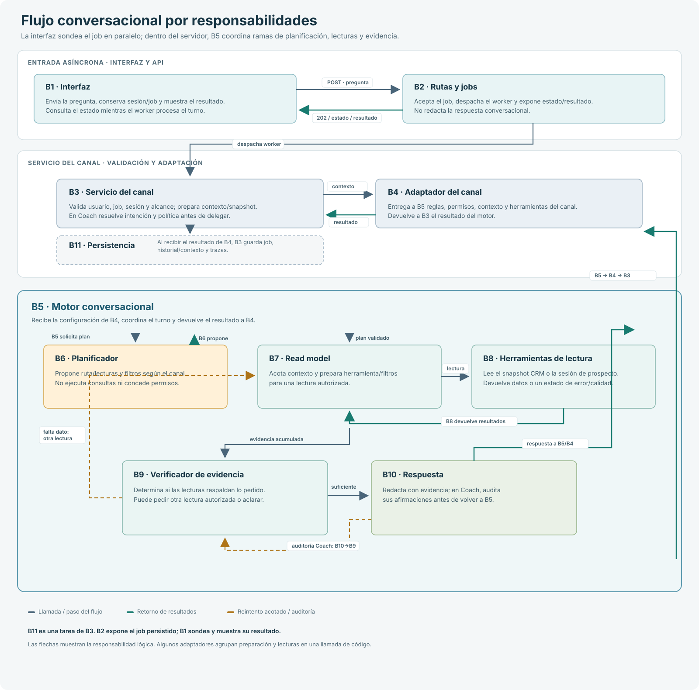
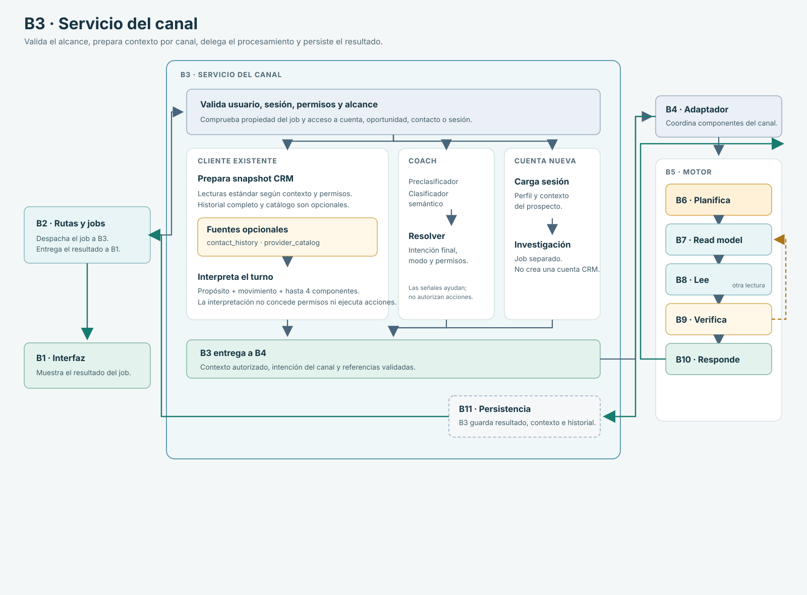

# Arquitectura del chat conversacional por canales

## Propósito

Este documento explica cómo una pregunta viaja desde la interfaz hasta los datos CRM y cómo regresa como respuesta. La arquitectura separa la experiencia del chat, la autorización, la planificación de consultas, la lectura de datos y la persistencia.

La regla principal es que el modelo puede interpretar una pregunta y proponer qué información consultar, pero no decide permisos ni accede directamente a la base de datos. El servidor valida el alcance, ejecuta las lecturas autorizadas y controla cualquier operación que pueda modificar el CRM.

## Vista general

Cada pregunta inicia un job asíncrono, pero el recorrido no es una cadena lineal B1→B12. B1 puede consultar el estado mientras B3 procesa el job; B3 resuelve la intención final de Coach y Cliente existente antes de delegar. Dentro de B5, B6 propone un plan compatible con esa intención, B5 lo valida, B12 recupera conocimiento documental cuando corresponde y B7/B8 ejecutan lecturas CRM; B9 decide si basta la evidencia o si hace falta otra ronda. B11 es una tarea de persistencia de B3, no un servicio por el que pase la respuesta antes de volver a empezar.

### Cliente existente: interpretación y evaluación

En la ruta vigente, B3 interpreta una sola vez el propósito y el movimiento del
turno. B4 coordina los componentes resultantes; B6 planifica dentro del propósito
sin cambiarlo, B9 verifica la evidencia y B10 presenta el resultado. La
arquitectura detallada, las fuentes de B3 y los límites entre bloques se explican
en [B3 · Servicio del canal](#b3--servicio-del-canal).

Las 46 categorías y los 13 movimientos se detallan dentro de B3. La evaluación
determinista tiene su propia [guía sintética](./chat-cliente-existente-evaluacion-sintetica.md);
los controles y recorridos opt-in con proveedor real se describen en la [guía
de evaluación live](./evaluacion-live-chat-cliente-existente.md).

## Conceptos principales

| Concepto                     | Responsabilidad                                                                                  | Ciclo de vida                                                                                                                       |
| ---------------------------- | ------------------------------------------------------------------------------------------------ | ----------------------------------------------------------------------------------------------------------------------------------- |
| **Sesión** (`chatSessionId`) | Agrupa la conversación y conserva su historial y contexto validado.                              | Persiste entre varios turnos. En Cliente existente queda asociada a una cuenta y a las entidades seleccionadas.                     |
| **Job** (`jobId`)            | Representa el procesamiento de una pregunta individual.                                          | Tiene un estado y un resultado propios. La interfaz consulta el job mientras se procesa.                                            |
| **Snapshot**                 | Proyección temporal de datos CRM que el usuario puede consultar en ese turno.                    | Se reconstruye desde el CRM, con permisos y límites aplicados. No es el historial de la conversación ni una copia completa del CRM. |
| **Contexto conversacional**  | Conserva las entidades, intenciones y filtros autorizados que dan continuidad a la conversación. | Se valida contra la cuenta y el snapshot antes de usarse en cada turno.                                                             |

Una sesión puede contener varios jobs. El snapshot se prepara para procesar un job; al finalizar, el resultado y el contexto actualizado se guardan en sus registros correspondientes.

:::details Resumen tabular de responsabilidades

| Bloque                            | Responsabilidad                                                                                                                                                                                                                                                           |
| --------------------------------- | ------------------------------------------------------------------------------------------------------------------------------------------------------------------------------------------------------------------------------------------------------------------------- |
| **B1 · Interfaz**                 | Inicia o retoma la conversación, envía la pregunta y el contexto propio del canal, conserva sesión/job y muestra el resultado. Coach usa contexto CRM opcional; Cliente existente, la cuenta seleccionada; Cuenta nueva, una sesión de investigación sin `accountId` CRM. |
| **B2 · Rutas y jobs**             | Autentica y valida la solicitud, crea o recupera la sesión, crea el job y devuelve su estado y resultado a la interfaz.                                                                                                                                                   |
| **B3 · Servicio del canal**       | Comprueba propiedad, permisos y alcance; prepara el snapshot autorizado y resuelve la intención final de Coach y Cliente existente antes de delegar. Coordina el procesamiento y la persistencia del canal.                                                              |
| **B4 · Adaptador**                | Traduce el contexto y las reglas del canal al contrato que espera el motor compartido. También normaliza la respuesta para ese canal.                                                                                                                                     |
| **B5 · Motor conversacional**     | Coordina y valida el plan de B6 contra la intención resuelta por B3, permisos y alcance; gestiona lecturas, evidencia, conocimiento documental B12 y respuesta. No administra sesiones HTTP ni autoriza datos CRM.                                                     |
| **B6 · Planificador**             | Propone el plan de consulta: lecturas y filtros compatibles con el contexto y la intención vigente. Su plan es una propuesta, no una autorización.                                                                                                                        |
| **B7 · Read model**               | Convierte el plan validado en lecturas disponibles para el canal y limita las herramientas a las permitidas.                                                                                                                                                              |
| **B8 · Herramientas de lectura**  | Ejecuta consultas CRM de solo lectura sobre el snapshot autorizado y devuelve resultados acotados.                                                                                                                                                                        |
| **B9 · Verificador de evidencia** | Comprueba si las lecturas responden la pregunta. Si falta información, puede solicitar lecturas adicionales sujetas a los mismos controles y límites.                                                                                                                     |
| **B10 · Respuesta**               | Forma una respuesta a partir de evidencia verificada. Algunas respuestas se calculan de forma determinista; otras pasan por síntesis y auditoría.                                                                                                                         |
| **B11 · Persistencia**            | Guarda el resultado del job, el historial y el contexto actualizado de la sesión, además de las trazas permitidas. No persiste notas CRM; estas se insertan en `opportunity_notes` solo mediante la operación controlada confirmada. |
| **B12 · Conocimiento documental** | Recupera fragmentos de documentos activos en Pinecone para preguntas pertinentes. Es una fuente separada de CRM, no autoriza lecturas/escrituras y puede omitirse o fallar sin interrumpir el turno.                                                                  |

:::

La interfaz muestra la respuesta que recibe de la API. No ejecuta consultas CRM ni compone por su cuenta la respuesta del motor.

:::details Detalle de cada bloque

Los bloques son responsabilidades del flujo, no necesariamente módulos independientes. B1/B2 gestionan la interacción HTTP; B3 coordina el servicio del canal y la persistencia; B4 adapta el canal al motor; B5 coordina el procesamiento interno. B6–B10 se ejecutan dentro de esa orquestación; el ciclo de evidencia puede repetir B7/B8/B9 y algunas ramas pueden terminar antes según la intención, el contexto y la evidencia.

:::details B1 · Interfaz

**Recibe:** la pregunta del vendedor y la sesión/contexto de la interfaz. El contexto depende del canal; B1 no deduce IDs CRM a partir del texto.

**Hace (común):** muestra la conversación, envía la solicitud al servicio del canal, conserva los IDs de sesión/job y, si el trabajo es asíncrono, presenta un estado pendiente y consulta su progreso. El indicador de espera es estado visual local: no es una respuesta ni se envía como contenido al servidor.

**Hace (por canal):**

- **Coach:** restaura la sesión activa o guardada con mensajes, contexto y operaciones pendientes. Envía la pregunta, hasta ocho mensajes previos y el contexto disponible. Los IDs de cuenta, oportunidad, contacto y lead son opcionales y solo acotan la consulta si el vendedor seleccionó ese contexto. Consulta `GET /api/mi-agent/coach/jobs/:jobId` cada segundo, hasta tres minutos.
- **Cliente existente:** crea o recupera una sesión asociada a la cuenta seleccionada por el usuario. El chat envía la pregunta con el `accountId` y las opciones elegidas. Si se marca investigación pública, B1 envía `includePublicResearch` dentro del mismo job del chat; no crea un segundo job de investigación externa. La acción **Agentes especializados** sí inicia un job separado en `/agents/jobs` e incluye investigación pública; B1 lo sondea hasta 60 veces, con pausas de unos 600 ms. El job del chat se sondea hasta 100 veces con la misma pausa. B1 no infiere la cuenta a partir de la pregunta. La ruta API dedicada `/external-research/jobs` no es invocada directamente por la interfaz web actual.
- **Cuenta nueva:** recoge empresa y país (obligatorios), y sitio web e industria (opcionales). Al iniciar, crea una sesión de investigación identificada por `sessionId`, no por un `accountId` CRM, y lanza un job separado de investigación externa. Al abrir una sesión guardada restaura la ficha y el historial. El chat se envía asociado al `sessionId` y su job se consulta hasta 100 veces, con pausas de unos 600 ms. El job de investigación externa es distinto: B1 usa el `pollAfterMs` que devuelve el servidor, hasta 240 consultas; si sigue activo al agotar ese sondeo, conserva la ficha y permite volver a pulsar **Actualizar investigación** para recuperar su estado.

**Entrega (común):** muestra la respuesta o el error que devuelve el servidor. No consulta directamente el CRM, no autoriza el acceso ni redacta por su cuenta la respuesta del motor.

**Entrega (por canal):**

- **Coach:** sustituye el indicador pendiente por la respuesta, aplica el contexto activo devuelto y actualiza la bandeja de operaciones persistidas.
- **Cliente existente:** añade al chat el resultado asociado a la cuenta seleccionada o muestra el error/timeout del job.
- **Cuenta nueva:** añade la respuesta del asistente al chat y al historial de la sesión; al completar la investigación externa, actualiza la ficha y su estado. Las acciones para marcarla objetivo o convertirla a cuenta/lead se solicitan al servidor explícitamente desde la interfaz.

:::

:::details B2 · Rutas y jobs

**Recibe:** solicitudes HTTP autenticadas de B1 para iniciar un procesamiento o consultar el estado de un `jobId`. El payload y los permisos requeridos dependen del canal y del tipo de trabajo.

**Hace (común):** al recibir una solicitud para iniciar un trabajo asíncrono, valida sus datos y permisos, guarda un job `pending` asociado al usuario y al contexto que corresponda, y despacha el worker. Devuelve la aceptación a B1 sin esperar a que el worker termine; este cambia el job a `completed` o `failed` y guarda su resultado o error. Las rutas que no inician un trabajo asíncrono responden directamente y no crean un job. La sesión es un recurso aparte: Coach puede crearla al recibir la pregunta, mientras que en Cliente existente y Cuenta nueva B1 suele crearla o recuperarla antes y enviar su ID junto con la solicitud del job. Por eso B2 no crea una sesión en todos los canales.

**Hace (por canal):**

- **Coach:** valida pregunta y contexto CRM seleccionado. Si no hay sesión, puede crearla; guarda pregunta/contexto en un job `coach` pendiente y despacha `runCoachJob` en segundo plano. Devuelve `202` con `sessionId`, `jobId` y `pollAfterMs`.
- **Cliente existente:** recibe la pregunta, el `accountId`, la sesión seleccionada o creada previamente y opciones como `includePublicResearch`. Crea un job `account_chat` y despacha su procesamiento. La investigación pública incluida en este chat forma parte de ese job; la acción **Agentes especializados** crea otro tipo de job. La ruta dedicada `/external-research/jobs`, si se invoca, crea y despacha por separado un job `external_research`.
- **Cuenta nueva:** recibe el `sessionId` ya creado para el prospecto y la pregunta del chat; valida la sesión, crea un job de chat asociado y despacha su worker. La investigación externa de prospectos es otra operación: crea/reutiliza un run de investigación y despacha su runner con su propio `runId` y `pollAfterMs`.

**Entrega inicial:** cuando acepta un trabajo asíncrono, responde normalmente `202 Accepted` con el ID del job y, cuando corresponde, el intervalo sugerido de sondeo. Un error de autenticación, permisos o validación se responde como error HTTP y no se despacha el worker.

**Entrega de estado y resultado:** las rutas de consulta verifican usuario propietario, tipo de job y asociación con la sesión. Devuelven el estado mientras está pendiente/en curso y, al finalizar, el resultado o mensaje de error persistido. B1 usa esas respuestas para actualizar el estado visible; B2 no compone la respuesta conversacional.

:::

:::details B3 · Servicio del canal

**Recibe:** del flujo de B2, el job aceptado, el usuario autenticado y los datos asociados al canal: pregunta, sesión, contexto CRM o ficha de prospecto. Algunos jobs no parten de una pregunta de chat, sino de una acción explícita como ejecutar **Agentes especializados** o iniciar investigación externa. En esos casos B3 recibe el tipo de trabajo y las referencias guardadas en el job: cuenta/entidades para Cliente existente, o `sessionId`/`runId` para Cuenta nueva. Con ellas valida el alcance, carga el snapshot o la sesión autorizados y ejecuta el servicio específico.

**Hace (común):** toma el job que B2 despachó y carga de la base de datos los datos asociados. Si es un chat, recupera la sesión, el historial y el contexto; si es otro trabajo, usa las referencias guardadas en el job, por ejemplo la cuenta o la sesión de prospecto. Comprueba que el usuario sea dueño de la sesión/job y que las entidades estén dentro del alcance permitido. En Coach y Cliente existente resuelve la intención antes de delegar; cada canal usa su propio catálogo, señales y contexto. Con ese contexto validado prepara el snapshot o los datos de trabajo y ejecuta el servicio propio del canal; al terminar, guarda el resultado y el estado para que B2 los entregue a B1. B3 es esta responsabilidad de servicio, implementada por workers de canal; sus clasificadores son componentes internos, no el bloque B3 completo.

**Hace (por canal):**

El diagrama muestra el flujo compartido de B3 y sus intercambios con B2, B4,
B5–B10 y B11; las subsecciones siguientes detallan el comportamiento de cada
canal.

**Cliente existente · 1. Contexto y fuentes**

Este paso prepara la evidencia que Cliente existente podrá consultar durante
el turno. B3 valida la cuenta y las entidades seleccionadas, aplica permisos y
alcance, y construye un snapshot autorizado. El snapshot es una proyección
temporal para este turno, no una copia completa del CRM. B3 determina y ejecuta
las lecturas base; el clasificador opcional no elige cada fuente ni amplía el
alcance autorizado.

**1. Cargar las fuentes CRM base**

Estas lecturas no son opciones del clasificador: B3 las carga cuando el contexto
las requiere y el usuario tiene el permiso correspondiente. Por tanto, “no
opcional” no significa que se lean sin comprobar contexto o permisos.

| Fuente | Datos incluidos | Límite estándar |
| --- | --- | --- |
| Cuenta y entidades seleccionadas | Datos de la cuenta; oportunidad o contacto si se seleccionaron. | Según las entidades seleccionadas. |
| `contacts` | Contactos activos de la cuenta. | 50 |
| `opportunities_active` | Oportunidades activas de la cuenta. | 50 |
| `opportunities_inactive` | Oportunidades inactivas de la cuenta. | 50 |
| `interactions` | Interacciones de la cuenta y sus oportunidades. | 30 |
| `renewals` | Renovaciones asociadas a las oportunidades de la cuenta. | 50 |
| `quotation_products` | Productos de cotizaciones asociadas a las oportunidades. | 200 |
| Contexto comercial de oportunidades | Preguntas y respuestas de etapa, acciones, debilidades, evaluaciones de criterios y playbook activo. | Para las oportunidades incluidas en el snapshot. |

Los permisos por dominio y el alcance de la cuenta se aplican a cada lectura.
Los límites son máximos estándar, no garantías de que haya esa cantidad de
registros. Si una lectura se trunca, B3 conserva esa señal para esa fuente; no
implica que las demás fuentes estén incompletas.

**2. Ampliar el snapshot cuando la solicitud lo requiere**

Si el vendedor pregunta por un periodo, B3 puede cargar actividades de
oportunidad con permisos `oportunidades` y `desarrollo_comercial`, y actividades
del calendario comercial con `oportunidades` y `calendario_comercial`. Estas
lecturas dependen del periodo solicitado y no forman parte de la carga estándar
de cada turno.

Antes de llamar al clasificador, B3 filtra los dominios que puede elegir según
la pregunta actual y los mensajes recientes del usuario. En particular,
`provider_catalog` solo se ofrece cuando el contexto señala productos,
proveedores, catálogo, precios o venta cruzada; una consulta general de
oportunidades no habilita esa fuente. `contact_history` se ofrece según el
permiso y también puede añadirse por una intención previa de historial.

El clasificador recibe la pregunta, hasta cuatro mensajes recientes, las
intenciones previas y señales de si hay una cuenta, oportunidad o contacto
seleccionado. Solo puede elegir entre los dominios que B3 ya consideró pertinentes
y autorizados para el usuario:

| Dominio | Permiso | Uso |
| --- | --- | --- |
| `contact_history` | `contactos` | Amplía contactos e interacciones para incluir contactos inactivos y superar los límites estándar de historial. |
| `provider_catalog` | `oportunidades` | Carga productos y proveedores activos para consultas de catálogo, precios o venta cruzada. |

Si el clasificador falla o devuelve confianza baja, no añade dominios por su
cuenta; `contact_history` puede seguir incorporándose por una intención previa
autorizada. La consulta de `provider_catalog` es global y está limitada a 1.000
elementos; si se trunca, el aviso de resultados parciales se refiere al catálogo,
no demuestra que la lectura de oportunidades esté incompleta.

**3. Mantener aparte la investigación pública y el material aportado**

La investigación pública no pertenece al selector de fuentes opcionales:
Cliente existente solo la incorpora si la solicitud incluye explícitamente
`includePublicResearch`. El material aportado por el usuario puede servir como
contexto para interpretar el turno, pero no se convierte por ello en evidencia
verificada del CRM.

**Cliente existente · 2. Interpretación estructurada del turno**

**Elección de dimensiones en B3:** el clasificador distingue el entregable
(`category`), su objeto (`object`), la fuente documental cuando aplica
(`documentSpec.source`) y la continuidad (`movement`/`continuationOf`).
Las reglas técnicas incluyen criterios de entrada/exclusión y ejemplos
contrastivos de detalle/notas/campos, consulta/redacción/operación y
biblioteca/adjunto/cotización. El mensaje actual determina el propósito;
conservar una entidad no obliga a conservar la tarea ni la fuente anterior.
Una comprobación en el mismo prompt pide preservar tareas, cantidades y
restricciones, sin añadir campos al contrato ni una llamada adicional.
No es un verificador independiente ni garantiza exactitud semántica.
La guía predeterminada administrable mantiene estos criterios; las versiones
personalizadas guardadas no se sobrescriben y siguen subordinadas al contrato.
La evaluación focalizada se ejecuta con
`npm run test:customer-chat:contract:live --prefix apps/api -- --dimensions-only`.
Realiza llamadas pagadas al proveedor con datos sintéticos y contrasta propósito,
objeto, fuente, movimiento y cantidad actual en casos de límites y continuidad.
Exige coincidencia tanto en la salida original del modelo como después de las
reconciliaciones del servidor, para no atribuir a la IA aciertos de una corrección.
Esta selección no sustituye la evaluación completa del catálogo y del diálogo.
Las normalizaciones posteriores no deben cambiar un objeto documental explícito
a oportunidad solo porque el mensaje mencione su nombre. La reconciliación de
fuente hacia biblioteca tampoco interviene cuando el mensaje menciona un archivo,
adjunto o PDF: ante señales de ambas fuentes conserva la decisión del clasificador
en vez de asumir que toda mención de biblioteca es una petición de consultarla.

**Barrera de coherencia antes de ejecutar:** después de interpretar y normalizar
el contrato, B3 aplica comprobaciones deterministas de fuente/objeto documental y
referencias de continuidad, y una llamada semántica independiente. También revisa
el contrato del atajo determinista de preguntas sobre el proceso de ventas cuando
la ruta estructurada está habilitada. La ruta legacy (`off`) no cambia.

El revisor contrasta mensaje actual, mensajes seleccionados (seis recientes y hasta
dos antecedentes de tareas pendientes), contexto validado,
disponibilidad de material y contrato propuesto. No recupera Pinecone ni nuevas
lecturas CRM. Comprueba propósito, objeto, fuente, continuidad, cobertura de
tareas y restricciones. El esquema limita la evidencia a identificadores seguros
(`e1`, `e2`, etc.) de `evidenceCatalog`; el servidor los resuelve a fragmentos
literales del mensaje o historial (máximo 500 caracteres por fragmento) para cada
discrepancia semántica; evidencia inventada, salida inválida o proveedor fallido
bloquean el turno con error explícito, sin activar el adaptador de ejecución.
El texto original, incluidos saltos de línea, queda en el contexto y las trazas
resueltas, no en los valores `enum` del esquema estricto del proveedor.

**Contraste bidireccional con el mensaje original:** la misma llamada del revisor
examina tres ejes. El servidor calcula `comparison` con tres booleanos a partir
de los códigos de las discrepancias validadas:

| Comprobación | Sentido | Discrepancia |
| --- | --- | --- |
| `coverage` | Cada petición explícita está representada en el contrato. | `MISSING_TASK` |
| `support` | Cada componente está respaldado por una petición actual o continuación inequívoca. | `UNSUPPORTED_TASK` |
| `fidelity` | Se conservan entidad, cantidad, alcance, fuente, exclusiones, condiciones, atribución y certeza. | Las demás discrepancias de coherencia. |

Una cita existente no basta: el revisor debe explicar en `problem` qué componente
o campo omite, añade o altera lo pedido por ella. Una acción mencionada en un
correo, una propuesta del asistente o un encargo anterior reemplazado no autorizan
otra tarea. Por ejemplo, redactar un correo para pedir reunión no solicita
programarla. Las lecturas internas necesarias no se consideran tareas adicionales.
El servidor calcula los indicadores sin pedir al modelo resultados redundantes:
cada eje queda en `false` si hay una discrepancia de ese tipo; una aprobación
exige que no existan discrepancias. `UNSUPPORTED_TASK` debe identificar el componente
agregado. Esto no demuestra mecánicamente la pertinencia semántica de una cita;
esa comprobación sigue dependiendo del modelo.

- **Aprobación:** entrega el contrato a ejecución. Una aprobación semántica no
  anula una contradicción determinista.
- **Contradicción con solicitud clara:** permite una sola reinterpretación con
  retroalimentación y revisa nuevamente el resultado normalizado.
- **Ambigüedad real:** solicita una aclaración específica sin reparar por su cuenta.
- **Contradicción persistente:** conserva los componentes y devuelve aclaración
  con confianza baja; no ejecuta la solicitud.

La revisión usa el mismo presupuesto de tiempo del turno; sin fecha límite
explícita dispone de 45 segundos para interpretación, revisión y eventual
reparación, con un máximo de 15 segundos por llamada. Los errores
`CUSTOMER_B3_REVIEW_FAILED` y `CUSTOMER_B3_REVIEW_TIMEOUT` se persisten como fallos
de clasificación en B3. `classificationFailure.reviewFailure` distingue salida
inválida, evidencia inválida, fallo del proveedor y timeout, con intento y rutas de
validación sin guardar respuestas crudas del proveedor.
Un job definitivamente `failed` libera el formulario para corregir la pregunta o
enviar otra en la misma sesión; no se reenvía automáticamente el job fallido.
Un turno pendiente, interrumpido o con error al cargar historial sigue bloqueando
nuevos envíos hasta recuperar su resultado o la conversación, para evitar duplicados.
Una reparación inválida o fallida tampoco habilita
ejecución. Esta barrera añade una llamada de IA en el camino normal y, si hay
reparación, hasta tres llamadas adicionales respecto al clasificador original.
No modifica permisos ni confirmaciones.

La traza de clasificación incluye `coherenceReview`: estado, número de revisiones,
si se intentó reparar (`repairAttempted`), si la reparación fue aprobada (`repaired`),
discrepancias, `comparison` en cada revisión y contrato inicial cuando fue rechazado.
El runtime no debe convertir un contrato que pide aclaración en confirmación de
un borrador ni resolverlo automáticamente desde memoria.
La evaluación sintética completa de esta barrera usa el comando anterior con
`--reviewed`: añade seis propuestas iniciales deliberadamente erróneas (detalle
reducido a notas, tarea omitida, fuente excluida, cantidad alterada, reunión no
solicitada y atribución/certeza cambiadas) y exige
detectarlas, repararlas y aprobarlas en la segunda revisión. El evaluador sin
esa opción sigue midiendo solo el clasificador.
La revisión es una segunda barrera, no una garantía de exactitud: puede omitir
contradicciones o producir falsos positivos y requiere seguimiento.

**Qué decide B3:** interpreta y revisa el turno actual, con una reparación máxima, y entrega una
descripción estructurada de la solicitud. B3 no decide si una lectura está
autorizada, no elige IDs CRM y no ejecuta acciones; permisos, alcance y
disponibilidad se validan en los pasos posteriores.

**Qué información utiliza:** `service.js` selecciona esta ruta según la
configuración y llama a `interpretReviewedCustomerTurn`, que utiliza `interpretCustomerTurn`.
La interpretación considera el
mensaje actual, el historial, el contexto conversacional ya revalidado, el
material aportado y pistas de nombres/tipos tomadas de entidades autorizadas del
snapshot. El modelo recibe nombres y tipos, no puede seleccionar IDs CRM. Las
instrucciones administrables de B3 solo orientan la interpretación: están
subordinadas al catálogo y al esquema del servidor y no los reemplazan.

**Preparación compartida del contexto:** `interpretation-context.js` construye
`interpretationContext` una vez por turno revisado y lo reutiliza también en la
reparación. Clasificador y revisor reciben los mismos mensajes seleccionados,
continuidad y marcas de origen; no se añade una llamada de IA ni un resumen generado.

- `currentRequest` conserva el mensaje actual completo como autoridad sobre la tarea.
- `entityFocus` separa cuenta como alcance de acceso y oportunidad/contacto vigentes
  como identidad, no como tarea o fuente heredada.
- `previousTasks` distingue `pending`, `not_pending` y `abandoned`. No pendiente no
  significa ejecución completada: es solo el estado de continuidad registrado.
  Conserva especificaciones y parches de cada componente; `previousTurn` conserva
  movimiento, resolución, aclaración y IDs pendientes. La IA no recibe además una
  copia del contrato anterior en `validatedContinuation.turnMemory`: la memoria
  completa permanece disponible en el servidor para las normalizaciones y el runtime.
- `pendingState` identifica memorias existentes de borradores/selecciones sin
  convertirlas en autorización para ejecutar. Los filtros y parches validados se
  conservan en `validatedContinuation`; no se infieren nuevas cantidades por código.
- `history` conserva hasta seis mensajes conversacionales recientes y agrega como
  máximo dos antecedentes originales de tareas pendientes, en orden cronológico.
  Solo agrega mensajes del usuario cuyo texto contenga literalmente el fragmento
  de la tarea (mínimo 20 caracteres para coincidencias parciales). Si no hay ancla
  fiable, no la inventa; una tarea no pendiente no reactiva mensajes antiguos.
  Cada mensaje seleccionado se limita a 2000 caracteres y marca su truncamiento.
- Las marcas de origen distinguen afirmación del usuario, salida/propuesta del
  asistente, selección validada y documento aportado. No certifican la verdad de
  afirmaciones ni convierten propuestas en órdenes.
- `material` distingue descripción del adjunto actual y material anterior disponible.
  El material previo es un candidato de continuidad, no un adjunto nuevo ni una
  fuente obligatoria. Una tarea abandonada no lo presenta como material vigente.
- `ambiguities` presenta nombres autorizados de candidatos de la selección de monto
  pendiente, sin elegir uno. Otras ambigüedades siguen resolviéndose con las pistas
  autorizadas y el clasificador, no con una nueva heurística de nombres.

Si la cuenta de la memoria difiere explícitamente de la cuenta del snapshot,
descarta memoria e historial para la interpretación; también filtra mensajes con
otra cuenta explícita y roles distintos de usuario/asistente. En producción la
sesión y su historial ya deben haber sido autorizados por B3: estas comprobaciones
no sustituyen esa validación. La traza `coherenceReview.contextSelection` registra
límites, cantidad de mensajes y descarte por cuenta, sin duplicar todo el historial.

**Qué produce:** una salida validada con versión, confianza, resolución y
pregunta aclaratoria cuando hace falta. Incluye un movimiento conversacional y
hasta cuatro componentes. Cada componente describe su categoría, texto, objeto,
tema, alcance, referencia, atribución, certeza, dependencias y
`continuationOf`. Esta última referencia identifica un componente previo, no un
registro CRM. Los IDs de componente son únicos y las dependencias forman un
orden acíclico. Algunos movimientos de control pueden no incluir componentes.
El servidor deriva la marca `explicitAction` de la categoría; esa marca no
autoriza ni ejecuta una operación.

**Categorías de propósito (44):** indican qué busca conseguir el usuario. El
catálogo de Cliente existente agrupa consultas (`query`), orientaciones
(`guidance`), contenido (`content`), reportes (`report`) y acciones (`action`).
Son 11 consultas, 8 orientaciones, 9 categorías de contenido, 6 reportes y 10
acciones. Reconocer una categoría no significa que exista una herramienta para
ejecutarla, que el usuario tenga permiso ni que se vaya a escribir en el CRM. El
[catálogo completo de capacidades](./chat-cliente-existente-alcance.md#catálogo-completo-y-capacidades)
indica qué está disponible, limitado o no implementado.

| # | Categoría | Significado y capacidad actual |
| --- | --- | --- |
| 1 | `query.account_summary` | Consultar el resumen autorizado de la cuenta. |
| 2 | `query.record_detail` | Consultar detalle de entidades expuestas por las herramientas actuales; parcial. |
| 3 | `query.field_value` | Consultar un campo disponible, como monto o etapa; parcial. |
| 4 | `query.record_list` | Listar registros autorizados, con los límites vigentes; parcial. |
| 5 | `query.record_search` | Buscar registros mediante filtros y entidades disponibles; parcial. |
| 6 | `query.history` | Consultar interacciones e historial expuestos; parcial. |
| 7 | `query.pending_items` | Consultar actividades y pendientes autorizados. |
| 8 | `query.relationships` | Consultar relaciones CRM expuestas, no inferidas; parcial. |
| 9 | `query.document_content` | Consultar cotizaciones autorizadas o texto extraído de un adjunto aportado; no hay lector genérico de documentos CRM. |
| 10 | `query.stage_readiness` | Consultar requisitos y preparación de etapa. |
| 11 | `query.system_help` | Solicitar ayuda del sistema; no disponible como herramienta de documentación. |
| 12 | `guidance.situation_assessment` | Evaluar la situación con evidencia disponible. |
| 13 | `guidance.risks_and_gaps` | Identificar riesgos y brechas, separados de hechos. |
| 14 | `guidance.next_steps` | Recomendar siguientes pasos, sin crear actividades implícitas. |
| 15 | `guidance.prioritization` | Priorizar oportunidades autorizadas; parcial. |
| 16 | `guidance.comparison` | Comparar oportunidades con datos disponibles y comparables; parcial. |
| 17 | `guidance.trend_analysis` | Analizar tendencias; no disponible por falta de una serie histórica comparable de ingresos. |
| 18 | `guidance.scenario_analysis` | Analizar escenarios como hipótesis explícitas, no predicciones confirmadas; parcial. |
| 19 | `guidance.strategy` | Proponer estrategia desde el contexto autorizado. |
| 20 | `content.email_draft` | Redactar un correo, nunca enviarlo. |
| 21 | `content.message_draft` | Redactar un mensaje breve, sin envío. |
| 22 | `content.meeting_preparation` | Preparar agenda o guion, sin programar una reunión. |
| 23 | `content.discovery_questions` | Preparar preguntas de descubrimiento. |
| 24 | `content.summary` | Resumir material disponible. |
| 25 | `content.explanation` | Explicar contenido o términos comerciales, no abrir una consulta externa libre. |
| 26 | `content.rewrite` | Reescribir material aportado. |
| 27 | `content.translation` | Traducir material aportado. |
| 28 | `content.value_argument` | Elaborar un argumento de valor sin métricas inventadas. |
| 29 | `report.client_statement` | Conservar información atribuida al cliente, incluidas sus sospechas. |
| 30 | `report.seller_observation` | Conservar una observación atribuida al vendedor. |
| 31 | `report.interaction_outcome` | Recibir un resultado reportado, sin registrar automáticamente una actividad. |
| 32 | `report.commitment` | Recibir un compromiso informado, sin programar automáticamente una reunión. |
| 33 | `report.document_evidence` | Recibir texto documental aportado, sin certificar su autenticidad; parcial. |
| 34 | `report.hypothesis` | Conservar una hipótesis sin incorporarla como hecho en respuestas de etapa. |
| 35 | `action.create_record` | Proponer contacto u oportunidad si su tipo está habilitado; no crear cuentas nuevas; parcial. |
| 36 | `action.update_fields` | Proponer cambios en campos permitidos de cuenta/contacto/oportunidad; parcial. |
| 37 | `action.update_stage_answer` | Proponer una respuesta de etapa para revisión y confirmación. |
| 38 | `action.link_records` | Proponer vincular contacto a oportunidad con habilitación explícita; parcial. |
| 39 | `action.schedule_activity` | Preparar un borrador de actividad futura o ya completada; la fecha/hora faltante queda pendiente. |
| 40 | `action.reschedule_activity` | Solicitar reprogramación; no disponible como edición de actividad existente. |
| 41 | `action.record_outcome` | Proponer resultado de llamada de un lead autorizado; parcial. |
| 42 | `action.change_status` | Solicitar cambio de estado; no disponible en este contrato, corresponde al módulo respectivo. |
| 43 | `action.remove_record` | Solicitar eliminación o cancelación; no disponible desde este flujo. |
| 44 | `action.send_communication` | Solicitar envío de comunicaciones; no disponible, no se sustituye silenciosamente por redacción. |

**Movimientos conversacionales (13):** describen qué hace el mensaje actual
dentro de la conversación: iniciar una solicitud, responder una aclaración,
cambiar de foco, detenerse, entre otros. No son propósitos. Por ejemplo,
`answer_clarification` describe el movimiento de la respuesta, mientras que la
categoría del componente conserva lo que el usuario intenta conseguir. La
interpretación depende del historial y de los pendientes; no es una regla de
coincidencia textual. Reconocer un movimiento tampoco habilita capacidades ni
ejecuta operaciones.

| # | Movimiento | Ejemplo | Comportamiento esperado |
| --- | --- | --- | --- |
| 1 | `new_request` | «Dame una lista de las oportunidades». | Iniciar una solicitud nueva sin reutilizar indebidamente el reporte anterior. |
| 2 | `answer_clarification` | «Renovación Alfa», después de preguntar para qué oportunidad es el reporte. | Completar el contexto del componente pendiente conservando su texto original. |
| 3 | `select_candidate` | «La primera pregunta», tras ofrecer Motivación y Presupuesto. | Seleccionar el candidato autorizado, sin reemplazar el reporte por esa frase. |
| 4 | `accept_proposal` | «Sí, prepara el borrador de la reunión». | Aceptar la preparación de la propuesta, no ejecutar una escritura. |
| 5 | `confirm_execution` | «Confirmo que se ejecute el cambio propuesto». | Remitir al control de confirmación existente; el mensaje no guarda cambios por sí mismo. |
| 6 | `modify_draft` | «Haz más breve el borrador del correo». | Modificar el borrador dentro de su alcance, sin enviarlo. |
| 7 | `correct` | «Corrijo: no es presupuesto, es falta de responsable». | Tratarlo como corrección del contexto o contenido pendiente. |
| 8 | `reject` | «No quiero esa propuesta». | Rechazar la propuesta conversacional, sin eliminar registros CRM. |
| 9 | `discard_draft` | «Descarta el borrador de la reunión». | Descartar el borrador mediante su flujo controlado, sin crear la actividad. |
| 10 | `continue` | «Continúa con el análisis». | Retomar el trabajo validado; pedir aclaración si no existe un pendiente inequívoco. |
| 11 | `change_focus` | «Dejemos ese reporte; ahora quiero ver contactos». | Cambiar el foco sin arrastrar el reporte anterior a la nueva solicitud. |
| 12 | `request_rationale` | «¿Por qué recomiendas esa acción?». | Solicitar una justificación sin convertirla en aceptación o ejecución. |
| 13 | `stop` | «Detente, no sigas con esta solicitud». | Detener la solicitud conversacional, sin cancelar registros CRM. |

**Continuidad:** la memoria `turnMemory` se valida contra la cuenta y el contexto
autorizado antes de reutilizar pendientes. Una respuesta a una aclaración puede
completar el componente previo sin perder su reporte literal, atribución o
incertidumbre. Una nueva solicitud o cambio de foco no reutiliza ese reporte como
si fuera una orden vigente. Los errores de interpretación se muestran
explícitamente; no activan silenciosamente el clasificador anterior.

**Disponibilidad y autorización:** B3 reconoce las 46 categorías sin ocultar las
no implementadas o deshabilitadas. Después, el coordinador separa capacidad
inexistente, política deshabilitada y permiso denegado. El modelo no convierte
«envía el correo» en «redacta un correo» solo porque no existe envío.

La implementación se distribuye entre `turn-contract.js` (catálogo, esquema,
interpretación y restricciones) y `turn-contract-runtime.js` (continuidad,
coordinación y verificadores de reporte/contenido), conectados por el servicio y
`customer-chat-adapter.js`.

**Activación:** `CUSTOMER_TURN_CONTRACT_MODE=on` es el valor predeterminado del
código y de las plantillas local/nube en todos los entornos. `off` conserva la
ruta anterior; `pilot` limita la nueva ruta a
`CUSTOMER_TURN_CONTRACT_PILOT_USER_IDS`. Las variables explícitas prevalecen
sobre el valor predeterminado. Un servidor remoto necesita recibir esta versión,
ajustar cualquier override y reiniciar su API; cambiar el repositorio no despliega
ni reinicia otros entornos. El rollback es `off` más reinicio, sin migraciones ni
cambios de permisos.

**Cliente existente · 3. Ejecución del job**

El worker del servicio comercial carga el job y valida que la sesión de chat
corresponda al usuario y a la cuenta —y a la oportunidad/contacto seleccionados,
si existen—. Reconstruye el snapshot autorizado de esa cuenta y valida el contexto
conversacional, incluida cualquier operación pendiente y la memoria del turno.
Por defecto, B3 interpreta el turno con la interpretación estructurada y entrega
sus componentes como autoridad a B4/B5; con `off` conserva la clasificación
anterior. Una aclaración no habilita una operación. Si la pregunta solicita
investigación pública, esta se incorpora al mismo job; **Agentes especializados**
y el endpoint dedicado de investigación externa usan jobs separados. El servicio
guarda la respuesta, el historial/contexto actualizado, las trazas y el estado
final del job.

**Cliente existente · 4. Compatibilidad: ruta anterior (`off`)**
**Decisión de intención:** después de validar la cuenta, reconstruir el snapshot y validar el contexto conversacional (incluida una actividad pendiente), B3 ejecuta tres etapas. La clasificación semántica corre en paralelo con la preparación de agentes; no cambia el alcance autorizado del snapshot.

**Decisión de intención:** después de validar la cuenta, reconstruir el snapshot y validar el contexto conversacional (incluida una actividad pendiente), B3 ejecuta tres etapas. La clasificación semántica corre en paralelo con la preparación de agentes; no cambia el alcance autorizado del snapshot.
1. **Preclasificador determinista:** normaliza el mensaje actual (minúsculas, sin tildes y puntuación separada) y emite una señal gruesa. No usa historial ni IDs. Los buckets y confianza son:
  - `content_draft` (`0.98`): combina verbos de redacción/preparación (`escribe`, `redacta`, `prepara`, `modelo de`, `borrador de`, entre otros) con un entregable como `correo`, `mensaje`, `documento`, `resumen`, `texto`, `guion` o `plantilla`. Incluye `contentKind=email` para correo.
  - `mixed_request` (`0.95`): detecta una petición de contenido y, además, una operación explícita unida por `y`, `también` o `además` (por ejemplo, “escribe un correo y agenda la reunión”).
  - `operation_request` (`0.85`): detecta verbos explícitos como `agenda`, `programa`, `registra`, `crea`, `actualiza`, `modifica`, `cambia`, `vincula`, `elimina` o `borra`, cuando no se detectó antes una petición de contenido.
  - `unknown` (`0.45`) o mensaje vacío (`0.2`): no hay una señal determinista suficiente; la interpretación semántica y el resolver deciden si pueden continuar.

  El bucket es una señal de contraste, no una autorización. Mencionar una reunión dentro de un texto que se pide redactar no se trata como una orden de agendarla.

2. **Clasificador semántico:** `classifyCustomerIntentSemantically` envía una solicitud estructurada con la pregunta (máximo 2.000 caracteres), hasta seis mensajes recientes, las selecciones de cuenta/oportunidad/contacto, la continuación validada y solo las intenciones habilitadas del catálogo `customer_account`. Devuelve una intención, confianza `high`/`medium`/`low`, motivo y pregunta aclaratoria opcional. El catálogo incluye `crm_operation`, `email_draft`, `quotation_query`, `contact_history`, `opportunity_status`, `opportunity_guidance`, `account_activity_history`, `contact_query`, `opportunity_query` y `account_overview`; las herramientas asociadas se restringen después en B5.

  **Instrucciones administrables de B3:** la sección **Clasificador semántico · B3** utiliza `semantic-classifier-prompts.js`, separada de los prompts del planificador B6. Permite editar instrucciones de Coach, Cliente existente y Cuenta nueva con permiso `mi_coach.admin`, control de concurrencia por `expectedVersion`, auditoría e historial. Restaurar una revisión crea una nueva versión; cargar las instrucciones predeterminadas solo cambia el editor hasta guardar.

  Solo **Cliente existente** consume esta configuración en los turnos nuevos. Coach continúa usando su clasificador actual; su texto inicial se ofrece como referencia. Cuenta nueva dispone de una propuesta para uso futuro, sin clasificador conectado a esta configuración. Guardar instrucciones no conecta ninguno de estos dos canales.

  B3 carga las instrucciones efectivas antes de clasificar. Sin personalización utiliza el texto predeterminado; un fallo de almacenamiento se reporta como fallo de preparación, no como una personalización ignorada. La traza de clasificación registra canal, versión y origen (`default`/`custom`). El catálogo habilitado, esquema de respuesta, umbrales, permisos y confirmaciones permanecen bajo control del servidor.

  La continuación validada incluye referencias mínimas (ID y nombre) de la cuenta y de la oportunidad/contacto que todavía aparecen en el snapshot autorizado. Esto permite cambiar el dato consultado conservando la entidad conversacional. Las instrucciones predeterminadas distinguen expresamente consultas factuales de seguimiento de operaciones: tras preguntar monto y etapa, “¿Qué actividad pendiente tiene?” consulta actividades existentes, sin pedir tipo, fecha u hora para crear otra. El historial se usa para interpretar referencias, no como evidencia CRM; una ambigüedad real sigue requiriendo aclaración.

  La confianza se normaliza a `0.95`, `0.75` y `0.35`, respectivamente. Una intención fuera del catálogo, confianza inferior a `0.68`, error o falta de respuesta se convierte en `clarify_needed`; no hay fallback a una operación inferida.

  **Intenciones habilitadas de Cliente existente:**
  - `crm_operation`: crear, registrar o cambiar datos/actividades de la cuenta; cada propuesta requiere revisión, permiso y confirmación posteriores.
  - `email_draft`: redactar un borrador de correo con datos CRM autorizados; no lo envía.
  - `quotation_query`: consultar contenido de una cotización autorizada.
  - `contact_history`: listar contactos visibles y su historial relacionado.
  - `opportunity_status`: consultar estado, etapa o activación de una oportunidad.
  - `opportunity_guidance`: recomendar siguientes pasos para la oportunidad seleccionada con evidencia CRM autorizada.
  - `account_activity_history`: consultar interacciones/actividades en el periodo pedido.
  - `contact_query`: buscar contactos de la cuenta y verificar asociaciones directas mediante detalle autorizado.
  - `opportunity_query`: buscar o resumir oportunidades de la cuenta.
  - `account_overview`: resumen general y fallback de la cuenta.

3. **Resolver:** `resolveCustomerIntentB3` combina el bucket, la intención semántica y el catálogo habilitado:
  - `content_draft` de correo resuelve a `email_draft` aunque la IA haya propuesto `crm_operation`. Si `email_draft` está deshabilitado, solicita aclaración.
  - `mixed_request` siempre solicita aclaración para separar borrador y operación.
  - Una solicitud de contenido genérico que contradice una operación o `email_draft` solicita aclaración; no crea ni ejecuta una operación.
  - Una señal explícita de operación que contradice `email_draft` solicita aclaración.
  - En los demás casos conserva la decisión semántica solo si es válida y está habilitada.

  La salida registra el bucket, la intención semántica y el resolver que decidió. B4/B5 reciben esa intención como autoritativa: B6 no puede cambiarla. La decisión de B3 no otorga permisos, no autoriza herramientas y no escribe en CRM; B5 conserva las validaciones finales de operación, contexto, entidades y alcance.

**Diferencia con Coach en esta ruta anterior:** ambos canales aplican preclasificador → clasificador semántico → resolver en B3, pero mantienen buckets, catálogo, contexto y reglas de conflicto propios. Coach mapea su intención a modos y procesos (`interactionMode`/`policyProcess`) y deriva herramientas; Cliente existente resuelve el objetivo de la conversación y entrega la intención a B5 para que B6 planifique dentro de ella. La ruta predeterminada de Cliente existente usa en cambio la interpretación estructurada del turno descrita arriba.

**Coach · `agent-gateway.js`**

El gateway `agent-gateway.js` implementa B3 y coordina el turno desde el job `pending` hasta su resultado final. `b3-preclassifier.js` es solo un componente interno de ese servicio; no es el bloque B3 completo.

**Decisión y autorización:** construye una instantánea de permisos del usuario. Primero `b3-preclassifier.js` analiza el texto con patrones fijos y devuelve un bucket/señales generales; después, `semantic-intent-classifier.js` llama a la IA con la pregunta, el historial y si hay entidades seleccionadas. Se ejecutan secuencialmente, no en paralelo: la IA no recibe el resultado del preclasificador (su bucket, señales o confianza). Cuando ambos resultados están disponibles, `resolve-final-intent.js` comprueba permisos para la intención semántica; si no está permitida, devuelve aclaración sin herramientas. También detecta un conflicto fuerte entre el bucket `coaching` del preclasificador y una intención de operación de la IA, y pide aclaración si la confianza semántica es menor que `0.7`. En los demás casos normalmente conserva la intención semántica, la mapea a `interactionMode` y `policyProcess`, y deriva las herramientas permitidas. El resultado del preclasificador es una señal de contraste; no tiene el mismo peso que la intención semántica ni autoriza acciones. B4/B5 reciben la decisión final y, si requiere aclaración, responden sin ejecutar lecturas.

**Intenciones permitidas al clasificador semántico:** esta es una lista cerrada distinta del catálogo editable de B6. La respuesta debe usar uno de estos códigos y tener confianza de al menos `0.68`; si no, el clasificador solicita aclaración.

- `seller_coaching`: orientación para priorizar y mejorar el seguimiento del vendedor. El resolver asigna `coaching` / `seller_coaching`.
- `account_performance`: análisis del desempeño, riesgos u oportunidades de mejora. Se enruta a `coaching` / `seller_coaching`.
- `account_query`: consulta puntual del contexto o resumen de una cuenta. Se enruta a `brief_context` / `brief_context`.
- `opportunity_query`: consulta puntual de oportunidades. Se enruta a `brief_context` / `brief_context`.
- `create_opportunity`: solicitud de proponer la creación de una oportunidad por el flujo controlado. Se enruta a `operation` / `operation` y requiere permisos y confirmación.
- `update_opportunity`: solicitud de proponer la actualización de una oportunidad existente. Se enruta a `operation` / `operation` y requiere permisos y confirmación.
- `general_query`: consulta general que no encaja en las categorías específicas. Se enruta a `coaching` / `default`.
- `clarify_needed`: solicitud ambigua, confianza insuficiente o clasificación inválida. Se enruta a `clarification` / `default` y no habilita herramientas.

  **Señales que busca el preclasificador:** analiza solo el texto del mensaje (no usa el parámetro de contexto), lo normaliza y prueba estos grupos en orden; el primer grupo que coincide determina el bucket:
  - **Operación** (`operation`, confianza 0.82): `actualiza/actualizar`, `agendar`, `crear`, `cambiar`, `modificar`, `registra/registrar`, `vincula/vincular`, `envía/enviar`, `confirma/confirmar`, `asocia/asociar`.
  - **Exploración detallada** (`deep_exploration`, 0.78): “historial completo”, “detalle completo”, “explora a fondo”, “resumen completo”, “todos los”, “todo el detalle”, “investiga a fondo”, “lista completa”.
  - **Coaching/análisis** (`coaching`, 0.85): señales como `performance`, `mejorar`, `oportunidad`, `riesgo`, recomendaciones o priorización, y referencias a una cuenta grande.
  - **Consulta puntual de cuenta** (`brief_context`, 0.74): `cuenta/cuentas`, “resumen de la cuenta”, “qué cuenta es” o “datos de la cuenta”.
  - **Sin coincidencia:** devuelve `unknown` y marca que conviene aclarar; un mensaje vacío también devuelve `unknown`, con confianza menor.

  **Límite de los patrones actuales:** el texto se normaliza quitando tildes, pero algunas expresiones configuradas conservan caracteres acentuados; además, fragmentos como `prioriz` o `recomend` están limitados por frontera de palabra y no detectan necesariamente sus formas conjugadas. Por eso estas señales son aproximadas y pueden omitir paráfrasis; la intención semántica con IA es la que interpreta la pregunta completa.

**Mejora propuesta para Administración del preclasificador de Coach (no implementada):** añadir una sección independiente para mantener las señales deterministas de B3 por categoría, con frases de ejemplo y una vista de prueba que muestre el bucket resultante antes de guardar. Los cambios deberían quedar validados y auditados; conviene administrar términos/frases controlados, no expresiones regulares libres. Esta configuración ajustaría solo la preclasificación de Coach: no modificaría los ejemplos del catálogo semántico usado por el planificador ni añadiría operaciones CRM. El clasificador semántico seguiría interpretando la intención en lenguaje natural y el resolver seguiría siendo responsable de permisos y confirmaciones.

**Preparación y delegación:** marca el job como `running` y, en Coach, carga desde Administración las **Políticas del canal y contexto** correspondientes a `policyProcess` (usa las reglas predeterminadas del canal cuando no hay una configuración específica). Estas políticas delimitan el alcance de datos y las operaciones que se pueden proponer. B3 construye B4 con la política, el usuario, los permisos, el contexto y las herramientas resultantes; la política no sustituye la comprobación independiente de permisos del usuario. Después entrega pregunta, historial, contexto y `jobId` al adaptador, que invoca B5.

**Cierre:** recibe respuesta, contexto activo, lecturas y trazas; registra la decisión y la calidad del turno; persiste las operaciones propuestas, limpia la pregunta pendiente y añade los mensajes del vendedor y de Coach a la sesión. Finalmente guarda el resultado y la observabilidad en el job y lo marca `completed`. Si la ejecución falla, registra la traza de error y marca el job `failed` para que B2 pueda informar a B1.

**Cuenta nueva:** el worker de prospección carga la sesión y su historial, ejecuta el adaptador de prospectos y guarda la respuesta en el historial de chat y en el job. La investigación externa es otro trabajo del servicio: su runner consulta fuentes públicas, filtra/deduplica evidencia y persiste hallazgos, contactos e hipótesis en la sesión junto con el estado de ese run. Ninguna de estas operaciones crea por sí misma una cuenta CRM; la conversión requiere la acción explícita posterior.

**Entrega y ramas:** B3 no responde directamente a B1; guarda estado y resultado para que B2 los entregue en una consulta posterior.

- **Job conversacional:** si termina bien, B3 persiste respuesta, contexto/historial actualizado y trazas, y marca el job `completed`. Si el worker falla, guarda un error acotado y lo marca `failed`; B2 devuelve ese estado cuando B1 consulta el job.
- **Investigación externa:** el runner persiste el estado del run y los hallazgos (en Cuenta nueva, también contactos e hipótesis) asociados a la sesión. B2 los expone por la ruta de consulta del run para que B1 actualice la ficha. Si el sondeo automático termina antes que la investigación, el run puede seguir activo y consultarse de nuevo.
- **Fallo de validación:** si B2 rechaza permisos o datos antes de aceptar el job, responde un error HTTP y no hay worker que ejecutar. Si la validación falla después de crear el job, el worker registra el fallo para que B1 lo vea al consultarlo.

En síntesis, B3 guarda el estado y el resultado del job; cuando B1 consulta el job, B2 los lee y los devuelve por HTTP.

:::

:::details B4 · Adaptador

**Recibe (común):** de B3 recibe una petición ya autenticada y dentro del alcance del canal, normalizada al contrato del adaptador. Incluye usuario/permisos efectivos, pregunta e historial, contexto validado, reglas/políticas del canal, `jobId` y, cuando hay traza, su contexto de ejecución. No recibe la petición HTTP original ni credenciales para consultar la base de datos.

**Entradas adicionales por canal:**

- **Coach:** decisión final del gateway (`intent`, `interactionMode`, `policyProcess` y su traza), reglas de negocio del proceso, contexto CRM seleccionado y catálogo de herramientas permitidas.
- **Cliente existente:** snapshot CRM ya autorizado para la cuenta seleccionada (y oportunidad/contacto, si aplican), intención B3 autoritativa, contexto conversacional validado, métricas de consultas al snapshot y resultados de los agentes preparados por B3.
- **Cuenta nueva:** sesión de prospecto, de la que B4 obtiene perfil, outreach, hallazgos públicos, contactos e hipótesis; recibe también las herramientas limitadas a esa sesión. No hay un `accountId` CRM hasta que se realiza una conversión explícita posterior.

**Hace (común):** convierte los datos de B3 en la entrada concreta de B5: pregunta e historial, contexto efectivo, usuario/permisos, reglas comerciales, herramientas permitidas, política de operaciones y `jobId`. Según el canal, recibe la política ya cargada por B3 o la carga desde Administración antes de construir esa entrada. Limita las capacidades visibles para B5 y conecta callbacks como resolver entidades, planificar lecturas, preparar el read model o auditar la respuesta. Después invoca `runConversationEngine` y espera su resultado. B4 no crea la sesión HTTP, no amplía el alcance autorizado ni reemplaza la validación independiente de permisos; tampoco cierra el job.

**Distinción con B5:** B4 adapta la configuración y las dependencias al canal;
B5 conduce cada ejecución del motor. En Cliente existente, B4 además coordina los
componentes del contrato y agrega sus resultados; no sustituye las validaciones
internas de cada ejecución de B5.

**Coordinación de componentes en Cliente existente:** el adaptador crea una
ejecución acotada por componente, conserva las dependencias y comparte entre todas
las ejecuciones el presupuesto de lecturas, rondas y tiempo. Un componente
dependiente no se ejecuta si su requisito no terminó correctamente. Se prepara como
máximo un borrador editable de reporte/acción por turno; si hay varios, se conservan
y se pide seleccionar uno. Los estados de salida distinguen `completed`,
`clarification`, `error`, `unavailable`, `disabled` y `permission_denied`;
`completed` significa solicitud atendida, no operación ejecutada.

**Hace (por canal):**

- **Coach — `coach-adapter.js`:** recibe de B3 la clasificación ya resuelta y las Políticas del canal y contexto cargadas para `policyProcess`, junto con permisos, reglas y contexto. Las traduce a herramientas y límites para B5 y, si está habilitado, conecta los hooks del pipeline: plan B6, lecturas B7/B8, evaluación B9 y auditoría B10. Tras `runConversationEngine`, finaliza la auditoría y adjunta diagnósticos y trazas del pipeline al resultado que devuelve a B3.
- **Cliente existente — `customer-chat-adapter.js`:** recibe el snapshot de la cuenta, la intención autoritativa de B3 y el contexto conversacional validado; carga desde Administración las Políticas del canal y contexto para `customer_account` y las combina con los permisos del usuario. Usa el alcance de la política para descartar referencias a oportunidad/contacto fuera de contexto y limitar herramientas/operaciones; después entrega a B5 el snapshot, la intención, las reglas efectivas, candidatos de entidades verificados y el callback de planificación estructurada. Devuelve a B3 la respuesta del motor junto con el nuevo contexto, lecturas y datos de calidad.
- **Cuenta nueva — `prospect-chat-adapter.js`:** carga las Políticas del canal y contexto para `prospect`/`prospect_chat`, arma el snapshot con perfil, outreach, hallazgos, contactos e hipótesis de la sesión, y entrega a B5 solo las herramientas permitidas para esa sesión. La política mantiene los datos dentro del prospecto y separa propuestas de conversión de registros CRM confirmados; los permisos del usuario se comprueban aparte. No crea ni selecciona una cuenta CRM. Devuelve la respuesta asociada a la sesión para que B3 actualice su historial y job.

**Entrega y límites:** devuelve a B3 la respuesta normalizada y los datos auxiliares del turno (por ejemplo, contexto activo, lecturas y trazas). B3 es responsable de persistir el resultado y cerrar el job; la validación final del plan y de las herramientas sigue siendo responsabilidad del servidor/motor, no una autorización concedida por el adaptador.

:::

:::details B5 · Motor conversacional

**Recibe:** de B4 recibe la pregunta e historial normalizados, contexto y snapshot autorizados, usuario y permisos, reglas del canal, política de operaciones, herramientas disponibles y `jobId`. En Coach y Cliente existente recibe además la intención final resuelta por B3; en Cuenta nueva recibe las reglas y los datos de routing propios del canal.

**Distinción con B4:** B5 ejecuta y gobierna el turno usando la configuración que B4 preparó: coordina routing, planificación, lecturas, evidencia y generación/validación de respuesta. Devuelve el resultado a B4, que lo entrega a B3.

**Hace (flujo común):**

1. **Aplica el alcance:** construye el conjunto efectivo de herramientas y operaciones usando los permisos, las reglas del canal y el catálogo que recibió de B4. Que el modelo proponga una herramienta no la autoriza; B5 la filtra o rechaza antes de ejecutarla.
2. **Resuelve contexto y referencias:** en Coach, el resolver del servidor contrasta nombres e identificadores explícitos en la pregunta con el snapshot CRM autorizado, el contexto seleccionado y el historial; aplica las coincidencias al contexto activo. Si encuentra referencias incompatibles o ambiguas, prepara una aclaración en lugar de escoger un registro a ciegas. En Cliente existente, valida el routing propuesto contra los candidatos de entidades resueltos por el servidor, el contexto de la cuenta y las herramientas permitidas. En Cuenta nueva, mantiene las referencias limitadas al prospecto de esa sesión. Después entrega el contexto y las lecturas necesarias a B7/B8 o a los componentes de lectura del canal.
3. **Llama al modelo de IA:** “modelo” aquí significa el modelo de lenguaje configurado para Mi Agent (actualmente seleccionado por `config.openai.model` e invocado por `requestMiAgentJson`), no el bloque B5 ni el planificador B6. B5 carga la guía del proceso comercial mediante `loadProcessGuide()` y la incluye en el prompt junto con la pregunta, el historial, el contexto autorizado, las reglas y la evidencia CRM que vuelve de B7/B8. La guía se obtiene por esta ruta; no se consulta con una herramienta CRM de B8. Si la pregunta mezcla cómo funciona el proceso con datos de una cuenta u oportunidad, el prompt combina la guía con los resultados de lectura autorizados. El modelo genera una respuesta estructurada y puede solicitar lecturas; B5 valida cada solicitud contra herramientas y políticas, ejecuta solo las autorizadas, incorpora sus resultados y vuelve a pedir la respuesta cuando corresponde.
4. **Valida la respuesta y la evidencia:** la exigencia de evidencia se aplica a la respuesta factual de negocio que va a entregar el asistente, no a la pregunta del usuario. Cuando las reglas del canal requieren respaldo, B5 comprueba que la respuesta incluya evidencia, hechos o evidencia asociada a una operación. Si falta, sustituye la respuesta por una aclaración de que no puede confirmar el dato y elimina las operaciones propuestas. Las reglas pueden permitir respuestas sin evidencia CRM para información general del proceso; aclaraciones, errores y handoffs tampoco se tratan como afirmaciones factuales sin respaldo. En Coach, B9 puede pedir lecturas adicionales antes de esta validación final. En Cliente existente, el contrato permite contenido generado y auditado sin inventar hechos CRM mediante un callback confiable exclusivo del canal; no es una exención general para respuestas factuales. El borrador determinista `email_draft` pertenece a la ruta anterior y no envía correo ni propone una operación.
5. **Devuelve un resultado normalizado:** conserva entidades y contexto activos, filtra operaciones según política y adjunta evidencia, resultados de herramientas y diagnósticos de routing/calidad para que B4 los entregue a B3.

**Carga y consulta de intenciones y enrutamiento:** B5 carga la configuración aplicable al canal y la usa para orientar o validar la ruta del turno. Cargarla no significa que B5 siempre decida la intención final; esa autoridad depende del canal.

- **Coach:** B5 carga el catálogo de Coach con sus ejemplos administrables y lo proporciona al planificador B6 para interpretar la pregunta y proponer lecturas compatibles. La decisión final (`intent`, `interactionMode` y `policyProcess`) ya fue resuelta por B3 mediante el gateway, la clasificación semántica y el control de permisos. B5 aplica esa decisión al limitar herramientas, modo de respuesta y lecturas; los ejemplos del catálogo no la sustituyen ni conceden permisos.
- **Cliente existente:** B5 recibe la intención autoritativa de B3 y la entrega a B6 junto con el catálogo habilitado, el contexto de cuenta y las herramientas. B6 propone consultas, entidades, filtros y, cuando corresponde, detalles de una operación, pero no puede cambiar la intención final. B5 valida que el plan sea compatible con esa intención, además de validar catálogo, contexto, entidades confiables, permisos y políticas antes de permitir lecturas o propuestas.
- **Cuenta nueva:** B5 carga la configuración propia del canal y la usa para clasificar/enrutar la solicitud dentro del alcance de la sesión de prospecto. La ruta resultante limita las herramientas disponibles; no habilita consultas CRM ni conversión automática de la sesión.

**Interacción con B12:** en Cliente existente, B5 solicita conocimiento documental cuando la intención lo requiere y mantiene sus fragmentos separados de la evidencia CRM. En el contrato estructurado, B4 puede llamar al mismo recuperador sin pasar por B5. La recuperación, sus fuentes y límites se describen en el bloque independiente **B12 · Conocimiento documental**.

**Carga y aplicación de Reglas conversacionales de Administración:** son las instrucciones comunes o específicas que orientan las respuestas del asistente. B5 las carga para el canal y proceso vigentes a través del adaptador, conserva solo las reglas activas y las incorpora al contexto/prompt que envía al modelo. Por eso influyen en cómo el modelo interpreta la solicitud y redacta la respuesta; en Coach también se entregan a B9/B10 para orientar la evaluación de evidencia y la auditoría. B5 y los bloques posteriores deben respetarlas al conducir el turno, pero estas instrucciones no conceden permisos ni habilitan herramientas: B5 valida el plan y las operaciones, y B7/B8 siguen limitados por permisos, herramientas y alcance autorizados por el servidor.

**Interacción con B6 (planificador):** B5 usa B6 para traducir una solicitud en un plan estructurado antes de iniciar las lecturas. El plan es una propuesta de trabajo, no una consulta ya ejecutada ni un permiso. La interacción es:

1. **B5 prepara la petición:** proporciona la pregunta, el historial relevante, el canal y su contexto efectivo, junto con la intención ya resuelta cuando el canal la determina en B3, el catálogo de intenciones/lecturas aplicable, las herramientas disponibles y las restricciones conocidas. En Cliente existente incluye además las clases de operaciones permitidas y el límite temporal del turno. En Coach incluye las herramientas y filtros que puede usar la intención resuelta; no entrega a B6 la decisión de autorización sobre datos CRM.
2. **B6 propone el plan:** según el canal, propone lecturas, filtros y referencias de entidad, indica contexto faltante o solicita aclaración. En Coach y Cliente existente el plan debe ser compatible con la intención final de B3; en Cliente existente puede además detallar una operación permitida. B6 no cambia la intención autoritativa, devuelve resultados CRM ni ejecuta lecturas.
3. **B5 valida la propuesta en el servidor:** comprueba que el plan tenga estructura válida, que sus intenciones existan en la configuración, que cada herramienta esté disponible y autorizada, que los filtros y operaciones sean admitidos, que las referencias sean compatibles con el contexto/candidatos confiables del servidor y que el plan respete la intención resuelta por B3. B5 normaliza el plan y descarta campos, entidades o herramientas inválidos o fuera de alcance; la salida del planificador no puede ampliar permisos ni cambiar la decisión final.
4. **B5 decide el siguiente paso:** solo un plan válido y dentro de alcance pasa a B7 para convertirlo en lecturas concretas; B8 ejecuta esas lecturas autorizadas. Si el plan es ambiguo, pide datos que faltan, contiene herramientas no permitidas o no se pudo generar/validar, B5 no lo trata como una consulta ejecutada: devuelve aclaración o error y evita leer el CRM cuando no hay una ruta válida.

**Diferencia por canal:** en **Coach**, el pipeline puede pedir a B6 que proponga lecturas CRM con filtros permitidos; la intención final ya resuelta por el gateway prevalece, B6 no devuelve IDs CRM y un modo de exploración profunda se deriva al espacio especializado en vez de abrir lecturas desde Coach. En **Cliente existente**, B5 invoca el planificador estructurado con catálogo, contexto, herramientas y límites del canal, y valida routing, entidades, filtros y operaciones antes de consultar. En **Cuenta nueva**, B5 clasifica la ruta con la configuración del canal y limita las herramientas a la sesión del prospecto; no utiliza la ruta de plan estructurado de Cliente existente ni puede convertir el prospecto en una cuenta.

**Variaciones por canal:**

- **Coach:** usa la intención y el modo ya resueltos por el gateway para limitar herramientas y respuesta; la planificación de lecturas no vuelve a decidir la intención final. Cuando está habilitado el pipeline, B5 coordina sus etapas de plan, lectura, evaluación de evidencia y auditoría. Si la consulta es de proceso general, puede responder desde la guía/política sin evidencia CRM; una solicitud de detalle fuera del espacio de Coach puede terminar en handoff.
- **Cliente existente:** ejecuta la ruta descrita arriba y respeta además el límite de tiempo y las rondas de evidencia configuradas para este canal.
- **Cuenta nueva:** enruta la consulta únicamente hacia las herramientas disponibles para la sesión de prospecto y mantiene la respuesta asociada a ese contexto; no convierte el prospecto ni crea una cuenta CRM.

**Ramas de salida:** puede responder directamente, devolver aclaración/handoff/error antes de leer, completar una o más llamadas autorizadas a herramientas y continuar la generación, o cerrar con evidencia insuficiente cuando no es seguro afirmar una respuesta. Un plan inválido, una referencia ambigua, un fallo de lectura o el agotamiento de límites no se presentan como una consulta exitosa sin resultados.

**Entrega y límites:** devuelve a B4 la respuesta normalizada, contexto activo, entidades, evidencia, operaciones filtradas, resultados de herramientas y traza de calidad. No responde directamente a B1, no persiste el historial ni decide el estado final del job: B3 guarda el resultado y B2 lo expone cuando B1 consulta el job.

:::

:::details B6 · Planificador

**Propósito:** convertir el lenguaje de la pregunta en una propuesta estructurada que B5 pueda validar y que B7 pueda convertir en lecturas acotadas. B6 reduce la ambigüedad del trabajo que sigue; no es el ejecutor de consultas ni la autoridad de permisos.

**Recibe:** B5 le proporciona, según el canal, la pregunta, historial pertinente, contexto efectivo, catálogo de intenciones/rutas, herramientas disponibles y restricciones aplicables. Puede incluir filtros permitidos, operaciones habilitadas, candidatos de entidades preparados por el servidor y un límite de tiempo. Solo debe usar ese contexto autorizado; el historial ayuda a interpretar referencias, pero no es evidencia de hechos CRM.

**Hace por canal:**

- **Cliente existente:** produce un plan compatible con la intención autoritativa de B3, no una respuesta para el vendedor ni una nueva clasificación de intención. Puede identificar dominios/intenciones consultados (`queries`), ruta, filtros, tipo y cardinalidad de la entidad objetivo, origen de la referencia, candidatos mediante claves opacas, herramientas propuestas y contexto faltante o ambiguo. Cuando la intención permite una operación, puede indicar `operationKind` y completar los campos de `activityDraft` pertinentes; no ejecuta ni confirma esa operación. No inventa datos ni IDs CRM. El servidor adjunta los candidatos autorizados y resuelve las claves a registros reales después de validar la propuesta.
- **Cuenta nueva:** en el flujo actual no usa el plan estructurado de Cliente existente; B5 aplica el routing del canal y mantiene las herramientas restringidas a la sesión del prospecto.

**Formato y calidad del plan:** las propuestas deben usar códigos del catálogo habilitado y filtros con tipos y valores permitidos. Una entidad se expresa como referencia/candidate key del conjunto autorizado, no como un ID inventado. Si hay varios objetivos plausibles, una referencia no resuelta, falta de contexto esencial o una solicitud fuera del alcance del canal, B6 debe marcar la ambigüedad o pedir aclaración, no escoger un registro a la fuerza ni ampliar la consulta.

**Interpretación estructurada en Cliente existente:** B6 trabaja por componente y el servidor
restringe el plan a su familia y tipo de operación. Puede añadir lecturas de apoyo
autorizadas —por ejemplo, hechos de la oportunidad para redactar un correo—, pero
no introducir `crm_operation` como lectura auxiliar ni convertir texto citado en
una orden de cambio. La resolución de referencias se hace contra candidatos
autorizados, no contra IDs elegidos por el modelo.

**Entrega a B5:** devuelve únicamente el plan estructurado y, cuando corresponda, los campos de aclaración. B5 valida esquema, catálogo, herramientas, filtros, permisos, política de operaciones, contexto y referencias confiables; elimina o rechaza elementos no permitidos. Solo un plan válido continúa a B7 para preparar lecturas y a B8 para ejecutarlas. Si el plan falla o requiere aclaración, B5 detiene las lecturas pertinentes.

**Límites:** B6 no ejecuta consultas CRM, no observa resultados como si ya fueran evidencia, no autoriza herramientas, no cambia permisos ni reemplaza la decisión final del gateway. Tampoco redacta la respuesta conversacional final: después de las lecturas, B5 y los componentes de evidencia/answering determinan si la evidencia basta y qué respuesta se devuelve.

:::

:::details B7 · Read model

**Propósito:** construir, a partir del plan validado por B5, una vista de datos efectiva y limitada que permita contestar la pregunta sin exponer todo el snapshot ni consultar entidades fuera de alcance. B7 adapta el trabajo de lectura al canal y entrega al motor evidencia de lectura, no una respuesta conversacional.

**Recibe:** de B5 recibe la pregunta, el historial/contexto efectivo, el snapshot autorizado, reglas y filtros del canal, entidades ya resueltas o candidatos confiables, la ruta validada y la lista de herramientas autorizadas. Si B9 solicita otra ronda, B7 recibe las lecturas adicionales que faltaron y el límite disponible.

**Hace (común):**

1. Determina la selección efectiva de cuenta, oportunidad, contacto, lead o sesión a partir del contexto validado y las referencias que resolvió el servidor. Conserva solo los registros visibles para ese canal y aplica permisos, reglas comerciales y filtros explícitos o heredados del turno conversacional.
2. Prepara un read model: el contexto ya resuelto, los datos del snapshot que sí se pueden usar y la lista de herramientas autorizadas. No incluye registros fuera de alcance ni trata una referencia ambigua como una selección confirmada.
3. Para cada lectura necesaria, arma una solicitud concreta para B8: herramienta, filtros/argumentos y snapshot autorizado. Por ejemplo, `searchOpportunities` con filtro de etapa/año o `getOpportunityActivities` para una oportunidad seleccionada. No envía herramientas ni filtros que la política del canal no permita.
4. B8 ejecuta la solicitud y devuelve el resultado a B7. B7 lo agrega al read model e identifica si fue exitoso, vacío, fallido, truncado o no ejecutado por un límite. Después devuelve a B5 el read model actualizado. Si falta contexto o hay ambigüedad, devuelve una aclaración en vez de presentar una lectura como válida. Un error, truncamiento o consulta omitida no equivale a “sin coincidencias”.

**Preparación por canal:**

- **Coach:** resuelve las entidades explícitas frente al snapshot CRM del vendedor y combina la pregunta con el contexto seleccionado. Si cambia la entidad activa, evita reutilizar historial incompatible. Construye un snapshot limitado al contexto y las reglas de Coach; puede seleccionar datos de una oportunidad, actividades, cotización, readiness, cartera o leads solo si la ruta y las herramientas lo permiten. Si una solicitud requiere una oportunidad concreta y no hay una selección válida, devuelve una aclaración con opciones autorizadas.
- **Cliente existente:** mantiene todas las lecturas dentro de la cuenta seleccionada por el servidor. Resuelve `candidateKey`/referencias validadas a registros de esa cuenta, aplica filtros del plan y, cuando la referencia viene del historial o contexto activo, conserva únicamente los filtros conversacionales confiables. Respeta el máximo de consultas por turno; las herramientas que no caben en el límite se reportan como omitidas, no como búsquedas vacías.
- **Cuenta nueva:** arma el read model desde la sesión de prospecto (perfil y, cuando la ruta lo permite, hallazgos, contactos e hipótesis). No busca cuentas, oportunidades ni contactos en el CRM y no transforma el prospecto en una cuenta.

**Aclaraciones y ramas:** si faltan permisos/herramientas, la ruta no autoriza lecturas, la referencia está en conflicto o no hay el contexto obligatorio, B7 entrega una aclaración y no ejecuta la lectura afectada. Puede preparar una lectura inicial o una ronda adicional pedida por B9. Un límite agotado, una fuente truncada o un error se conservan como estado de calidad: no significan “sin coincidencias”.

**Qué pasa después:** B5 usa el read model que devolvió B7 para continuar la respuesta. En Coach, B5 entrega a B9 la pregunta, el plan, el contexto y los resultados de B8; **B9 decide si la evidencia basta**. Si B9 detecta que falta una lectura autorizada y quedan herramientas/límites, solicita otra ronda: `B9→B7` prepara la solicitud, `B8` la ejecuta y devuelve el resultado a `B9` para reevaluarlo.

**Nota de implementación:** algunos adaptadores agrupan la preparación de B7 y la ejecución de lecturas iniciales de B8 en una misma llamada de código. En el diagrama se mantienen separados para mostrar el intercambio: B7 arma y organiza la lectura; B8 la ejecuta.

:::

:::details B8 · Herramientas de lectura

**Propósito:** convertir la solicitud de lectura de B7 en datos concretos para el turno. B8 toma una herramienta ya elegida (por ejemplo, `searchOpportunities`), aplica sus filtros al snapshot autorizado y devuelve a B7 los registros que coinciden o el estado que impidió obtenerlos. B7 incorpora ese resultado al read model y se lo entrega a B5 para continuar la respuesta. Así, B8 aporta datos verificables al flujo sin decidir qué buscar: no interpreta la intención del usuario, no cambia los filtros del plan ni busca fuera del alcance recibido. B8 consulta datos CRM o de la sesión de prospecto; no carga la guía del proceso comercial, que B5 incorpora al prompt por separado.

**Recibe:** de B7 recibe el nombre de una herramienta permitida, sus argumentos/filtros ya acotados y el snapshot/contexto autorizado contra el que debe operar. Cada llamada corresponde a una lectura específica, por ejemplo buscar oportunidades con filtros o recuperar actividades de una oportunidad seleccionada.

1. Comprueba que la herramienta solicitada exista para el canal y que no esté bloqueada por el alcance o las reglas aplicables. Rechaza una herramienta no soportada o no permitida.
2. Ejecuta la función de lectura correspondiente sobre los datos autorizados que recibió: snapshot CRM de Coach/Cliente existente o snapshot de la sesión de Cuenta nueva. Aplica los argumentos y filtros permitidos; no busca registros fuera de ese conjunto ni acepta instrucciones del modelo como autorización.
3. Devuelve el resultado asociado a la herramienta sin modificar CRM, historial, cuenta ni sesión. La ejecución es read-only; B8 no redacta la respuesta al usuario ni determina si la evidencia contesta suficientemente la pregunta.

**Variación por canal:** en **Coach** y **Cliente existente**, las herramientas leen del snapshot CRM acotado por permisos, cuenta y contexto; Cliente existente también dispone de una lectura de notas paginada y autorizada para una oportunidad única. En **Cuenta nueva**, las herramientas solo consultan los datos de la sesión de prospecto, como perfil, hallazgos, contactos o hipótesis. B8 no convierte un prospecto ni crea registros CRM.

`getOpportunityNotes` es una lectura B8 de solo lectura. B4 entrega un único
`opportunityId` resuelto dentro de la cuenta fija; el servicio vuelve a validar
permisos, pertenencia de la oportunidad y estado de la cuenta antes de leer
`opportunity_notes`. El historial vacío es un resultado explícito, y una página
con notas anteriores informa que la lectura está limitada a las 50 más recientes.
**Entrega y errores:** devuelve a B7 el nombre de la herramienta, el resultado y, cuando corresponda, error/código de error, timeout, truncamiento u otra métrica de calidad. Una lista vacía solo significa que una lectura terminó correctamente y no encontró coincidencias; si hubo error, timeout, truncamiento o la consulta se omitió por límites, esos estados se conservan y no se presentan como “sin resultados”.

**Límites de seguridad:** el modelo no recibe credenciales SQL ni puede enviar SQL arbitrario. B8 solo ejecuta las herramientas conocidas del catálogo sobre el snapshot o servicio de lectura que le entrega el servidor; las operaciones de escritura y conversión pertenecen a otros flujos y requieren sus propias reglas/confirmaciones.

:::

:::details B9 · Verificador de evidencia

**Propósito:** comprobar, antes de redactar la respuesta, si los resultados obtenidos realmente respaldan lo que preguntó el usuario. B9 verifica evidencia; no vuelve a planificar libremente, no consulta por su cuenta y no redacta la respuesta final.

**Verificación por familia en Cliente existente:** B9 recibe el propósito fijado
por B3 y no vuelve a decidir si el mensaje era consulta, reporte o acción.
| Familia | Responsabilidad de B9 |
| --- | --- |
| `query` | Verificar hechos y cobertura de lecturas CRM/públicas autorizadas; distinguir ausencia, error y límite. |
| `report` | Asociar el texto literal con un destino/pregunta de etapa autorizado, ya respondido o no. No exigir que la información nueva ya exista en CRM ni reclasificarla como solicitud de consejo. Conservar atribución y certeza; no incorporar hipótesis como hechos. |
| `content` | Generar y auditar el contenido contra las fuentes disponibles. Una transformación de material aportado no necesita inventar evidencia CRM; tampoco puede presentar ese material como verificado en CRM. |
| `action` | Mantener contrato operativo, permisos, vínculos autorizados, datos pendientes y confirmación existente. |

El antiguo clasificador de reportes de B9 solo permanece en la ruta anterior.
En la interpretación estructurada de Cliente existente, el matcher de reportes
decide la asociación al destino, no el propósito. Si el complemento supera el límite del formulario, pide acortarlo en
vez de truncar silenciosamente el reporte.

El panel interpreta los estados según su verificador:
`report_destination_validated` indica destino validado, no veracidad del reporte;
`report_destination_clarification` es una advertencia de aclaración pendiente y
`report_destination_failed` es un error. `content_validated` indica contenido
generado y auditado; `content_failed` conserva el error. Los estados desconocidos
no se presentan como éxito. El resumen y la comprobación de B9 usan la misma
interpretación al guardar el job y el historial.

**Recibe:** la pregunta completa, el plan/routing validado, el contexto y alcance efectivos, la lista de herramientas autorizadas y los resultados de B8, incluidos errores, truncamientos y consultas omitidas. En Coach también recibe la guía/reglas comerciales permitidas; en Cliente existente, la evaluación equivalente puede incluir evidencia CRM y resultados de investigación pública. El historial sirve para resolver a qué se refiere el usuario, pero por sí solo no prueba hechos CRM.

**Qué comprueba:** descompone la solicitud en los hechos que deben respaldarse y contrasta cada uno con resultados de lecturas que terminaron correctamente. Distingue una búsqueda válida sin coincidencias de una consulta fallida, truncada o no ejecutada. No exige registros CRM para explicar una guía de proceso autorizada; tampoco convierte campos futuros aún no proporcionados (por ejemplo, fecha/hora de una actividad propuesta) en hechos que deban aparecer en CRM.

**Resultados posibles:**

- `sufficient`: la evidencia permitida cubre todos los hechos solicitados y no quedan lecturas relevantes pendientes.
- `no_results`: las lecturas necesarias sí se ejecutaron sin errores, pero no encontraron registros. Esto permite explicar la ausencia dentro del alcance consultado; no se usa para ocultar un fallo.
- `incomplete`: falta evidencia factual, pero una lectura autorizada que aún no se hizo podría aportarla.
- `clarification`: hay una referencia ambigua o falta un dato esencial que ninguna lectura segura puede resolver; se formula una pregunta aclaratoria.
- **Error o límite:** si falla el verificador o una fuente, se agota el tiempo/límite de consultas/rondas, o una fuente queda truncada, el turno termina como error o evidencia insuficiente. No se afirma que no existan datos.

**Lecturas adicionales:** cuando falta una herramienta concreta, B9 devuelve a B5/B7 solo herramientas ya autorizadas y aún no consultadas. El flujo las prepara en B7, las ejecuta en B8 y vuelve a evaluar los resultados (`B9→B7→B8→B9`). En Coach y Cliente existente el límite es de hasta 2 rondas adicionales, 8 lecturas por turno y 45 segundos; al agotarlo, se detiene y se devuelve una salida segura.

En el contrato de Cliente existente esos límites se comparten entre todos los
componentes: cuatro solicitudes no reciben cuatro presupuestos. La deduplicación
usa herramienta y argumentos normalizados; dos consultas con filtros distintos no
se confunden solo por usar la misma herramienta.

**Entrega y diferencias por canal:** con `sufficient` o `no_results` verificado, permite que B10 redacte una respuesta respaldada. Con ambigüedad pide aclaración; ante fallos o evidencia incompleta sin lecturas restantes, devuelve aclaración/error en vez de permitir una afirmación no sustentada. En Coach este ciclo forma parte explícita del pipeline B6–B10 y puede usar guía/reglas como respaldo para preguntas de proceso. Cliente existente aplica la misma responsabilidad con su verificador y ciclo de evidencia del canal, que considera lecturas CRM y evidencia pública; no es exactamente la misma implementación del pipeline de Coach.

:::

:::details B10 · Respuesta

**Propósito:** convertir la evidencia que B9 consideró suficiente (o una ausencia de resultados correctamente verificada) en una respuesta clara para el usuario, sin añadir hechos que las fuentes no sostienen. B10 redacta y comprueba la respuesta; no consulta CRM ni ejecuta operaciones.

**Recibe:** la pregunta, el contexto y la intención ya validados, los resultados autorizados de B8, el estado de verificación de B9 y las guías/reglas permitidas. Para cada fuente conserva su tipo: CRM, investigación pública o guía/regla de negocio; una guía puede respaldar cómo se aplica el proceso, pero no demostrar un dato actual de una cuenta.

**Forma la respuesta:** produce una salida estructurada para que B5 la normalice, que puede incluir respuesta, hechos/evidencia, inferencias, recomendaciones, datos pendientes, entidades y operaciones propuestas. Debe distinguir:

- **Hechos:** afirmaciones respaldadas por una lectura autorizada o por una fuente documental adecuada a ese tipo de afirmación.
- **Orientación e inferencias:** recomendaciones comerciales identificadas como tales; no se presentan como hechos CRM.
- **Pendientes:** información que el usuario todavía debe proporcionar, por ejemplo fecha u hora para una actividad futura.
- **Operaciones:** propuestas editables sujetas a validación y confirmación en su flujo correspondiente. B10 nunca afirma que una operación se guardó o ejecutó solo porque aparece en la respuesta.

**Auditoría y ramas por canal:**

- **Coach:** después de generar la respuesta, B10 devuelve sus afirmaciones a B9 para una auditoría final contra la evidencia autorizada (`B10→B9`). La guía y las reglas pueden respaldar orientación de proceso/coaching, pero no hechos de clientes. B9 marca la respuesta `supported`, `unsupported` o `inconclusive`; solo `supported`, sin afirmaciones rechazadas, permite conservarla y aplicar la política a las operaciones propuestas.
- **Cliente existente:** consultas y orientación se auditan contra evidencia CRM/pública autorizada y resultados vacíos verificados. El contenido usa generación y auditoría propias; material aportado conserva `contentSource: user_provided` y se muestra como «Material aportado; no verificado en CRM». Las cotizaciones usan sus lectores autorizados; poder responder sobre texto extraído de un adjunto no implica disponer de un lector genérico de documentos CRM. Si una afirmación excede la fuente, mezcla fuentes como si fueran hechos CRM o la auditoría no está disponible, se devuelve una salida segura. La ruta determinista `email_draft`, sin envío ni operaciones, solo permanece en el flujo anterior.
- **Cuenta nueva:** la respuesta se construye únicamente con el snapshot y la evidencia de la sesión de prospecto. Distingue hallazgos públicos de inferencias y no presenta el prospecto como cuenta CRM confirmada; las acciones de conversión requieren confirmación explícita.

**Entrega y límites:** B10 devuelve la respuesta y, cuando aplica, el resultado de auditoría a B5. B5 normaliza el contrato, vuelve a aplicar las restricciones del canal y entrega el resultado a B4. Si la evidencia no alcanza, una afirmación no está respaldada o la auditoría falla/no puede completarse, B5 devuelve aclaración o error seguro y no conserva operaciones propuestas como acciones ejecutadas.

En solicitudes compuestas de Cliente existente, B4 agrega respuestas y estados de
`components` sin ocultar errores parciales ni cambiar el propósito de los
componentes. Las consultas no generan recomendaciones de acción implícitas.
Los reportes ofrecen un complemento revisable; «sí» o «confirmo» en el chat no
guarda cambios. El botón de oportunidad abre el borrador en una pestaña nueva y
el usuario revisa y guarda manualmente; un bloqueo de ventanas se informa.

:::

:::details B11 · Persistencia

**Propósito:** dejar guardado el resultado del turno para que sobreviva al worker asíncrono y pueda recuperarse después mediante el job/sesión. B11 es la tarea de persistencia que B3 realiza al cerrar el procesamiento; no es otro motor conversacional ni un servicio que responda por HTTP.

**Recibe de B3:** el `jobId`, canal y sesión asociados; el resultado final ya normalizado por B5/B4 (respuesta, entidades/contexto, evidencia y estado); los mensajes que deben añadirse al historial; las trazas/diagnósticos permitidos; y, si aplica, propuestas de operación que deban quedar guardadas como borradores.

**Qué persiste:**

- **Job:** cambia su estado final a `completed` y guarda el resultado serializado; o lo marca `failed` con un mensaje de error acotado si el procesamiento/cierre falla. En los canales que lo usan, también actualiza `finished_at` y metadatos de diagnóstico.
- **Conversación:** agrega la pregunta del usuario y la respuesta del asistente al historial de la sesión, y guarda el contexto actualizado para que el siguiente turno pueda continuar con referencias/filtros vigentes.
- **Contrato de Cliente existente:** conserva `turnMemory` validada, componentes pendientes y sus dependencias, material aportado necesario para continuar y metadatos visibles de componentes, procedencia y complemento de etapa. Al recargar la sesión se recuperan los estados y el acceso al borrador, no solo su texto. La memoria queda acotada a la cuenta y se revalida en el siguiente turno; la ruta anterior no la usa para interpretar o planificar.
- **Trazabilidad:** conserva la traza de calidad y los diagnósticos asociados al canal/job, como routing, entidades, herramientas usadas, evidencia, auditoría, errores y latencia, según las reglas de cada canal.

En Cliente existente, el diagnóstico del turno y su traza de ejecución se generan
y persisten tanto en development como en production. La respuesta del job y el
historial recargado solo entregan el diagnóstico técnico a usuarios con el permiso
existente `mi_coach.chat_diagnostics` («Revisar conversaciones para soporte»).
La interfaz aplica el mismo permiso al panel dentro del chat; administrar Mi Coach
no sustituye ese permiso. Sin él se conservan la respuesta comercial, los borradores
y sus controles, pero no se entregan `debug`, `turnDebug` ni `qualityTraceId`.
El filtrado se aplica al leer, también para jobs fallidos e historial antiguo, sin
borrar las trazas internas ni depender del entorno. También se conservan las
trazas de fallos de preparación y persistencia; no se reconstruyen turnos antiguos.
- **Coach:** puede guardar las operaciones propuestas como registros pendientes/editables asociados al job y a la sesión. Guardar una propuesta no significa ejecutarla ni escribir el cambio en CRM; eso requiere el flujo posterior de confirmación/operación.
- **Cliente existente:** B11 puede persistir la propuesta pendiente `opportunity_note`, pero no la nota CRM. Solo después de que el vendedor revise y confirme, la operación controlada inserta atómicamente en `opportunity_notes` y registra una auditoría sin duplicar el texto comercial.

**Variación por canal:** Coach actualiza el job y los turnos de la sesión, además de enlazar trazas y propuestas; Cliente existente guarda el resultado junto con el historial y contexto de la sesión de chat de la cuenta; Cuenta nueva guarda el resultado del job y añade los mensajes al historial de la sesión de prospecto. Cada canal persiste solo sus datos de sesión y alcance autorizados.

**Cierre y entrega:** tras persistir, B3 devuelve el control al worker/job. B1 no recibe la respuesta desde B11: consulta a B2 con el `jobId`, y B2 lee el estado/resultado persistido y lo entrega. Si el job falla, B2 puede devolver ese estado/error en lugar de una respuesta comercial. No se reinicia el flujo B1–B10 ni se repiten lecturas por guardar el resultado.

**Límites:** B11 no decide el contenido, no valida evidencia, no ejecuta lecturas ni modifica directamente cuentas/oportunidades CRM. Su trabajo es guardar de forma asociada y recuperable el resultado, la sesión, propuestas pendientes y la observabilidad del turno. Una propuesta persistida no equivale a guardar una nota; la escritura en CRM requiere ejecución controlada e idempotente después de confirmación explícita.

:::

:::details B12 · Conocimiento documental

**Propósito:** recuperar conocimiento general de la biblioteca Documentación RAG mediante el Assistant de Pinecone para Cliente existente. Es una fuente separada del CRM, no una lectura de registros del cliente.

**Recibe:** desde B5, tras validar el routing, o desde B4 en los componentes compatibles del contrato estructurado, la pregunta actual depurada para retirar nombres de cuenta, oportunidad y contacto seleccionados y referencias CRM numéricas. No se envían a Pinecone el historial, el snapshot ni las lecturas CRM.

**Cuándo se consulta:** para orientación comercial, preparación de contenido sobre procesos, productos o soluciones y consultas explícitas a la biblioteca interna. Las preguntas puramente factuales del CRM, aclaraciones y operaciones no disparan la recuperación.

**Fuentes e interpretación:**

- Las consultas directas usan `query.document_content`, `object=general` y `documentSpec.source=knowledge_library`, distinto de `quotation` (cotización CRM) y `provided_document` (archivo aportado).
- Ejemplos: «Según nuestra documentación interna, ¿qué problemas de DNS, DHCP e IPAM resuelve BlueCat?» o «¿Cómo protege F5 las aplicaciones y APIs?». No requieren adjuntar de nuevo los documentos ni seleccionar una oportunidad.
- Si la solicitud menciona explícitamente documentación interna o la biblioteca RAG y no hay adjunto, B3 reconcilia una clasificación contradictoria `query.document_content`/`general`/`provided_document` como `knowledge_library`. Registra `CUSTOMER_LIBRARY_SOURCE_RECONCILED` y elimina referencias de selección heredadas; no cambia consultas de cotizaciones ni archivos identificados.
- Cambiar de fuente no conserva la selección de una cotización. El contenido general de descubrimiento, reuniones o argumentos de valor no ejecuta lecturas CRM innecesarias; las peticiones sobre una oportunidad concreta conservan sus verificaciones de alcance.

**Hace:** limita la búsqueda en servidor a documentos y versiones activos de temas activos. Aplica un tiempo máximo de ocho segundos y recupera hasta cinco fragmentos. Reutiliza los resultados dentro del turno para evitar llamadas duplicadas.

**Devuelve:** estado y fragmentos en `documentKnowledge`, separados de `readToolResults` y de la evidencia CRM. La interfaz y el historial identifican `knowledge_library` como «Biblioteca documental RAG» y `mixed_knowledge` cuando se combina con otras fuentes.

**Uso en respuesta y auditoría:** generación y auditoría reciben los mismos fragmentos. Pueden respaldar características generales, pero no demuestran qué compró, necesita, configuró o logró la cuenta. Se tratan como datos no confiables, nunca como instrucciones. La auditoría conserva un código de motivo acotado en B9; si rechaza un borrador respaldado por RAG, se permite una única corrección con nueva auditoría dentro del plazo del turno. Un segundo rechazo bloquea el contenido: no se desactiva el verificador. Los fallos del proveedor distinguen generación y auditoría.

**Estados y fallos:** distingue `results`, `no_results`, `no_documents`, `not_configured`, `error` y omisiones como `not_applicable`. Un error de Pinecone no se presenta como búsqueda sin resultados. El turno puede continuar con otras fuentes cuando corresponda; una consulta que depende de documentación no disponible informa el límite, sin inventar una respuesta.

**Diagnóstico:** registra estado y cantidad de fragmentos, nunca su texto ni identificadores documentales. El resumen empareja llamada y retorno por `spanId`: `requested` proviene de la llamada; estado y cantidad, del retorno de esa misma ejecución, conservando también un conteo de cero. B11 persiste esa traza junto con el resultado del turno.

**Límites:** B12 no ejecuta consultas CRM, no autoriza lecturas ni escrituras y no redacta la respuesta final. Recuperar fragmentos no demuestra por sí solo pertinencia, aprobación de la respuesta ni cobertura completa de la biblioteca.

:::

:::

:::

## Validación de Cliente existente

Las solicitudes de detalle general de una oportunidad usan `query.record_detail`;
no se sustituyen por `query.opportunity_notes`, que exige una petición de notas.
B3 reconcilia esa confusión para peticiones explícitas de detalle y registra
`CUSTOMER_OPPORTUNITY_DETAIL_PURPOSE_RECONCILED`, sin cambiar consultas específicas
de notas, actividades, historial o cotizaciones.

Las pruebas no forman parte del flujo que ejecuta cada mensaje ni son bloques
adicionales de B3. Hay dos evaluaciones separadas:

- **Sintética y determinista:** usa fixtures y no llama a un proveedor de IA. Su
  corpus, alcance y comando se describen en la
  [guía de evaluación sintética](./chat-cliente-existente-evaluacion-sintetica.md).
- **Live con proveedor real:** incluye los controles críticos y los recorridos
  integrales de Cliente existente. Es opt-in, se ejecuta manualmente, puede
  generar costo y usa snapshots/políticas sintéticos; no realiza escrituras CRM.
  Los casos, comandos y resultados históricos están en la
  [guía de evaluación live](./evaluacion-live-chat-cliente-existente.md).

Las evaluaciones live no forman parte del CI configurado actualmente. Sus
métricas documentadas son una referencia histórica y no deben interpretarse como
medición del estado actual del código.

:::details Ejemplo de recorrido con ramas

Pregunta: “¿Qué oportunidad tengo de mejorar mi performance en la cuenta más grande este año?” El ejemplo supone una pregunta en Coach; qué cuenta es “la más grande” y qué datos están disponibles dependen del snapshot autorizado. El flujo muestra una ruta normal y sus posibles salidas anticipadas; no todos los turnos recorren cada bloque.

1. **La interfaz inicia el job (`B1 → B2`).** B1 envía la pregunta y el contexto seleccionado. B2 valida la solicitud, crea el job y devuelve `202` con su `jobId`. En paralelo, B1 consulta el estado del job; todavía no hay respuesta comercial.
2. **El servicio valida y prepara el canal (`B2 → B3 → B4`).** B3 valida usuario, sesión, permisos y alcance. En Coach, el clasificador/resolver de B3 fija la intención y la ruta (`coaching` / `seller_coaching`); con `policyProcess` carga las políticas aplicables. B3 prepara el contexto/snapshot y delega a B4. B4 adapta reglas, permisos y herramientas para B5.
3. **B5 solicita y valida un plan (`B5 → B6 → B5`).** B6 propone lecturas y filtros para investigar el desempeño y el periodo. La intención ya resuelta en Coach es autoritativa: B6 no puede cambiarla ni autorizar sus propuestas. B5 valida el plan antes de continuar.
4. **B7 prepara la lectura y B8 la consulta (`B5 → B7 → B8 → B7 → B5`).** B7 determina el contexto/snapshot y arma solicitudes concretas con herramientas y filtros permitidos. B8 aplica cada herramienta read-only sobre los datos autorizados y devuelve a B7 los resultados o estados de error/truncamiento. B7 incorpora esos resultados al read model y se lo entrega a B5.
5. **B9 evalúa la evidencia (`B5 → B9`).** B5 presenta a B9 la pregunta, el plan, el contexto y los resultados. Si la evidencia es suficiente, B9 permite seguir a B10. Si falta una lectura autorizada y quedan límites, solicita otra ronda (`B9 → B7 → B8 → B9`). Si hay ambigüedad, error o límites agotados, el turno pide aclaración o termina de forma segura; un fallo no se interpreta como “sin coincidencias”.
6. **B10 redacta y audita en Coach (`B9 → B10 → B9 → B5`).** Con evidencia suficiente, B10 redacta hechos y recomendaciones distinguidos. En Coach, B9 audita las afirmaciones de B10 contra las fuentes autorizadas; si no se respaldan, se devuelve una salida segura. Si se valida, el resultado vuelve a B5 para normalización y aplicación final de políticas.
7. **El resultado se adapta, persiste y se entrega (`B5 → B4 → B3 → B11`; luego `B1 → B2 → B1`).** B4 devuelve el resultado a B3. B3 ejecuta B11 para guardar resultado, historial/contexto y trazas, y marca el job `completed` (o `failed` si el cierre falla). Cuando B1 vuelve a consultar el job, B2 lee el estado y resultado persistidos y los devuelve a la interfaz.

:::details Recorrido bloque por bloque en una tabla

| Bloque                            | Qué ocurre en este ejemplo                                                                                                                                                                                                                         |
| --------------------------------- | -------------------------------------------------------------------------------------------------------------------------------------------------------------------------------------------------------------------------------------------------- |
| **B1 · Interfaz**                 | Envía la pregunta/contexto a B2 y sondea el `jobId` en paralelo al procesamiento. Al recibir el resultado de B2, lo muestra en el chat.                                                                                                            |
| **B2 · Rutas y jobs**             | Valida la solicitud, acepta el job asíncrono y despacha B3. En los sondeos posteriores devuelve el estado/resultado persistido; no redacta la respuesta.                                                                                           |
| **B3 · Servicio del canal**       | Valida propiedad de job/sesión, permisos y contexto. En Coach resuelve la intención final, carga políticas según `policyProcess`, prepara el snapshot y coordina B4. Al final ejecuta B11 para persistir.                                          |
| **B4 · Adaptador**                | Prepara para B5 las reglas, permisos, contexto y herramientas propias de Coach. Al terminar, devuelve el resultado normalizado a B3.                                                                                                               |
| **B5 · Motor conversacional**     | Coordina el turno: solicita y valida el plan B6, consulta B12 cuando aplica, gestiona B7/B8, presenta resultados a B9, recibe la respuesta/auditoría de B10 y aplica normalización/políticas antes de devolverla a B4.                                                 |
| **B6 · Planificador**             | Propone las lecturas/filtros para analizar cuenta, oportunidad y periodo. Respeta la intención final resuelta por B3 y no concede permisos ni ejecuta consultas.                                                                                   |
| **B7 · Read model**               | Resuelve el contexto de lectura permitido y prepara para B8 la herramienta, argumentos/filtros y snapshot autorizado. Incorpora la respuesta de B8 al read model y lo devuelve a B5.                                                               |
| **B8 · Herramientas de lectura**  | Aplica las herramientas read-only al snapshot autorizado y devuelve registros o estados de error/calidad a B7. No modifica CRM.                                                                                                                    |
| **B9 · Verificador de evidencia** | Decide si los resultados respaldan el análisis. Puede solicitar otra lectura autorizada; ante ambigüedad, fallos o límites agotados, provoca aclaración/error en vez de afirmar datos no verificados. En Coach también audita la respuesta de B10. |
| **B10 · Respuesta**               | Redacta el análisis con evidencia suficiente y recomendaciones identificadas. En Coach devuelve sus afirmaciones a B9 para auditoría; tras validarse, retorna el resultado a B5.                                                                   |
| **B11 · Persistencia**            | Es la tarea que B3 ejecuta al cerrar: guarda job/result, historial/contexto y trazas. B1 recupera después el resultado consultando B2.                                                                                                             |
| **B12 · Conocimiento documental** | Recupera fragmentos pertinentes del índice documental y entrega solo estado/cantidad a la traza. Sus fragmentos quedan separados de la evidencia CRM; un fallo se degrada sin bloquear el turno.                                                   |

:::

En forma compacta: `B1→B2` acepta el job; B2 despacha `B3→B4→B5`; dentro de B5, `B5→B6→B5` prepara y valida el plan, `B5→B12→B5` obtiene conocimiento documental solo si corresponde, y `B5→B7→B8→B7→B5` prepara, ejecuta e incorpora lecturas CRM. B5 entrega resultados a B9; si faltan datos, `B9→B7→B8→B9` repite una lectura autorizada. Si basta la evidencia, `B9→B10`; en Coach, la auditoría vuelve `B10→B9` y la respuesta validada regresa a B5. Finalmente `B5→B4→B3`, B3 ejecuta B11 y B1 obtiene el resultado sondeando B2. Aclaraciones, errores o rutas sin contexto pueden terminar antes de B8 o B10. El contrato estructurado de Cliente existente puede llamar a B12 desde B4 sin pasar por B5.

:::
