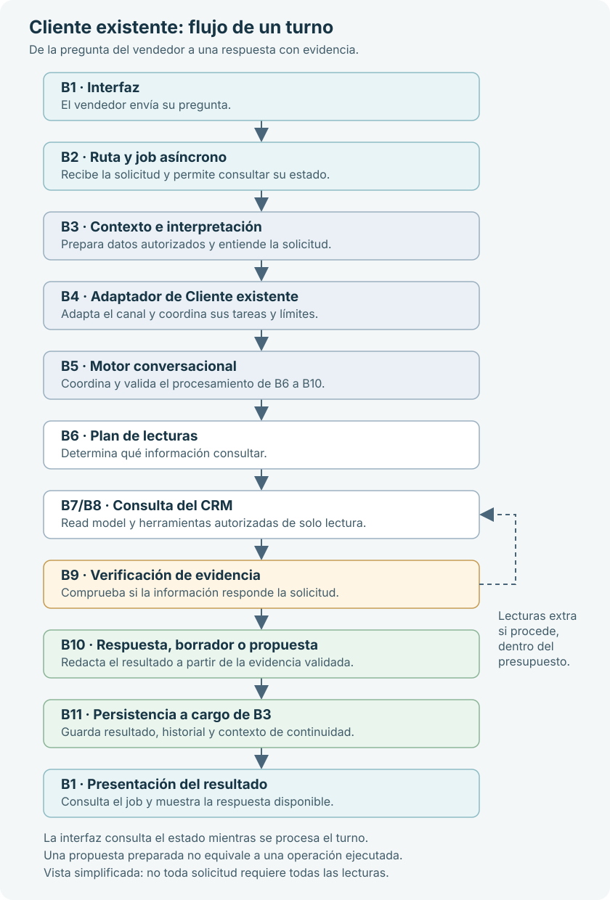

# Alcance funcional: Chat de Cliente existente

## Revisión de diagnósticos de chat

El tab **Diagnóstico de chats** de Mi Coach requiere `mi_coach.chat_diagnostics`.
Muestra 10 sesiones por página y la fecha y hora de creación de cada sesión en
la zona horaria comercial configurada. El filtro de diagnóstico
(todos, pendientes o cerrados) es independiente del estado técnico del turno.

**Cerrar diagnóstico** guarda el usuario, la fecha y el último turno revisado
en `customer_chat_diagnostic_reviews`, con auditoría transaccional. La tarjeta
se vuelve verde después de confirmar el servidor y sigue permitiendo abrir
las trazas. No modifica mensajes, oportunidades ni estados comerciales.
No se permite cerrar mientras haya turnos en proceso ni si llegaron turnos
posteriores a los mostrados; se debe actualizar y revisarlos primero.
Un nuevo turno deja automáticamente la revisión pendiente. Repetir el cierre
del mismo último turno conserva el usuario y la fecha del cierre original.

Este documento define el alcance, los permisos y el comportamiento esperado del chat de Cliente existente. Es el contrato funcional para mejorar su interpretación y recuperación de información; no autoriza cambios de permisos ni amplía el acceso del modelo al CRM.

Describe las capacidades y restricciones del canal, no resultados de pruebas
ni una certificación de funcionamiento. La aplicación es nueva: la aceptación
se prepara para su lanzamiento, no para un piloto.

La documentación se complementa con:

- [Validación y matriz detallada de las 46 categorías](./validacion-chat-cliente-existente.md):
  alcance que se propone evaluar, prioridades y criterios pendientes de aprobación.
- [Preguntas, contexto y respuestas esperadas](./preguntas-validacion-chat-cliente-existente.md):
  185 entradas nuevas de evaluación basadas en registros reales, con
  precondiciones y brechas explícitas. Están pendientes de revisión y ejecución.

## Objetivo

Ayudar al vendedor a consultar, resumir y analizar información CRM de una cuenta existente que ya está seleccionada y autorizada. El chat debe entender preguntas expresadas en lenguaje natural, consultar únicamente evidencia permitida y explicar cuándo no puede contestar con seguridad.

El selector **Cuenta existente** muestra las cuentas por nombre de A a Z,
con orden alfabético en español sin distinguir mayúsculas ni acentos, tanto
al cargar como al buscar clientes.

El chat es un asistente especializado en información comercial de la cuenta. No es un asistente general, no sustituye los módulos operativos del CRM y no debe afirmar que una propuesta de escritura ya se ejecutó.

La entrada de preguntas admite varias líneas, ajuste de texto y altura inicial
de 90 px ampliable verticalmente. Enter inserta un salto de línea; el botón
**Preguntar** envía el mensaje. La cabecera compacta reúne nueva conversación,
fundamento y fuentes públicas; no muestra preguntas sugeridas.

## Límites invariantes

- El alcance de datos es una sola cuenta CRM seleccionada y autorizada.
- Una oportunidad, contacto, lead, actividad o interacción relacionada debe pertenecer a esa cuenta o estar vinculada a ella por una relación CRM autorizada.
- Nombrar otra cuenta en el texto de la pregunta no cambia la cuenta seleccionada ni amplía el alcance. El chat debe negarse a consultar o actuar sobre esa otra cuenta e indicar al vendedor que cambie la selección desde la interfaz.
- Las consultas y operaciones deben validar permisos en el servidor. El planificador, el modelo y las instrucciones del prompt no conceden permisos.
- El historial de este canal no se comparte con Coach ni con Cuenta nueva.
- Los datos CRM, las fuentes públicas y las inferencias deben distinguirse. Un dato público no se presenta como un hecho confirmado en el CRM.
- Ninguna escritura se ejecuta directamente desde la respuesta del modelo. Las propuestas requieren revisión, permiso de ejecución y confirmación en el flujo autorizado.

## Entrada y permisos generales

Las rutas de sesión y conversación de `account-chat` requieren:

| Uso                                                                                | Permisos requeridos                                                                                      |
| ---------------------------------------------------------------------------------- | -------------------------------------------------------------------------------------------------------- |
| Abrir Cliente existente, crear o consultar sesión y crear o consultar jobs de chat | `mi_coach.use` y `inteligencia_comercial.read`                                                           |
| Leer datos de una entidad o dominio                                                | Permiso de lectura específico del dominio, indicado en la matriz siguiente                               |
| Ejecutar una operación CRM propuesta                                               | `mi_coach.execute` y permiso de escritura específico del dominio, además de la confirmación del vendedor |
| Investigar fuentes públicas                                                        | Acción explícita del vendedor, permiso de fuentes externas y controles de gobierno vigentes              |

Los permisos `read_all` pueden habilitar el alcance de lectura administrativo previsto por el servidor, pero no cambian el contexto funcional del chat ni permiten que una respuesta mezcle silenciosamente otra cuenta con la seleccionada.

## Archivos adjuntos

Cliente existente y el repositorio documental de editar oportunidad comparten
el catálogo de formatos, tipos MIME y límites por archivo:

| Formatos | Máximo por archivo |
| --- | ---: |
| PDF | 20 MB |
| DOCX | 15 MB |
| XLSX, XLS | 10 MB |
| CSV | 5 MB |
| TXT, MD | 2 MB |
| EML | 10 MB |
| PNG, JPG, JPEG | 10 MB |
| MP3, WAV, M4A | 50 MB |

El chat admite un archivo por mensaje, acompañado de una pregunta o instrucción.
El repositorio conserva la carga múltiple. Los archivos vacíos, tipos MIME
incompatibles y tamaños superiores al límite se rechazan en el servidor.
Los tipos MIME genéricos se normalizan según la extensión antes de la extracción.
Una configuración administrativa de MIME puede restringir el catálogo.

Ambos flujos reutilizan el extractor documental: texto de documentos y correos,
datos de hojas de cálculo, OCR para imágenes y transcripción para audio.
Imágenes y audio requieren proveedor IA configurado y sus controles de consumo.
Un PDF sin texto extraíble no tiene OCR automático garantizado; no se presenta
una extracción vacía o fallida como un análisis completado.

Adjuntar en el chat no crea documentos en el repositorio de una oportunidad ni
modifica el CRM. El contenido se utiliza como material de referencia no confiable
de la conversación y los archivos temporales se limpian al terminar el proceso.
PPT, PPTX y MP4 no se habilitan en el selector ni en los adjuntos del chat;
se conserva su soporte interno previo en el servicio documental.

## Matriz de capacidades de lectura

| Dominio                          | Consultas incluidas                                                  | Permisos mínimos de lectura                                                                            |
| -------------------------------- | -------------------------------------------------------------------- | ------------------------------------------------------------------------------------------------------ |
| Cuenta seleccionada              | Datos y resumen de la cuenta                                         | `cuentas.read` o permiso administrativo equivalente                                                    |
| Oportunidades de la cuenta       | Lista, búsqueda, detalle, estado, etapa, pipeline y readiness        | `oportunidades.read`; pipeline, actividades y readiness también requieren `desarrollo_comercial.read`  |
| Contactos de la cuenta           | Datos y relaciones CRM permitidas                                    | `contactos.read`                                                                                       |
| Leads e interacciones vinculados | Leads, interacciones y actividad relacionada visible para el usuario | `interacciones.read`                                                                                   |
| Actividades de oportunidades     | Actividades vinculadas a oportunidades autorizadas de la cuenta      | `oportunidades.read` y `desarrollo_comercial.read`                                                     |
| Cotizaciones de una oportunidad  | Contenido comercial de la cotización accesible                       | `oportunidades.read` y al menos un permiso `cotizaciones.*`, sujeto a ownership y controles del módulo |
| Fuentes públicas                 | Evidencia externa relacionada con la cuenta                          | Investigación solicitada explícitamente, permiso `fuentes_externas.execute` y gobierno de fuentes      |

La lectura de cotizaciones no expone costo interno, margen ni notas internas. Una cotización aceptada o ganada no prueba por sí misma que el producto se haya comprado o entregado.

### Detalle de oportunidades y contactos (Q02)

El contrato estructurado permite pedir una ficha de un registro individual:

- **Oportunidad:** nombre, cuenta, importe en USD, cierre previsto, etapa,
  estado comercial, activación y nombre del contacto asociado autorizado.
- **Contacto:** nombre, cuenta, cargo, correo, teléfono y móvil autorizados.

La ficha se construye directamente con los resultados de las herramientas de
lectura, sin generar valores nuevos con el modelo. Una solicitud de detalle
no carga automáticamente actividades, cotizaciones ni todo el historial.
Los demás tipos de registro no tienen una ficha garantizada por Q02.

Un campo vacío se muestra como «No informado». Una lectura no disponible o
restringida se distingue de un campo vacío; un fallo se comunica como tal.
El importe cero se conserva como cero. Si no se puede recuperar el contacto
asociado por permisos o por las fuentes disponibles, no se afirma que la
oportunidad carezca de contacto.

La resolución y el contexto validado determinan el registro; si hay varios
candidatos, se pide aclaración. La ficha respeta la cuenta seleccionada y
los permisos, no infiere autoridad de compra y no prepara ni ejecuta cambios.
Esta capacidad implementada requiere todavía validación con el proveedor
real y los usuarios, permisos y registros previstos para el lanzamiento.

### Consulta de campos específicos (Q03)

Q03 consulta uno o varios campos de un mismo registro, sin mostrar toda la
ficha de Q02. Admite los mismos campos y tipos de registro que Q02.
El contrato estructurado identifica los campos en `requestedFields`; las
lecturas autorizadas y el formato de valores se comparten con Q02.

Por ejemplo, «¿cuál es su monto?» muestra el nombre del registro y su
importe USD; «¿y su cierre?» consulta la fecha del registro que resuelva el
contexto validado, no repite el importe anterior. Una selección posterior a
una aclaración conserva los campos pedidos.

Se reconocen equivalencias como monto/importe, cargo/puesto y móvil/celular.
Etapa, estado comercial y activación siguen siendo conceptos distintos.
Si no está claro el campo o el registro, se solicita precisión.
Los campos fuera del catálogo se indican como no soportados, sin
sustituirlos por otro: presupuesto no equivale al importe de oportunidad,
ni este equivale al total de una cotización.

La respuesta se construye directamente desde la evidencia autorizada,
conserva cero, moneda y fecha, e informa por separado campos vacíos,
restricciones y fallos de lectura. No consulta fuentes externas ni agrega
historial, recomendaciones o propuestas de escritura. La validación con
proveedor real y perfiles de lanzamiento sigue pendiente.

Q02 y Q03 requieren el permiso base de lectura del tipo de registro
(`oportunidades.read` o `contactos.read`). Un permiso `read_all` por sí solo
no sustituye ese requisito de las herramientas de lectura.

### Listados de oportunidades y contactos (Q04)

Q04 construye listas directamente desde las herramientas de lectura
autorizadas, sin pedir al modelo que elija los registros o redacte sus
valores. No requiere seleccionar un registro individual.

Preguntas como "que oportunidades hay?" o "que oportunidades hay en esta cuenta?"
solicitan el listado de oportunidades de la cuenta seleccionada, no un resumen
general ni una aclaracion por datos pegados. Lo mismo aplica a preguntas
equivalentes sobre contactos. Si el interprete confunde esa consulta simple con
un resumen, el servidor reconcilia el proposito antes de ejecutar las lecturas,
sin agregar filtros implicitos ni ampliar permisos o el alcance de la cuenta.

| Elemento | Alcance implementado |
| --- | --- |
| Colecciones | Oportunidades y contactos de la cuenta seleccionada. |
| Filtros de oportunidad | Estado comercial, código de etapa y activación, separados. |
| Orden de oportunidad | Nombre, importe USD o cierre previsto, ascendente o descendente. |
| Orden de contacto | Nombre o cargo, ascendente o descendente. |
| Columnas | Campos autorizados del catálogo Q02/Q03; las columnas no soportadas se informan sin sustituirlas. |
| Presentación predeterminada | Oportunidades: nombre, importe USD, etapa y estado comercial. Contactos: nombre y cargo. Orden por nombre ascendente. |
| Cantidad | La solicitada, hasta un máximo de 50 registros mostrados; si hay menos coincidencias, se muestra la cantidad disponible. |

El servidor valida la cuenta, permisos base de lectura, configuración y
herramientas permitidas; elimina duplicados por ID, filtra, ordena y
después aplica la cantidad. Los valores vacíos van al final en ambos
sentidos de orden; los empates se resuelven por ID ascendente.
Un importe cero no se considera vacío. No se agregan recomendaciones ni
operaciones de escritura.

Sin filtros explícitos de oportunidad se incluyen los estados y
activaciones disponibles en el snapshot autorizado, sin aplicar los
filtros predeterminados de otras consultas. La política administrativa
puede excluir ganadas, perdidas o anuladas, también cuando están inactivas.
El alcance efectivo se declara. Los contactos se limitan al alcance de su
lectura, normalmente solo activados, salvo que se haya autorizado la
lectura con historial; Q04 no amplía ese acceso.

La respuesta distingue recuperados, coincidencias conocidas y mostrados.
Las lecturas actuales pueden limitarse a 50 oportunidades activadas,
50 no activadas y 50 contactos; sus métricas determinan si se truncaron.
Cuando hay truncamiento o falta evidencia de completitud, se informa
resultado parcial, no se declara un total global y el orden se describe
como aplicado solo a los registros recuperados. El límite de presentación
es independiente de ese límite de lectura. No hay paginación ni promesa
de recuperar los siguientes registros mediante «muéstrame más».

Las continuaciones conservan la especificación validada y cambian solo
los filtros, orden, cantidad o columnas pedidos. Una nueva solicitud no
hereda esos filtros. «Detalle de la segunda» o «monto de la tercera»
se resuelve contra los IDs en el orden realmente mostrado, con nueva
validación de cuenta, visibilidad y permisos. Si la lista dejó de ser
verificable, se pide el nombre o repetir la consulta, sin desplazar las
posiciones. Un turno que muestra varias listas no conserva una lista
ordinal arbitraria.

Se distinguen ausencia de coincidencias, lectura fallida, restricción y
resultado parcial. Los criterios no soportados se comunican sin mostrar
una lista que los ignore. La validación con proveedor real sigue pendiente.

### Búsqueda por criterios (Q05)

Q05 reutiliza la lectura, filtros, orden, columnas, límites y selección
ordinal de Q04. El modelo interpreta la petición; el servidor aplica las
condiciones y construye la respuesta directamente con los registros
autorizados. No amplía la recuperación del CRM ni permite escrituras.

| Criterio | Alcance implementado |
| --- | --- |
| Texto de oportunidad | Nombre, con igualdad o coincidencia parcial. |
| Texto de contacto | Nombre y cargo, con igualdad o coincidencia parcial. |
| Importe de oportunidad | USD: igual, mayor, mayor o igual, menor, menor o igual e intervalos con extremos explícitos. |
| Cierre previsto | Fecha exacta o límites inclusivos/exclusivos; mes y año se convierten en intervalos de fechas válidas. |
| Otros filtros | Estado comercial, etapa y activación de oportunidad, separados, como en Q04. |

Las condiciones se combinan con **Y**; varios estados o etapas son
alternativas dentro del mismo filtro. La búsqueda de texto ignora
mayúsculas, acentos y espacios repetidos, pero no es semántica ni atribuye
autoridad de compra por el cargo. No se admiten alternativas entre
campos distintos ni intervalos disjuntos.

«Mayor a USD 500.000» excluye el valor exacto; «desde USD 500.000» lo
incluye. Un importe cero es válido; un importe o fecha vacío no cumple
condiciones numéricas o temporales. «Enero de 2027» incluye del
2027-01-01 al 2027-01-31, no todo el año. Moneda ambigua, año faltante,
extremos ambiguos o contradictorios requieren precisión; otras monedas
y criterios no soportados se informan sin sustituirlos.

El contrato usa `textFilters`, `amountFilters` y `closeDateFilters`.
Las continuaciones añaden o reemplazan el grupo modificado y permiten
quitarlo explícitamente con un conjunto vacío. Se conservan los demás
criterios; una búsqueda nueva no los hereda. Una aclaración pendiente
conserva sus criterios hasta que se resuelve o se reemplazan explícitamente.
Una referencia explícita a otra cuenta no cambia el alcance: requiere
seleccionarla en la interfaz y validar el acceso.

La respuesta declara los criterios efectivos, operadores, moneda y fechas.
La garantía es sobre la colección autorizada recuperada: si la lectura
está truncada, se informa parcialidad y no se afirma ausencia global ni
un orden global. Se mantienen el máximo de 50 mostrados y la ausencia de
paginación de Q04. Las pruebas con proveedor real siguen pendientes.

### Historial comercial (Q06)

Q06 tiene un recorrido de lectura determinista para cuenta, oportunidad y
contacto. B3 interpreta `historySpec`; el servidor valida la entidad,
resuelve el periodo, consulta las fuentes autorizadas y construye una
cronología conjunta sin planificador ni redactor generativo adicional.
No prepara operaciones ni modifica registros del CRM.

| Fuente | Relaciones admitidas |
| --- | --- |
| Interacciones | Cuenta, oportunidad principal y contactos con vínculo explícito en el CRM. |
| Actividades de oportunidades | Cuenta y oportunidad registrada. No se atribuyen a un contacto por pertenecer a su cuenta. |
| Calendario | Cuenta, oportunidad directa o principal de la interacción vinculada y contacto directo registrado. |

Sin periodo se aplican los **últimos seis meses**, con fechas exactas
anunciadas. Se admiten rangos absolutos de hasta cinco años, periodos
móviles en días/semanas/meses/trimestres/años y periodos calendario.
El reloj se fija al inicio del turno y se usa la zona horaria del negocio.
El periodo calendario actual termina en la fecha de referencia; un mes,
trimestre o año explícito comprende sus límites completos. Un año faltante,
rango inválido o criterio no soportado requiere precisión o se informa;
no se ignora para ejecutar una consulta más amplia.

Los filtros de fuente y estado se aplican antes del límite de presentación.
Los estados son pendiente, en curso, bloqueada, realizada y cancelada;
`done` y `completed` se reconocen como realizada sin cambiar el estado
registrado. Las interacciones no se convierten en actividades con estado:
un filtro de estado de actividad las excluye y se informa.

Cada evento identifica su fuente, registro, fecha y significado de fecha.
Se prioriza programación, vencimiento y creación en actividades, y creación
o actualización en interacciones. Las fechas de vencimiento almacenadas
como día no se desplazan por zona horaria. Una fecha de programación,
vencimiento o creación **no acredita cuándo se realizó la gestión**.
El contenido registrado no demuestra que se haya logrado el objetivo:
«averiguar si aprobaron presupuesto» no significa «presupuesto aprobado».

La consulta restringe periodo y entidad antes de recuperar hasta 500
registros por fuente, con detección del registro adicional para identificar
truncamiento. Los márgenes temporales de recuperación se filtran después
con las fechas exactas en la zona del negocio. Se mantienen la autorización
y las exclusiones de gobierno de oportunidades; un alcance de oportunidades
recuperadas incompleto también limita la cobertura del historial.
Se muestran como máximo 50 eventos por consulta, ordenados por fecha,
hora cuando existe y un desempate estable. No hay paginación.

Se deduplica por identidad de fuente y registro, no por títulos parecidos.
Los registros sin fecha utilizable se separan y no cuentan como
coincidencias del periodo. Se distinguen por fuente: lectura completa,
parcial o desconocida, fallo, restricción, deshabilitación y relación no
admitida. Una fuente fallida no impide mostrar las demás, pero su fallo
es visible. Si ninguna fuente se pudo consultar, la respuesta es un error.
Nunca se concluye que no hubo relación comercial por una tabla vacía.

Las continuaciones conservan entidad y criterios efectivos; modifican solo
los grupos pedidos y permiten quitar filtros. Una solicitud nueva o cambio
de entidad no hereda criterios anteriores. Las aclaraciones conservan la
petición pendiente. Un turno con varios historiales muestra sus cronologías
por separado y no conserva uno arbitrario para continuar. Se siguen
respetando permisos base, alcance y herramientas habilitadas, presupuesto
compartido y plazo de verificación. La validación con proveedor real sigue
pendiente. No se agregan correos, documentos ni auditoría de cambios.
El calendario de un contacto requiere además la lectura de actividades
habilitada en el canal; no se amplía el catálogo de herramientas de los
recorridos anteriores de contactos.

### Relaciones entre oportunidades y contactos (Q08)

Q08 consulta relaciones registradas mediante un contrato `relationshipSpec`
y respuestas deterministas, sin planificador ni redactor generativo
adicional. No crea ni modifica vínculos: esa es una acción distinta.

| Consulta | Evidencia y alcance |
| --- | --- |
| Contacto asociado a una oportunidad | Vínculo directo de la oportunidad, contrastado con el contacto autorizado y activado. |
| Verificar una pareja contacto-oportunidad | Comparación de identificadores autorizados, no nombres ni pertenencia a la cuenta. |
| Oportunidades de un contacto | Relación inversa del mismo vínculo dentro de las oportunidades autorizadas recuperadas. |

Ambos tipos de registro requieren permisos base de lectura y alcance
habilitado. Se respetan la configuración y herramientas permitidas de
contactos y oportunidades, el presupuesto compartido y el plazo del turno.
Una referencia ambigua o no encontrada requiere aclaración y no se sustituye
por otro registro seleccionado. Otra cuenta debe seleccionarse en la interfaz.

La proyección del identificador asociado es optativa en las herramientas;
no modifica las salidas anteriores de Q02/Q03. Un vínculo vacío se distingue
de destino restringido, no recuperado, inactivo o lectura fallida. No se
revelan identidades de destinos no autorizados. La falta de lectura de un
contacto no demuestra ausencia del vínculo.

«No es el contacto asociado registrado» solo niega ese vínculo concreto;
no niega otras formas de participación. Asociación, cargo, influencia
general y pertenencia a una cuenta no acreditan autoridad de compra,
decisión ni firma. Las preguntas por esos roles, jefatura u otras relaciones
fuera del alcance se reconocen sin sustituirlas por el contacto asociado.

La consulta inversa reutiliza filtros, columnas, orden y límite de Q04/Q05.
Primero filtra por identidad del contacto asociado y después ordena y limita.
Conserva los conteos de recuperados, coincidencias y mostrados. Un vínculo
no verificable o una lectura truncada/desconocida produce advertencia de
parcialidad; no permite afirmar ausencia global. Se muestran hasta 50
oportunidades, sin paginación ni ampliación de recuperación CRM.

Las continuaciones conservan oportunidad y contacto por separado, mantienen
las aclaraciones y cambian solo los grupos pedidos. Una nueva solicitud o
cambio de contacto no hereda filtros de otra consulta inversa. Para modificar
un listado asociado, la interpretación debe conservar Q08; un listado genérico
no quita silenciosamente la restricción de contacto. La selección ordinal
Q02/Q03 reutiliza el orden mostrado, valida de nuevo contacto, permiso y
vínculos y descarta toda la lista si alguna asociación cambió, sin desplazar
posiciones. Varias relaciones en un turno no conservan un referente arbitrario.

No se implementa un mapa universal de relaciones ni se acredita autoridad
comercial. La validación con proveedor real sigue pendiente.

### Contenido de cotizaciones y material aportado (Q09)

Q09 usa un contrato `documentSpec` que distingue cotización CRM de material
aportado, oportunidad, referencia comercial de cotización, revisión, selección,
aspecto consultado y objetivo puntual. La máscara de cambios conserva los
criterios pendientes sin aplicar placeholders del proveedor. Resumir una
cotización o un archivo requiere este recorrido, no un resumen genérico de cuenta.

La lectura CRM exige `oportunidades.read`, un permiso de cotizaciones admitido
por el módulo, ownership cuando corresponde, cuenta y oportunidad autorizadas,
intención habilitada, herramientas permitidas y alcance del servidor. La
selección de candidatos y la lectura de contenido son consultas separadas:

- Sin criterio inequívoco entre varias cotizaciones, se ofrecen candidatos y
  se pide selección. Dos cotizaciones con revisiones 8 y 1 siguen siendo dos
  registros independientes.
- La referencia explícita se filtra antes del límite de recuperación. Se
  muestran hasta 50 candidatos, con un registro adicional para detectar recorte;
  no se implementa paginación.
- «La última» usa actualización de cotización descendente y luego identificador
  descendente como desempate. No equivale al mayor número de revisión.
- Sin revisión explícita, una nueva selección consulta la última versión de
  esa cotización e indica su número. Una continuación conserva la versión
  seleccionada y la vuelve a leer; cero en `versionNumber` solicita la última.
- La revisión explícita se restringe simultáneamente a cotización, oportunidad
  y cuenta. No se sustituye una versión inexistente por otra disponible.
- Los ordinales conservan las identidades presentadas. Todos los candidatos
  recordados se revalidan; si falta alguno o cambió su versión, se pide nueva
  selección sin desplazar posiciones. También se comprueba que la versión
  vigente no cambió entre la selección y la lectura.

Partidas, cantidades, moneda, entrega, vigencia, garantía y pago tienen respuesta
determinista. Cada partida conserva sección, inclusión, tipo, cantidad, precio
unitario de lista y descuento disponibles; un nulo no se convierte en cero.
No se suman equipos y servicios heterogéneos ni se recalculan totales. Las
consultas de texto, exclusiones y resúmenes usan generación documental a
temperatura cero, citas de fragmentos existentes y auditoría; sin citas válidas
o aprobación no se presenta el borrador como respuesta verificada.

La proyección comercial excluye columnas de costo, margen y notas internas.
Introducción y `quotation_notes` se tratan como texto comercial porque forman
parte del PDF de propuesta; este último se expone únicamente como
`commercialNotes` en el recorrido Q09. No se incorporan campos internos
arbitrarios a la evidencia. Cotización aceptada no acredita compra,
facturación ni entrega.

Para los adjuntos ya admitidos se conserva nombre, texto, longitud original
del texto extraído, longitud disponible y recorte. El límite sigue siendo
12.000 caracteres; no se amplían formatos ni se añade OCR. Una extracción
fallida o vacía se informa como error. La cobertura se refiere al texto extraído,
no certifica que imágenes u otros elementos del archivo hayan sido interpretados.
Material anterior sin metadatos se considera de cobertura desconocida/parcial.
No se inventan páginas: las citas identifican fragmentos del texto leído.

La evidencia generativa se limita a 12.000 caracteres y 1.500 por fragmento;
las notas comerciales tienen prioridad al consultar exclusiones, para que
una introducción extensa no las oculte. Se muestran hasta 50
partidas y se limita la extensión de respuesta; cualquier recorte se advierte
antes del contenido. La ausencia en un extracto no demuestra ausencia en todo
el documento. Las instrucciones dentro de archivos o textos CRM son datos,
no órdenes; el material aportado se atribuye al documento, no a hechos CRM.
No encontrar una partida tampoco acredita una exclusión.

La memoria conserva fuente e identidades, no copias nuevas del contenido CRM.
Un nuevo archivo reemplaza al anterior; cambiar oportunidad, cotización o fuente
descarta selecciones incompatibles. Varias consultas documentales no dejan una
fuente seleccionada arbitrariamente. El historial y la interfaz conservan
procedencia, cobertura y respaldo documental, incluso al reabrir la sesión.
Las lecturas consumen el presupuesto compartido, incluidas las subconsultas de
contenido; generación y auditoría están sujetas al plazo del turno.

No se crea, modifica ni envía ningún documento. No hay lector genérico de
archivos CRM. La aceptación con proveedor real sigue pendiente.

### Priorización de oportunidades (G04)

G04 dispone de un contrato `prioritySpec` y de un recorrido determinista:
interpretar conjunto y criterio, resolver todas las referencias, leer las
oportunidades autorizadas, filtrar con Q04/Q05 y ordenar sin generación de
ranking ni scoring predictivo.

El conjunto puede ser la colección filtrada de la cuenta, oportunidades
nombradas o exactamente los registros presentados en un listado anterior.
Cada nombre debe resolverse inequívocamente dentro de la cuenta; una referencia
ambigua o no encontrada impide ordenar un subconjunto incompleto. Se eliminan
duplicados por identidad. Los IDs recordados no conceden acceso: se revalidan
cuenta, visibilidad, permiso `oportunidades.read`, alcance del servidor, intención
`opportunity_query`, herramienta `searchOpportunities` y gobierno vigente de
estados históricos. Un conjunto derivado de una relación conserva el contacto
asociado y exige su permiso y alcance de lectura.

Los únicos criterios iniciales son:

| Criterio | Regla |
| --- | --- |
| Importe USD registrado | Descendente por defecto; ascendente si se solicita. Cero es válido; nulos y valores no finitos van al bloque de información insuficiente. No es valor de venta realizada ni probabilidad de ganar. |
| Cierre próximo registrado | Por defecto, fechas desde hoy ascendentes en el ranking principal; vencidas en bloque separado para revisar su vigencia; sin fecha válida en bloque de información insuficiente. |
| Fecha de cierre ascendente o descendente explícita | Orden cronológico solicitado, señalando las fechas vencidas. No se sustituye por la regla de cierre próximo. |

El día de referencia se calcula con un único reloj por turno y la zona horaria
del negocio; las fechas DATE se conservan como días, sin conversión de zona.
Una fecha prevista no acredita compromiso confirmado, compra ni entrega.
Urgencia, riesgo, esfuerzo y probabilidad requieren una especificación propia;
no se sustituyen por criterios disponibles. Sin objetivo inequívoco se pregunta
si se desea importe o cierre y se aclara que no se puede asegurar una venta.

Se reutilizan los filtros de estado, etapa, activación, texto, importe y cierre
de Q04/Q05, sin limitar antes de ordenar. G04 presenta nombre, dato del criterio,
grupo, empate y fundamento; columnas personalizadas corresponden a Q04/Q05.
Cada resultado se muestra una sola vez. Valores iguales tienen igual prioridad;
el ID solo estabiliza su presentación y no rompe el empate comercial.
Los datos faltantes no reciben cero ni una fecha supuesta.

Se muestran hasta 50 resultados, sin paginación. Un top respeta estrictamente
la cantidad solicitada y, si corta un empate, informa cuántas oportunidades
empatadas recuperadas quedaron fuera. La respuesta distingue recuperados,
elegibles y mostrados, y cuenta los bloques vencidos o sin dato aunque no quepan
en el top. Una recuperación truncada o de completitud desconocida se declara
parcial: no se afirma que la primera recuperada sea la mejor de toda la cuenta.
Errores de lectura no se convierten en conjuntos vacíos.

La continuidad conserva conjunto, filtros y criterio; cambiar criterio no
amplía el conjunto. Nombres nuevos reemplazan el conjunto sin arrastrar filtros
anteriores. Una lista de nombres vacía no equivale a solicitar toda la cuenta.
Una continuación genérica Q04/Q05 no quita silenciosamente las restricciones
del ranking; debe interpretarse como G04 o como una nueva solicitud explícita.

La memoria guarda criterios, IDs, datos utilizados y orden mostrado, no
registros CRM completos. «Por qué la segunda» relee y explica la posición
presentada. Si cambiaron datos, conjunto, cobertura o fecha de referencia
relevante, pide actualizar y conserva el conjunto para esa actualización;
no presenta el orden anterior como vigente. La actualización informa si hubo
cambios. El detalle Q02/Q03 usa las posiciones mostradas y revalida los datos
de todo el conjunto elegible, incluidas oportunidades fuera del top, sin
desplazar ordinales. Cambiar cuenta invalida la memoria; varias priorizaciones
en un turno no conservan un ranking o listado arbitrario.

Historial e interfaz conservan criterio, cobertura y fundamento al reabrir.
Se utiliza el presupuesto compartido de lecturas y plazo del turno.
No hay generación adicional para ordenar o explicar los criterios objetivos,
ni operaciones CRM implícitas. La aceptación con proveedor real sigue pendiente.

### Preparación comercial con consultas coordinadas (Q10)

Una evaluación de preparación comercial de varias oportunidades no se reduce a
G05: B3 coordina `query.stage_readiness` (Q10) independiente por cada oportunidad
nombrada y B10 integra lo documentado, faltantes y siguientes pasos sugeridos.
El revisor de B3 comprueba la cobertura del conjunto sin exigir un comparador
de campos como sustituto. Se conserva el límite de cuatro componentes por turno;
si la solicitud lo excede, se delimita explícitamente, sin truncar el conjunto.
Las consultas comparten permisos, presupuesto y plazo existentes, sin ampliar
accesos ni iniciar validaciones que puedan avanzar etapas.

El contrato tipado de comparación distingue `purpose=fields` de
`purpose=commercial_readiness`. En el segundo caso, el servidor expande las
referencias nombradas en Q10 aunque el proveedor haya elegido `guidance.comparison`;
las dimensiones predeterminadas de G05 no sustituyen ese objetivo. Los campos o
cálculos pedidos además requieren tareas propias, sujetas al mismo límite.
La expansión conserva dependencias posteriores y pide delimitación para conjuntos
excesivos, referencias no resueltas o fuentes adicionales no cubiertas.

Cada Q10 incluye respuestas registradas y requisitos de la etapa actual, no una
confirmación independiente del cliente. No consultar cotizaciones, documentos o
notas no prueba que falte información en esas fuentes. Una lectura fallida se
identifica para esa oportunidad sin ocultar las restantes. No se concluye
duplicidad, independencia, aceptación ni una ganadora por nombre o etapa.
`stageReadinessResults` conserva estado y evidencia por oportunidad; con varias
consultas no se selecciona arbitrariamente la primera como foco del chat.
El campo `coverage` distingue requisitos por validar de ausencia real y enumera
fuentes no consultadas. “Siguiente paso acordado” pendiente de validar no significa
que no se haya acordado ninguno; las actividades documentadas conservan su valor.
En turnos compuestos exclusivamente de estas lecturas Q10 verificadas, se conserva
la presentación por oportunidad sin reescritura generativa final
(`verified_readiness_comparison`). Esto evita que una paráfrasis convierta
requisitos pendientes en afirmaciones de inexistencia; conserva también fallos
individuales y no añade llamadas de presentación. Otros tipos de turnos mantienen
su presentación y auditoría habituales.

### Necesidades registradas y fuentes documentales

- `query.stage_readiness` con `purpose=recorded_needs` lee respuestas de etapa e
  interacciones autorizadas. Conserva el vínculo por oportunidad; las interacciones
  sin vínculo se identifican como información de cuenta, no de esa oportunidad.
  Las respuestas guardadas no acreditan su autoría ni declaraciones textuales del
  cliente. El resumen de una interacción puede contener análisis automático.
- Un resumen de necesidades no se sustituye por conteos de oportunidades o importes.
  `accountSummarySpec.purpose=recorded_needs` con referencias nombradas se coordina
  con esas lecturas. Una consulta Q10 de colección consulta el conjunto autorizado
  de la cuenta, sujeto al límite de cuatro componentes y al presupuesto compartido;
  si excede el límite, pide delimitar sin truncar.
- `documentSpec.purpose=associated_files` lista archivos asociados a oportunidad
  o cotización; nunca los sustituye por conocimiento general de una solución.
  `source_content` conserva la fuente para preguntas y resúmenes posteriores.
  El nombre de una solución dentro del nombre de oportunidad no cambia la fuente.
- La oportunidad nombrada inequívocamente en una consulta documental anterior
  puede servir de identidad para “esta oportunidad”, incluso si la interpretación
  anterior eligió mal la fuente. No acredita archivos, no hereda esa fuente y no
  evita revalidar permisos y asociaciones al leer.
- Un bloqueo de interpretación conserva su aclaración original. B10 no lo
  transforma en “no encontré el documento”. Un resumen documental CRM ya auditado
  conserva su respuesta y advertencia de cobertura parcial sin otra reescritura
  (`validated_crm_document`). Las lecturas de necesidades y su explicación
  dependiente auditada se conservan con `verified_needs_explanation`.

Se verificó de forma acotada la secuencia de Lactalis de necesidades, listado de
archivos y resumen de la reunión del 12 de agosto: el archivo asociado se recuperó
con permisos del usuario, con lectura parcial y sin cambios comerciales. Esa
verificación no certifica todos los documentos ni todas las formulaciones.

### Comparación de oportunidades (G05)

G05 dispone de contrato `comparisonSpec` y de un motor determinista para comparar
entre **2 y 5 oportunidades distintas de la cuenta seleccionada**. No ordena por
prioridad ni declara una ganadora, duplicidad o preparación comercial a partir
de un solo campo. La priorización adicional corresponde a otro componente G04.

El conjunto se expresa mediante todos los nombres o posiciones de un listado
previo revalidado. Sin posiciones, se utiliza exactamente el listado mostrado;
no los primeros cinco, las coincidencias no mostradas ni toda la cuenta.
Se deduplica por identidad conservando el orden solicitado y se exige resolver
todas las referencias inequívocamente. Nombres similares no son equivalentes.
Una selección con menos de dos o más de cinco oportunidades pide aclaración,
sin recortar ni comparar solo las restantes.

Las dimensiones predeterminadas son importe USD, etapa, estado comercial y
cierre previsto. El contacto asociado solo se incluye cuando se solicita,
contrastando el vínculo explícito con contactos autorizados y activados,
sin atribuir autoridad de decisión, aprobación o firma. **Pendientes e historial
no están incluidos en esta entrega**: se comunica el límite ante esas solicitudes
sin sustituirlas por datos actuales. Tampoco se comparan productos, competidores,
otras cuentas, monedas sin conversión válida ni scores de preparación.

La matriz presenta las mismas dimensiones para todas las oportunidades,
incluidas las incompletas. Distingue valores conocidos, no registrados,
inválidos, no verificables y restringidos; cero es válido, no un dato faltante.
Dos vacíos no acreditan una coincidencia ni una desventaja comercial.
El estado comercial no se sustituye por activación; las etapas no acreditan
probabilidad de cierre. Importes no equivalen a ingresos realizados y fechas
previstas no son compromisos confirmados.

El motor calcula coincidencias, diferencias y contrastes numéricos sin llamadas
generativas adicionales. Entre dos oportunidades presenta por defecto
diferencia de importe (segunda menos primera) y razón (segunda/primera).
Para tres o más no elige pares arbitrarios. Cada cálculo explícito identifica
base y destino por posición; porcentajes usan `(destino - base) / base * 100`,
y diferencias de fecha usan días calendario. Se explicitan base cero, datos
insuficientes y resultados fuera del rango numérico; no se muestran NaN ni infinito.
Los valores numéricos se presentan con hasta seis decimales.

La lectura exige permiso base `oportunidades.read`, cuenta, alcance del servidor,
intención habilitada y herramienta autorizada. `read_all` no reemplaza el permiso
base. Los contactos requieren además su permiso, alcance y herramienta.
Si la dimensión de contacto está restringida o falla su lectura, los campos
permitidos pueden mostrarse con cobertura parcial y la limitación expresa,
sin revelar datos guardados de contactos ni afirmar ausencia de asociación.
Una lista derivada de Q08 conserva su restricción de relación y exige
revalidarla incluso cuando no se presenta la dimensión de contacto.
Fallos en oportunidades no se convierten en conjuntos vacíos.

La memoria conserva IDs y orden, dimensiones, bases de cálculo, evidencia
estructurada y cobertura. «Añade», «quita la tercera» y «solo importe y cierre»
modifican la comparación, no registros CRM. Las ediciones respetan 2–5 y las
selecciones inválidas conservan la comparación previa verificable para corregir.
Cambiar el conjunto invalida bases ordinales de cálculo antiguas.
Una explicación relee los datos: si cambiaron valores o cobertura exige
actualizar conservando el conjunto, sin presentar la comparación anterior
como vigente. La actualización declara si hubo cambios.
Q02/Q03 utilizan las posiciones presentadas y revalidan la evidencia sin
desplazarlas; una continuación genérica Q04/Q05 no amplía el conjunto.
Cuenta o permisos revocados invalidan la memoria que ya no puede utilizarse.
Varias comparaciones conservan sus tablas, pero no un listado o memoria arbitrario.

Interfaz e historial conservan tablas accesibles con desplazamiento horizontal,
fundamento y cobertura, con hasta 256.000 caracteres de respuesta para G05.
Las lecturas respetan presupuesto y plazo compartidos. No hay escrituras
implícitas ni aceptación con proveedor real por el mero paso de las pruebas locales.

### Evolución comercial histórica (G06)

G06 analiza oportunidades registradas, movimientos de etapa, recorrido,
permanencias, cantidades de cierres comerciales, cambios de importe/cierre
previsto y fotografías históricas del pipeline. **Facturación, ingresos
contables, cobros, pagos y saldos por cobrar aún no están disponibles.**
No se sustituyen por ganadas ni importes de oportunidades. Una petición mixta
conserva ambas partes y señala la financiera como no disponible.

`trendSpec` fija métrica, periodo, comparación opcional, granularidad
día/semana/mes/trimestre/año, oportunidad y filtros históricos. Sin variable
o periodo se pide aclaración. Cada consulta admite hasta cinco años y 500
cortes; esto limita la consulta, no la conservación ilimitada de eventos.
Las fechas futuras no se presentan como historia. Periodos relativos se fijan
como absolutos al iniciar el análisis, usando un único reloj y zona del negocio.

La fuente es la auditoría existente (`audit_log`), sin caducidad. Cada escritura
comercial de la aplicación guarda una captura anterior/posterior completa,
versión, ID y fecha UTC en `changed_fields.commercial_history.after`.
Las acciones `commercial_history_created`, `commercial_history_changed` y
`commercial_history_deleted` identifican esas capturas; los demás registros
de auditoría mantienen su significado y no duplican las métricas.

El helper compartido bloquea la oportunidad antes de cambiarla y guarda la
captura en la misma transacción InnoDB. Si falla la auditoría, el cambio
se revierte. Cubre las rutas de oportunidades, campos de Coach, Chatbot,
validaciones de etapa y creaciones desde interacciones/prospección.
Se conserva el actor según las reglas existentes de auditoría; esos datos
técnicos no se exponen en el chat. No hay triggers ni cambios de parámetros RDS.
Los escritores nuevos deben utilizar el mismo helper. Cambios directos por
SQL, importaciones o herramientas externas que lo omitan no quedan capturados
automáticamente: no se garantiza cobertura para esos cambios.

#### Instalación controlada y RDS

Ejecutar primero un respaldo local privado y después:

```sh
npm run history:install --workspace=api -- --apply
```

El instalador obtiene un bloqueo exclusivo de migración, bloquea las
oportunidades para observar un estado consistente y guarda estados base en
la propia auditoría con acción `commercial_history_baseline`. Omite registros
que ya tienen baseline o creación capturada, sin duplicarlos al repetirlo.
Una tabla de control acredita que el estado base se completó; no contiene
otra copia de los cambios. No modifica valores de oportunidades.
El estado base acredita su instante de observación, no el pasado.
La auditoría previa se consulta directamente como antecedente no certificado; sus eventos
generales/específicos no se suman dos veces ni certifican automáticamente
pipeline o duraciones anteriores. No se recuperan eventos ya eliminados.

Desplegar primero todos los escritores auditados y ejecutar después el
instalador. No requiere `TRIGGER`, SUPER ni cambiar
`log_bin_trust_function_creators`. Las DDL de MySQL pueden dejar la tabla de
control creada tras un fallo, pero la fuente no se marca lista si la escritura
del baseline falla. El lector exige la instalación completada.
Las tablas vacías de un intento previo de instalación con triggers no se usan
ni se eliminan automáticamente.

No se ejecutan purgas de auditoría por antigüedad. Supervisar almacenamiento,
respaldos y cobertura de los escritores; conservación ilimitada no equivale
a respaldo ni recupera registros eliminados antes de retirar la purga.

#### Reconstrucción, métricas y cobertura

El lector consulta el conjunto autorizado completo, independientemente del
snapshot limitado del chat. Cuenta y oportunidad exigen permisos base;
`read_all` no los reemplaza. Propietarios actuales y gobierno vigente limitan
el alcance. Una pertenencia histórica no concede acceso actual ni revela
datos de otras cuentas. No se exponen documentos generales de auditoría.
Límites duros de 10.000 oportunidades y 100.000 eventos producen error, no
totales truncados. La lectura usa transacción consistente y verifica captura.

El motor reconstruye estados a partir de creación capturada o baseline,
verifica continuidad anterior/posterior y contrasta el estado final con el
actual. Timestamps iguales usan ID como orden estable. Un corte anterior
al estado base o con secuencia contradictoria no se presenta como exacto.
No se reemplazan valores históricos por actuales.
El conjunto corresponde a oportunidades actualmente autorizadas de la cuenta,
no a un inventario histórico universal que incluya registros ya inaccesibles.

- **Registradas:** identidades por fecha de creación, sin sumar importes
  actuales como importes iniciales. Filtros de estado inicial requieren ese
  estado capturado; si falta, el conteo filtrado es parcial.
- **Etapas:** transiciones y oportunidades distintas por separado; avances,
  retrocesos y saltos según el orden del catálogo consultado. Los saltos son
  parte de los avances, no una cantidad adicional.
- **Recorrido:** creación/estado base, cambios de etapa/estado/activación y antecedentes
  de auditoría claramente separados.
- **Permanencia:** días transcurridos por estancia verificada, incluidos
  reingresos; el cierre comercial termina la estancia. Un estado base no
  acredita entrada a etapa; no se usa `updated_at` como sustituto.
  Las estancias abiertas se miden hasta ahora cuando el periodo llega a hoy.
- **Cierres:** eventos y oportunidades distintas, con resultados separados;
  no equivalen a facturación.
- **Cambios:** importes y cierres previstos anteriores/posteriores, sin
  congelar los valores de la oportunidad.
- **Pipeline:** oportunidades y suma USD en cada corte histórico; por defecto
  En proceso y activadas. Se suma en centavos para evitar pérdida por acumulación.
  No se suman fotografías de distintos cortes como si fueran ingresos.

Los filtros se aplican a estados históricos; no se soportan filtros históricos
de asignación en esta entrega. Comparaciones de cantidades calculan diferencia
y porcentaje solo con periodos de igual duración y cobertura suficiente;
base cero no produce porcentaje. Ausencia de evidencia no equivale a cero.
El periodo actual se identifica como en curso. No se infieren causas,
estacionalidad ni pronósticos garantizados.

Continuidad conserva métrica, periodo y filtros. Explicar relee y compara
una huella del resultado; si cambió, pide actualizar y conserva los criterios.
Varias series no dejan una memoria arbitraria. Tablas, metodología y cobertura
se conservan en interfaz e historial. Presupuesto compartido: seis lecturas
para revalidar cuenta y gobierno, control, conjunto, auditoría y los tres
catálogos agrupados en una consulta.
Una fila temporal no selecciona una oportunidad por ordinal; el recorrido
requiere una referencia inequívoca.
Aceptación con proveedor real pendiente; validar rollback y fallo de auditoría
requiere una base aislada, no modificar datos comerciales reales.

### Escenarios hipotéticos verificables (G07)

**Existente dentro del alcance aprobado.** `scenarioSpec` separa selección,
alternativas, cambios, supuestos y modo. B3 interpreta la petición; después,
un motor determinista calcula y explica sin otro modelo generativo.
La orientación cualitativa usa reglas comerciales condicionadas por tipo de
supuesto/cambio: no intenta predecir causas ni efectos sobre probabilidad.
Esto sustituye la generación libre propuesta inicialmente por una salida
acotada y verificable, sin atribuir decisiones al cliente.

#### Base y selección

Se relee el conjunto actual completo autorizado de la cuenta, no solo las
oportunidades incluidas en el snapshot del chat. Se revalidan cuenta, permisos
base, propietarios y gobierno vigente; `read_all` no sustituye permisos base.
La selección debe ser explícita: nombres inequívocos, toda la cuenta, filtros
Q04/Q05 o un listado previo verificable, incluido uno producido por un
componente requisito del mismo turno. No se elige arbitrariamente entre varios
listados ni se interpreta una fila de simulación como selección real.

Filtros no vacíos son obligatorios para una selección filtrada. No se aplica
un top silencioso: un subconjunto acotado requiere nombres o listado previo.
Nombre ambiguo, registro revocado o ausencia de una parte del conjunto pide
aclaración; no se calcula solo con los restantes. Una selección vacía no
acredita pipeline global cero.

La fuente es una lectura actual, independiente de la instalación histórica
G06. Presupuesto compartido de tres lecturas: cuenta, gobierno y conjunto.
Más de 10.000 oportunidades produce error explícito, no totales truncados.
Cancelación, fallo de fuente y vencimiento del plazo no usan una respuesta
generativa como sustituto.

#### Transformaciones y resultados

- Importe USD: porcentaje firmado, diferencia absoluta o nuevo importe.
  Máximo dos decimales monetarios y cuatro en el porcentaje; una reducción no
  puede superar 100 %. Se opera en centavos enteros, con redondeo al centavo,
  mitad hacia arriba, en cada transformación. Resultado negativo o fuera del
  rango admitido requiere aclaración. Un importe ausente no equivale a cero.
- Cierre previsto: fecha absoluta o desplazamiento entero en días, meses o
  trimestres. Días son calendario; meses/trimestres conservan el día cuando
  existe y, si no, ajustan al último del mes. No se inventa una fecha base
  ausente ni se aceptan fechas imposibles.
- Estado comercial: En proceso, Ganada, Perdida o Anulada solo mediante cambio
  hipotético explícito. «Supón aprobación» no equivale a Ganada.
- Cada alternativa parte de la **misma base real**. Los cambios dentro de una
  alternativa se aplican en el orden declarado y, opcionalmente, a nombres
  concretos del conjunto. Correcciones reemplazan cambios; únicamente
  «además»/acumular explícitamente los agrega. Se pueden quitar alternativas.
- Supuestos cualitativos: aprobación, presupuesto, retraso, competencia u
  otro. El presupuesto del cliente no se identifica con el importe de una
  oportunidad ni modifica este por inferencia. La orientación propone
  validaciones y opciones generales, no concesiones ni viabilidad confirmada.

Se muestran importe/fecha/estado reales e hipotéticos, diferencias y
distribución por estado. Un periodo absoluto explícito, de hasta cinco años,
añade pipeline por mes, trimestre o año: únicamente En proceso y activadas,
con sin fecha/fuera del periodo separados y diferencias frente a la base real.
No se infiere un periodo ni se usa esta proyección como historia o ingreso.
Las celdas ausentes de una distribución no agregan oportunidades; si todo
el conjunto abierto activado está vacío, se muestra cero explícito.

Hasta tres alternativas, cinco cambios y cinco supuestos por alternativa,
diez referencias nominales por selección/cambio y 500 filas de detalle
presentadas. Los totales se calculan sobre el conjunto completo antes del
recorte; la presentación limitada se señala como cobertura parcial.
Sumas de importes conocidos se distinguen de totales completos.
No se calculan facturación, ingresos contables, cobros, pagos, saldos,
márgenes desconocidos, probabilidades ni resultados garantizados.
Peticiones mixtas conservan la parte financiera como no disponible.

#### Continuidad, aislamiento y presentación

La memoria almacena IDs, criterios, huella y fecha de lectura; no almacena
valores hipotéticos como campos CRM ni selecciona una oportunidad real.
Explicar relee la base sin cambiar criterios. Si cambió un importe, fecha,
estado o el conjunto, pide actualizar antes de recalcular. Actualizar vuelve
a aplicar los supuestos a la base vigente. Cambiar de tema, detener o volver
a los datos reales abandona la memoria activa; varias simulaciones en el
mismo turno no dejan una memoria elegida arbitrariamente.

No hay operaciones propuestas ni ejecutadas por simular. Una acción que
depende de una simulación pide un cambio real por separado, sin consumir
supuestos como confirmación. Interfaz e historial conservan etiqueta
«Escenario hipotético», tablas, supuestos, método y cobertura.
G07 no crea tablas, baseline, triggers ni eventos de auditoría; no cambia
parámetros RDS. Las pruebas aisladas no sustituyen la aceptación pendiente
con el proveedor real de B3 ni la revisión comercial de la utilidad.

### Reportes documentales contrastados (R05)

**Existente dentro del alcance aprobado.** R05 recibe una afirmación atribuida
a un documento; Q09 consulta qué contiene una fuente. Recibir el reporte no
obliga a asociarlo con una pregunta de etapa ni autoriza escribir.
`documentReportSpec` separa afirmación literal, fuente, modo y pregunta de
etapa explícitamente seleccionada; `documentSpec` reutiliza identidad y
selección documental de Q09. Los placeholders del proveedor no alteran la
continuidad y una afirmación inventada por B3 se rechaza.

#### Fuente, contraste y cobertura

- **Cotización CRM:** mismo listado, lector comercial y permisos de Q09,
  oportunidad inequívoca y versión identificada. No abre documentos CRM
  arbitrarios ni expone costos, márgenes o notas internas.
- **Adjunto:** únicamente texto efectivamente extraído por el canal existente.
  Una extracción fallida no equivale a un documento vacío.
- **Fragmento aportado:** material de referencia conservado en el turno,
  siempre con cobertura parcial; no se afirma leer el documento completo.
- **Documento no aportado:** se conserva como relato del vendedor, sin
  afirmar acceso ni confirmación documental. No requiere llamadas al modelo
  de contraste. Si la fuente no está identificada se pide aclaración.

La fuente disponible se contrasta semánticamente mediante una salida tipada
y una segunda revisión contra todos los fragmentos disponibles. El servidor
valida estado, citas y referencias; el texto citado procede de los fragmentos,
no de citas redactadas por el modelo. El resultado distingue:

1. Respaldada por el contenido consultado.
2. Contradicha por el contenido consultado.
3. No determinable con el contenido disponible.
4. Sin fuente disponible para contrastar.

Respaldada no certifica autenticidad ni verdad externa. Contradicha exige
incompatibilidad explícita, no ausencia de una frase ni extracción parcial.
Una afirmación parcialmente respaldada no se confirma en su totalidad.
Partidas, plazos o aceptación de cotización no acreditan por inferencia
entrega, pago o aprobación. Afirmación, documentos y respuestas CRM son datos
no confiables: las instrucciones incrustadas no se obedecen.

Se pueden señalar incompatibilidades explícitas con las respuestas de etapa
ya disponibles de la oportunidad autorizada, mostrando pregunta, respuesta
registrada y diferencia sin elegir qué fuente es verdadera ni sobrescribirla.
Esta comparación se limita a hasta 20 respuestas disponibles, de hasta 4.000
caracteres cada una; no es una auditoría universal de campos CRM ni lee otras
cuentas para completar el contraste.

Se reutilizan los límites Q09: 12.000 caracteres de contenido para el modelo,
fragmentos de hasta 1.500 y cobertura declarada. Cada contraste admite hasta
ocho citas y diez diferencias con respuestas CRM disponibles. El lector
consume cuatro consultas compartidas para resolver y leer una cotización;
preparar etapa consume además el presupuesto del flujo de etapa existente.
Los fallos de lectura, revisión, proveedor, permisos o plazo no se sustituyen
por una confirmación, un resultado vacío o una respuesta generativa libre.
Dos llamadas de IA para contraste/revisión; preparar puede requerir las
llamadas existentes de planificación y asociación de etapa.

#### Revisión de etapa, continuidad e historial

Los modos recibir/contrastar no generan borrador. **Preparar** debe ser
solicitado explícitamente; exige permisos de preparación y que las respuestas
de etapa estén habilitadas. El destino se valida entre preguntas editables.
La selección se expresa como referencia literal, no como ID CRM inventado por
B3. Si cambió el conjunto de preguntas, se pide seleccionar de nuevo en lugar
de desplazar ordinales; hasta 100 preguntas editables por destino.
La oportunidad destino debe coincidir con la fuente CRM verificada.
Un destino ambiguo pide aclaración, sin perder afirmación ni fuente.

El complemento incluye reporte atribuido, fuente/versión, resultado del
contraste, fundamento y límites. Una afirmación contradicha o no verificable
se conserva como tal, no como hecho confirmado. Se conserva la respuesta
existente. Más de 4.000 caracteres en el complemento pide una versión más
breve; no se recorta silenciosamente. Solo el flujo normal de revisión y
**Guardar cambios** puede persistirlo. R05 no ejecuta escrituras, envíos ni
cambios de importe, fecha o estado por inferencia.

La memoria acotada conserva afirmación, fuente/versión, modo, destino,
huella y fecha; no convierte el reporte en campos CRM. Una fuente Q09 como
requisito del mismo turno puede reutilizarse por identidad, releyendo su
contenido. Varias fuentes requieren selección, no una elección arbitraria.
Varias R05 conservan sus resultados, pero no dejan una memoria elegida al azar.

Explicar conserva la afirmación y relee la fuente sin preparar un cambio.
Cambiar contenido o versión exige actualizar antes de reutilizar el contraste;
actualizar vuelve a contrastar. Permisos y referencias se revalidan.
Aclarar selección o pregunta de etapa conserva el reporte original; cambiar
de cotización no hereda la versión de la anterior. Detener, descartar o cambiar
de tema abandona el pendiente activo, sin borrar el historial.

Interfaz e historial conservan etiqueta de reporte documental, estado del
contraste, fuente, citas, diferencias, cobertura y borrador separado.
No requiere migraciones, triggers ni parámetros RDS nuevos.
Pruebas con proveedor real y revisión comercial de utilidad siguen siendo
aceptaciones separadas de la validación automatizada.

### Borradores de contacto y oportunidad (A01)

`action.create_record` es **Existente dentro del alcance aprobado**: prepara un
contacto o una oportunidad de la cuenta seleccionada, con revisión y guardado
exclusivamente en el módulo correspondiente. No crea cuentas nuevas, altas
masivas, clones ni registros relacionados implícitos; tampoco habilita tipos
desactivados por la política administrativa.

- B3 devuelve `creationSpec` tipada. Cada campo nuevo o corregido lleva su valor
  y una cita literal del mensaje actual. El servidor verifica ambas procedencias,
  los campos permitidos y sus límites; no copia hipótesis, adjuntos ni valores CRM
  para rellenar datos futuros. Los datos inválidos se comunican sin truncarlos.
- Contactos: nombre, apellido, cargo, correo, teléfono, móvil, departamento,
  ciudad y estado/región. Oportunidades: nombre, importe explícito en USD,
  cierre en `AAAA-MM-DD` y referencia literal a un contacto autorizado existente.
  Moneda ambigua, otra moneda y fechas no inequívocas requieren aclaración;
  no hay conversión automática. El contacto debe tener una coincidencia exacta
  única de la misma cuenta; se vuelve a validar antes de continuar.
- Nombre y apellido del contacto, o nombre de oportunidad, se completan antes
  de ofrecer la continuación. El resto puede permanecer pendiente para el
  formulario. Se enumeran también los catálogos y requisitos de destino
  (participación, jerarquía, relación, influencia, estado laboral y activación
  en Contactos; importe, cierre, contacto, línea de negocio, vendedor y revisión
  de etapa/activación en Oportunidades). El módulo conserva su validación final
  y su proceso de solicitud/aprobación cuando corresponda.
- La memoria aislada `creationMemory` conserva cuenta, tipo, identidad del
  borrador, revisión y valores aportados. Permite completar, corregir, retirar
  campos y revisar, incluso después de una consulta intermedia. Un cambio
  ambiguo de tipo pide aclaración; iniciar expresamente otro borrador no hereda
  los datos anteriores. Cancelar elimina la memoria, no registros CRM.
- Las coincidencias se calculan sobre los contactos y oportunidades autorizados
  disponibles (incluidas las oportunidades inactivas recuperadas): nombre
  normalizado, nombre parcialmente coincidente o correo idéntico. Se distingue
  coincidencia de duplicado confirmado. Una posible coincidencia exige revisar
  y confirmar en un turno posterior que es otro registro; la confirmación queda
  ligada a una huella de los valores y de todas las coincidencias disponibles.
  Cambiar esos datos invalida la confirmación. Se muestran hasta 20 coincidencias,
  indicando el total; no se afirma cobertura universal ni ausencia de duplicados.
  Una lectura fallida o restringida se informa y no se interpreta como cero.
  Contactos conserva su comprobación definitiva de duplicados al guardar.
- Se exige `mi_coach.execute` y permiso de creación o solicitud, no permiso de
  actualización como sustituto. Se revalidan política del canal, permisos,
  acceso a la cuenta, contacto y revisión vigente al persistir la propuesta,
  generar el handoff y abrirlo desde el módulo. Una propuesta histórica cancelada,
  sustituida o desactualizada no se reutiliza como vigente.
- Identidad estable y revisión evitan nuevas operaciones persistentes por
  reintentos, incluso entre sesiones Coach. La persistencia serializa por usuario;
  una revisión anterior no reemplaza otra posterior. Un borrador ya trasladado
  o cerrado no se reabre mediante una nueva propuesta del mismo borrador.
  Se reutilizan tablas y tokens existentes; no hay migraciones ni triggers.
- Respuesta, metadatos y vista histórica distinguen borrador, pendientes y
  coincidencias. Abrir el formulario no acredita creación. Solo el resultado del
  módulo acredita el guardado; un resumen histórico no es un comprobante de alta.

Pruebas automatizadas cubren extracción tipada, continuidad, aclaraciones,
coincidencias, permisos, límites y traslado de campos al formulario. La prueba
MySQL aislada usa el esquema Coach real con datos ficticios para verificar
concurrencia, revisiones, tokens y cierre sin crear registros CRM. La aceptación
semántica con proveedor real y vendedores permanece pendiente; no se ejecuta
IA real ni se crean contactos u oportunidades en producción durante las pruebas.

### Revisión de notas de oportunidad

Las propuestas `opportunity_note` de Cliente existente se preparan y revisan
desde «Revisar operación», dentro de la cuenta seleccionada. El servidor
comprueba que tanto la nota como la oportunidad correspondan a esa cuenta
y mantiene las validaciones de permisos y gobierno de notas.
La revisión abre el modal de confirmación; no guarda todavía la nota.
El campo «Oportunidad» muestra el nombre del registro autorizado, no el título
de la operación (o su identificador si el nombre no está disponible).
«Confirmar y guardar» valida el texto de la nota: una nota vacía o compuesta
solo por espacios no permite confirmar. No exige un valor de cambio de campo.
Si falla la preparación o la revisión, el error se muestra en Cliente existente,
sin obligar al vendedor a cambiar al espacio del Coach.

## Matriz de operaciones propuestas

El chat puede presentar las operaciones siguientes si el modelo propone una acción válida y el usuario cuenta con los permisos requeridos. Esta matriz describe operaciones propuestas, no una autorización para ejecutarlas automáticamente.

| Operación propuesta                                         | Permiso de dominio para escribir | Condiciones adicionales                                                                                                               |
| ----------------------------------------------------------- | -------------------------------- | ------------------------------------------------------------------------------------------------------------------------------------- |
| Proponer una actividad comercial o seguimiento              | `calendario_comercial.update`    | Oportunidad y contacto verificados en la cuenta; requiere también `oportunidades.update`; revisar y guardar manualmente en Calendario |
| Actualizar respuesta de etapa                               | `oportunidades.update`           | Oportunidad de la cuenta; validar estado y reglas de etapa; revisar y confirmar                                                       |
| Actualizar nombre, importe o fecha de cierre de oportunidad | `oportunidades.update`           | Solo campos permitidos; oportunidad abierta y perteneciente a la cuenta; revisar valor vigente y confirmar                            |
| Actualizar campos permitidos de cuenta                      | `cuentas.update`                 | Cuenta seleccionada; campo permitido; revisar valor vigente y confirmar                                                               |
| Actualizar campos permitidos de contacto                    | `contactos.update`               | Contacto vinculado a la cuenta; campo permitido; revisar valor vigente y confirmar                                                    |
| Registrar resultado de llamada de lead                      | `interacciones.update`           | Lead/interacción autorizada y asociada con la cuenta; validar estado; revisar y confirmar                                             |

Las operaciones controladas requieren además `mi_coach.execute`, una entidad identificada sin ambigüedad, validación de alcance en el servidor y la confirmación explícita del vendedor. La API debe ser la autoridad final sobre la elegibilidad y la ejecución.

Una instrucción explícita para cambiar el monto se trata como una operación aunque el planificador la clasifique como consulta. Si la instrucción abarca varias oportunidades y no identifica un único registro, el chat debe pedir que se seleccione o nombre una oportunidad; no debe afirmar que preparó propuestas individuales ni ejecutar cambios masivos.

### Recopilación conversacional de actividades

Después de un listado o búsqueda de oportunidades que muestra un único resultado,
«de esta oportunidad» puede continuar hacia el borrador de actividad sin volver
a pedir el nombre. El servidor revalida el ID mostrado contra la cuenta y la
lectura autorizada; no selecciona cualquier oportunidad por ser la única de la
cuenta. Un listado ambiguo, fallido, no vigente o de otra cuenta no fija el destino.
Una selección explícita vigente prevalece sobre el listado.

«Registrar una llamada que hice hoy para agendar una reunión» solicita una llamada
realizada; la reunión es su objetivo, no una segunda actividad automática.
Si falta la hora real, permanece pendiente de completar antes de guardar.

El planificador IA extrae `activityDraft`: acción (preparar, continuar o descartar), tipo, objetivo, fecha/hora, preferencia temporal, notas y resultado esperado. Recibe el borrador pendiente, el historial reciente, la fecha de referencia del servidor y la zona horaria del negocio. Las referencias CRM se resuelven con candidatos autorizados, no con IDs inventados por el modelo.

Para una actividad de oportunidad con contacto, el servidor verifica el detalle de la oportunidad, la asociación directa del contacto, la cuenta y los permisos. La disponibilidad del contacto, sus preferencias o actividades previas no son requisitos para preparar una propuesta. Una consulta explícita sobre esos hechos sigue pasando por la verificación de evidencia habitual.

Los campos faltantes de la propuesta no son `missingFacts` del CRM. Por ejemplo, "la próxima semana" conserva una preferencia temporal y deja `scheduledAt` pendiente hasta que el vendedor indique día y hora. El servidor pregunta por esos campos sin inventar una cita ni afirmar que el contacto la aceptó.

El primer borrador se persiste en `coach_session_operations` con estado `collecting`; el contexto del chat guarda su referencia. Las respuestas posteriores actualizan la misma operación y la pasan a `ready` al completar los datos. La identidad y versión se comprueban en el servidor, incluso si la IA etiqueta una continuación como preparación. Las operaciones cerradas no se reutilizan. Al reabrir el chat se conserva el acceso al borrador; el botón recupera la versión actual por ID antes de continuar a Calendario. Descartar la propuesta la cancela y no crea ninguna actividad.

Preparar o completar el borrador no guarda una actividad de Calendario. El vendedor abre el formulario oficial, revisa los datos y confirma el guardado manualmente.

### Revisión de respuestas de etapa

Cuando el vendedor aporta información atribuida al cliente, el chat la distingue
de consultas, hipótesis propias y solicitudes explícitas de escritura. La ruta
`opportunity_guidance` permite leer el contexto, pero no implica que se estén
solicitando recomendaciones o actividades. Esta distinción se aplica también
cuando el clasificador usa instrucciones personalizadas.

Una interpretación dedicada recibe el mensaje actual separado del historial y
las preguntas candidatas, sin el objetivo del planificador ni el análisis general
de evidencia CRM. Se ejecuta en la ruta `opportunity_guidance`, no en consultas
factuales de estado, monto, contactos o actividades solo por tener preguntas de
etapa disponibles. Así, una consulta anterior sobre la etapa no convierte el
reporte actual en otra consulta. Una interpretación ausente o inválida se muestra
como error; no se sustituye silenciosamente por recomendaciones.

El reporte se compara semánticamente con las preguntas reales de la etapa actual
de la oportunidad autorizada, incluidas las preguntas sin respuesta y las ya
contestadas; no depende de que readiness tenga una evidencia `stage_answer`.
Una correspondencia única prepara un borrador sin sustituir la respuesta actual.
Si no hay correspondencia clara, hay varias alternativas o el identificador
propuesto no pertenece al contexto autorizado, se solicita precisar la pregunta
y repetir el reporte en lugar de inventar una asociación o recomendar actividades.
Las oportunidades cerradas no generan estos borradores. El reporte conserva su
atribución al cliente y no se presenta como un hecho verificado o guardado en CRM.

El diagnóstico de evidencia incluye `sellerReport`: clase de mensaje, preguntas
candidatas, presencia de respuestas previas, IDs seleccionados o rechazados,
justificación y resultado (`draft_prepared`, `clarification`, `not_a_report`,
`explicit_operation` o `evidence_unavailable`).

El botón "Abrir oportunidad para revisar" abre el formulario de la oportunidad en
una pestaña nueva y mantiene la conversación original. El borrador se transfiere
al `sessionStorage` de la nueva pestaña antes de navegar, sin almacenarlo en
`localStorage`; la pestaña se abre sin acceso a la ventana de origen. El formulario
consume el borrador, agrega el texto a la respuesta vigente y no persiste cambios
hasta que el vendedor pulsa "Guardar cambios". Si el navegador bloquea la apertura
o falla la transferencia del borrador, el chat muestra un error para reintentarlo.

## Confirmar notas y cambios de datos desde el chat

Por defecto, una operación propuesta se revisa y se confirma en el Coach («Revisar operación»). Un administrador puede activar, en **Gobierno de Mi Coach** (`Confirmar notas y cambios de datos (oportunidad, cuenta y contacto) desde el chat de Cliente existente`, apagado por defecto), que estos cambios se confirmen dentro del chat:

- registrar una **nota** en una oportunidad;
- cambiar el **nombre, el monto o la fecha de cierre** de una oportunidad;
- cambiar un dato de texto de la **cuenta** (`name`, `phone`, `website`, `city`, `stateRegion`, `companyDescription`);
- cambiar un dato de texto de un **contacto** (`firstName`, `lastName`, `email`, `mobile`, `phone`, `positionTitle`, `department`, `city`, `stateRegion`).

Siguen yendo al Coach, porque su pantalla muestra más información que un «actual → nuevo»: respuestas de etapa, resultado de llamada, actividades, altas y los campos de contacto basados en catálogo o en otro contacto (nivel jerárquico, tipo de relación, nivel de influencia, jefe, a quién influye).

**Cómo funciona.** El chat usa los mismos servicios y las mismas comprobaciones del Coach; no hay una ruta de escritura nueva:

1. **Revisar y confirmar aquí** guarda la propuesta como operación pendiente (sin tocar el CRM) y el servidor lee el valor vigente.
2. La tarjeta muestra el valor actual y el propuesto (o el texto de la nota) con **Confirmar cambio** / **Registrar nota** y **Descartar**. Un «sí» escrito en el chat nunca ejecuta nada.
3. Al confirmar, el servidor exige: revisión previa, versión vigente, clave de idempotencia, `mi_coach.execute` y el permiso del dominio, acceso al registro y que el dato no haya cambiado. Si algo falla, la tarjeta muestra el error y no da el cambio por guardado.
4. Si el vendedor quiere **cambiar el valor propuesto**, la tarjeta ofrece **Editar en el Coach**: abre la ventana de confirmación del Coach con esa misma propuesta (si ya se había revisado en el chat, reutiliza la misma operación en vez de crear otra). La tarjeta no edita valores: el servidor compara el valor con el borrador vigente y no admite que cambie entre la propuesta y la confirmación.
5. El cambio de campo puede **deshacerse** desde la tarjeta mientras el valor no haya cambiado después. Una nota no es reversible.

**Controles del servidor para la confirmación desde el chat** (`confirmedVia: "customer_chat"` en `POST /api/mi-agent/coach/operations/:id/execute`):

- el interruptor debe estar encendido, la operación debe haber nacido en Cliente existente y ser de uno de esos tipos y campos; si no, responde 403 con `CHAT_CONFIRMATION_DISABLED`, `CHAT_CONFIRMATION_ORIGIN` o `CHAT_CONFIRMATION_KIND_NOT_ALLOWED`;
- exige una conversación propia (`chatSessionId`);
- no permite confirmar dos veces la misma propuesta en una conversación (409 `CHAT_OPERATION_ALREADY_CONFIRMED`), salvo después de deshacerla;
- registra `confirmedVia` en los eventos `approved` y `completed` de la operación, además de la auditoría habitual.

Confirmar en el Coach no cambia. Apagar el interruptor no afecta lo ya guardado.

**Estado de cada propuesta.** El resultado (confirmada o descartada) se guarda por conversación en `customer_chat_operation_outcomes` con una firma de la propuesta (tipo, destino, campo y valor nuevo). Al reabrir la conversación o recuperar un turno, la tarjeta muestra «Confirmado y guardado» o «Descartado» en lugar de ofrecerla otra vez. Si el vendedor la resolvió desde **Editar en el Coach**, el Coach avisa a la conversación (`chatSessionId`) y el resultado también queda registrado; el servidor lo anota cuando la operación es de Cliente existente y se completa, aunque no se haya confirmado «aquí». `GET /api/commercial-intelligence/account-chat/capabilities` informa al chat si la función está encendida y qué tipos admite.

## Comportamiento esperado ante preguntas

| Situación                                                                                     | Comportamiento requerido                                                                                                                                       |
| --------------------------------------------------------------------------------------------- | -------------------------------------------------------------------------------------------------------------------------------------------------------------- |
| Pregunta clara sobre un solo registro                                                         | Consultar ese registro y contestar con los datos devueltos por el CRM autorizado                                                                               |
| Solicitud plural o de listado                                                                 | Devolver la colección que cumpla los filtros; no forzar la selección de un registro individual                                                                 |
| Pregunta sobre varios dominios                                                                | Consultar cada dominio necesario dentro de los permisos y alcance disponibles; separar los resultados por tema                                                 |
| Referencia a un elemento de un turno anterior                                                 | Resolverla contra el contexto conversacional y la cuenta actual; no reutilizar entidades de otra sesión                                                        |
| Varias oportunidades o contactos posibles                                                     | Preguntar cuál registro quiere decir el vendedor antes de dar un dato específico o proponer una escritura                                                      |
| Cambio de monto solicitado para varias oportunidades                                          | Pedir una oportunidad específica; no anunciar propuestas individuales ni aplicar una actualización masiva                                                      |
| Solicitud sobre una cuenta distinta a la seleccionada                                         | Negarse a consultar o actuar sobre esa cuenta e indicar que debe seleccionarse desde la interfaz                                                               |
| Consulta general sin periodo (por ejemplo, listar oportunidades actuales)                     | No inventar un periodo. Usar el conjunto predeterminado que devuelve la consulta autorizada y comunicar su alcance o cualquier truncamiento                    |
| Pregunta que depende de un periodo no especificado (por ejemplo, comparar actividad reciente) | Preguntar el periodo antes de concluir; no inferir fechas a partir de expresiones vagas                                                                        |
| Periodo relativo explícito (por ejemplo, “últimos seis meses”)                                | Resolverlo con la fecha actual del servidor, aplicar el filtro y expresar en la respuesta las fechas efectivas consultadas                                     |
| Sin registros coincidentes                                                                    | Informar que la consulta no devolvió registros con esos filtros; no afirmar que el registro nunca existió si no se consultó el historial completo              |
| Falta de permiso                                                                              | Informar que ese dato no está disponible para el usuario; no insinuar que el dato está vacío o no existe                                                       |
| Error o límite de consulta                                                                    | Informar que no se pudo verificar o que el resultado está limitado; no presentar el fallo como ausencia de datos                                               |
| Evidencia insuficiente o contradictoria                                                       | Separar hechos e inferencias, explicar la limitación y pedir el dato mínimo necesario para continuar                                                           |
| Solicitud de cambio                                                                           | Presentar una propuesta con entidad, campo, valor actual y nuevo valor cuando aplique; no afirmar que está guardada antes de recibir confirmación de ejecución |
| Solicitud de correo                                                                           | Redactar un borrador con los datos autorizados; no enviar el correo automáticamente                                                                            |
| Solicitud de investigación pública                                                            | Ejecutarla solo después de la acción explícita, permiso y validaciones de gobierno; separar sus resultados del CRM                                             |

## Fuera de alcance

- Consultar libremente cualquier cuenta, oportunidad o contacto del CRM.
- Sustituir pantallas o flujos especializados para edición detallada, aprobaciones y administración.
- Leer campos internos de cotización excluidos por la política de datos.
- Consultar casos de soporte o cualquier dominio que no esté incluido explícitamente en la matriz de capacidades de lectura.
- Tratar inferencias, recomendaciones o fuentes públicas como hechos CRM confirmados.
- Ejecutar escrituras, enviar correos o convertir prospectos sin el flujo de permiso y confirmación correspondiente.
- Responder preguntas generales no relacionadas con la cuenta usando conocimiento externo como si proviniera del CRM.

## Condiciones funcionales para la aceptación previa al lanzamiento

1. El alcance de una conversación queda fijado a la cuenta seleccionada y no cambia por una instrucción contenida en el texto del usuario.
2. Cada lectura y escritura conserva la validación de permisos de servidor por dominio.
3. Una referencia ambigua no se resuelve escogiendo arbitrariamente una entidad.
4. Una consulta fallida, incompleta o sin permiso se distingue de una consulta válida sin resultados.
5. Hechos CRM, evidencia pública e inferencias se presentan como categorías distintas.
6. Una operación de escritura no se comunica como completada hasta que el servidor confirma su ejecución.
7. La nueva evaluación debe comprobar el alcance aprobado, los permisos, la ambigüedad, la evidencia y la separación entre propuesta y ejecución antes del lanzamiento. Las capacidades incluidas no se consideran validadas por estar documentadas.

## Decisiones de alcance acordadas

Las decisiones siguientes fueron confirmadas para esta implementación:

- Una solicitud sobre otra cuenta se rechaza; el usuario debe cambiar la selección en la interfaz.
- Siguen disponibles las propuestas de actividad, respuestas de etapa, resultados de llamadas y cambios permitidos en campos de cuenta, contacto y oportunidad. Todas requieren los permisos del dominio y el flujo de confirmación.
- Las consultas usan el conjunto predeterminado de cada consulta. La respuesta debe declarar el alcance aplicado y avisar si el resultado es parcial o está truncado.
- La investigación pública no participa en respuestas por defecto. Solo puede ejecutarse por acción explícita del usuario, con permiso y sujeto al gobierno de fuentes.
- Los casos de soporte y cualquier dominio no enumerado en la matriz quedan fuera de alcance.

Cuando una lista o historial esté limitado por la consulta, el chat debe identificarlo como un resultado parcial, incluir el rango o criterio aplicado cuando esté disponible y ofrecer acotar o continuar la búsqueda. No debe llamarlo “todos” si no verificó que el resultado esté completo. Las capacidades de escritura aquí enumeradas describen lo que el canal mantiene disponible; no eliminan validaciones de permisos, elegibilidad, alcance o confirmación del servidor.

La continuidad entre turnos conserva por separado del historial visible un resumen tipado y pequeño de entidades y filtros aclarados. Antes de reutilizarlo, el servidor comprueba que pertenece a la misma cuenta y que cada registro sigue presente en el snapshot autorizado y habilitado por la política vigente. Las referencias que no se pueden validar se descartan; una pregunta nueva y explícita prevalece sobre el contexto recordado. Errores y solicitudes de aclaración no reemplazan el último resumen válido. Los periodos de actividad admiten rangos ISO explícitos, días, semanas, meses, años calendario y trimestres, con un máximo de cinco años para rangos absolutos.

La nueva evaluación utiliza información actual de la aplicación. Los valores
esperados deben comprobarse antes de ejecutar cada lote, porque los registros
pueden cambiar. Los casos sin datos, acceso o condiciones suficientes quedan
bloqueados; no se inventan datos ni se cuentan como aprobados.

## Contrato estructurado y configuración técnica

El **contrato estructurado** es el formato que organiza lo que solicita el
vendedor: qué quiere hacer, sobre qué registro, si falta aclarar algo y qué
tareas componen el mensaje. No es un contrato comercial ni una autorización
para ejecutar acciones. Reconocer una categoría no significa poder atenderla:
el servidor comprueba capacidad, configuración, elegibilidad y permisos.

El contrato de B3 es obligatorio y solo interpreta turnos de acción: el motor de
expedientes responde el resto y entrega a B3 un plan restringido a categorías de
acción. Las variables `CUSTOMER_TURN_CONTRACT_MODE` y
`CUSTOMER_TURN_CONTRACT_PILOT_USER_IDS` fueron retiradas junto con la ruta
anterior; no hay interruptor para volver a ella.

### Responsabilidades por bloque



Los bloques representan responsabilidades, no servicios independientes ni una
cadena que siempre se recorre completa. **B4** adapta el contexto y las reglas
de Cliente existente y coordina los componentes del mensaje. **B5** organiza
y valida el procesamiento dentro del motor compartido: planificación,
lecturas, evidencia y respuesta. **B3** coordina la persistencia mediante B11.

- **B3** reconoce 46 categorías aunque una capacidad no esté implementada. El
  catálogo de interpretación no oculta categorías deshabilitadas. La disponibilidad
  se decide después, en el servidor. Identificar una oportunidad por nombre no exige
  demostrar su existencia en B3: B6 resuelve la referencia contra candidatos autorizados.
- El contrato contiene versión, confianza, resolución, movimiento y hasta cuatro
  componentes con IDs únicos (cero para controles como detener o confirmar), categoría, texto, objeto, tema, alcance, referencia,
  atribución, certeza, autorización explícita solicitada, dependencias y
  `continuationOf` (referencia a un componente anterior, nunca un ID CRM).
  Los campos y dependencias se validan con Zod. Pedir cinco ejemplos es un componente,
  no cinco solicitudes. Más de cuatro solicitudes requiere dividir el mensaje.
- **B6** recibe el componente como autoridad: no puede convertir un reporte en una
  actividad ni cambiar el tipo de operación. Las referencias se convierten en IDs
  exclusivamente mediante candidatos del servidor. Las políticas existentes siguen
  intersectando herramientas, tipos de operación, dominio y permisos.
- **B9/consulta y orientación** conserva la verificación de evidencia CRM/pública y
  el control de límites. **B9/reporte** solo verifica el destino y asocia semánticamente
  el reporte con una pregunta de etapa; no vuelve a decidir si era pregunta o reporte,
  ni exige que la información nueva ya exista en CRM. Incluye preguntas sin respuesta
  y preguntas ya respondidas. Las hipótesis propias no se agregan como hechos.
  **B9/contenido** verifica fuentes y audita el borrador; una transformación de texto
  no requiere inventar evidencia CRM. La orientación con lecturas completas trata las
  respuestas vacías como brechas para recomendar, no como un impedimento para orientar.
  **B9/acción** conserva el contrato operativo,
  las comprobaciones de vínculos y las confirmaciones vigentes.
- **B10** usa respuestas deterministas donde ya existen, generación/auditoría de
  contenido para redacción y el generador con evidencia para consultas/orientación.
  Aplica una guía común de lenguaje claro y etiquetas pensadas para vendedores a
  las 46 categorías, sin añadir llamadas al modelo ni alterar evidencias, hechos,
  límites, incertidumbre o estado de las operaciones. La salida incluye
  `components` con categoría, etiqueta y estado de cada solicitud.
  Los estados distinguen `completed` (atendida, no ejecutada), `clarification`,
  `error`, `unavailable`, `disabled` y `permission_denied`.
- El presupuesto de lecturas, rondas y tiempo es **compartido por todo el turno**,
  no se multiplica por el número de componentes. La deduplicación identifica
  herramienta **y argumentos normalizados**, no solo su nombre.
- No se ejecuta una escritura por decir «sí» o «confirmo» en el chat. Se dirige al
  control de confirmación existente. Los reportes preparan un complemento revisable,
  conservando su texto, atribución e incertidumbre; Guardar cambios sigue siendo manual.

### Actualizaciones controladas de campos (A02)

Si el vendedor pide actualizar una oportunidad sin identificarla, el chat
solicita el destino y muestra únicamente candidatos autorizados de la cuenta.
No elige automáticamente ni siquiera cuando solo hay una oportunidad.
La selección se resuelve antes de comunicar errores de valores propuestos;
una lectura fallida no se interpreta como ausencia de registros.

El borrador conserva el relato original como contexto no confiable y los cambios
válidos mientras se aclara el destino. Un plazo como «el siguiente mes» no se
convierte en un día supuesto: el cierre previsto permanece pendiente hasta que
el vendedor proporcione una fecha exacta AAAA-MM-DD. Si no indicó qué cambiar,
se pregunta si desea registrar una nota, revisar una respuesta de etapa o cambiar
un campo, sin ejecutar ninguna de esas alternativas por suposición.
Seleccionar una oportunidad no confirma el cambio ni guarda datos en el CRM.

**Existente dentro del alcance aprobado.** B3 interpreta una `updateSpec` tipada;
el servidor valida la procedencia literal del valor y resuelve el destino dentro
de la cuenta fija. No se aceptan IDs aportados como prueba de identidad.

Campos garantizados:

| Registro | Campos |
| --- | --- |
| Cuenta | `name`, `phone`, `website`, `city`, `stateRegion`, `companyDescription`. |
| Contacto | `firstName`, `lastName`, `email`, `phone`, `mobile`, `positionTitle`, `department`, `city`, `stateRegion`. |
| Oportunidad | `name`, `amountUsd`, `closeDate`. |

- Un registro por borrador y un campo revisable por operación. Los demás campos
  quedan en cola, sin afirmar que se guardaron. Avanzar exige ejecución observada,
  retiro explícito o coincidencia exacta sin cambio.
- `set` aporta un valor literal; `pending` conserva un campo cuyo valor falta;
  `clear` vacía un campo opcional del CRM; `remove` retira solo la propuesta.
  No se vacían nombres obligatorios, importe ni cierre previsto.
- Importe no negativo, moneda USD explícita y hasta dos decimales; admite
  agrupación española e inglesa inequívoca, incluido cero. No convierte monedas
  ni interpreta abreviaturas como «550 mil» sin aclaración. Fecha real ISO
  `AAAA-MM-DD`, año 1000–9999, sin completar fechas relativas. Se respetan límites
  de longitud y formato de correo/sitio web.
- `context_json.updateMemory` mantiene destino, identidad, revisión y campos
  pendientes independientemente de consultas intermedias. Detener la solicitud
  retira la memoria activa; los botones de versiones históricas dejan de ser
  utilizables. Cambiar de destino exige un nuevo borrador explícito.
- El antes/después proviene de una lectura autorizada actual, no del snapshot
  parcial ni de valores inventados por IA. Ambigüedad, lectura fallida, destino
  de otra cuenta u oportunidad ganada/perdida/anulada bloquean la propuesta.
- La propuesta y su revisión no escriben datos CRM. Proponer, revisar y ejecutar
  revalidan permisos, política, cuenta, identidad, valor y revisión persistida.
  Cada corrección invalida la revisión anterior; el modal de A02 indica corregir
  desde el chat en lugar de modificar el valor fuera del borrador.
- El guardado exige confirmación en el control existente, versión vigente e
  idempotencia. Compara el valor revisado con el vigente bajo bloqueo; un cambio
  concurrente no se sobrescribe. Actualización, auditoría, evento y finalización
  son transaccionales; oportunidades registran además historia comercial G06.
  No se crea una escritura ni auditoría de modificación cuando no hay cambio.
- Historial y panel muestran origen, cuenta/destino, campo, antes/después y cola.
  Un resumen de propuesta no es una confirmación histórica de ejecución.
- Etapa, estados, activación, respuestas de etapa, catálogos y relaciones no
  amplían el alcance garantizado A02. Las capacidades legacy siguen disponibles
  por su flujo existente; no se sustituyen por escritura genérica o masiva.

Validación automática: motor, contrato, continuidad, permisos, rutas oficiales y
MySQL aislado con ejecución real sobre registros ficticios, auditoría,
idempotencia, concurrencia y rollback. La aceptación con proveedor real de IA y
vendedores continúa pendiente; estas pruebas no escriben en el CRM productivo.

### Vínculos contacto-oportunidad (A04)

**Existente dentro del alcance aprobado:** preparar la asignación o sustitución
del único contacto asociado a una oportunidad de la cuenta fija. Sigue sujeto a
habilitación administrativa explícita de `link_contact_to_opportunity`; no se
activa globalmente con esta implementación.

- `linkSpec` tipa referencias literales de ambos extremos, intención
  (`assign`, `replace`, `add`, `unspecified`), selección ordinal y continuidad.
  La IA no aporta IDs ni decide si los registros existen.
- Resolución determinista dentro de las colecciones autorizadas: nombre exacto
  y después coincidencias parciales, sin escoger por cargo ni confiar en IDs
  escritos. Cada extremo se aclara independientemente. Los ordinales exigen
  lista e identidad/orden revalidados; máximo 100 candidatos visibles.
- `context_json.linkMemory` conserva identidad, revisión, extremos y relación
  observada. Consultar otro dato no borra el borrador. Corregir un extremo o
  actualizar explícitamente la propuesta invalida la revisión anterior.
  Descartar retira la propuesta, no elimina registros ni relaciones CRM.
- Lectura reciente de cuenta, oportunidad, contacto propuesto y asociación
  actual. Exige cuenta activada, pertenencia a la cuenta fija, contacto activado,
  permisos de lectura y oportunidad no ganada/perdida/anulada.
- Mismo contacto ya asociado: `no_change`, sin operación ni escritura.
  Contacto distinto: sustitución explícita, mostrando anterior y propuesto.
  No se interpreta «agrega conservando ambos» como sustitución: se explica el
  modelo de un solo contacto y se solicita una intención compatible.
- Proponer, generar traslado, cargarlo y guardar revalidan permisos, política,
  cuenta, extremos y revisión persistida. Las correcciones reutilizan la operación
  del borrador, pero invalidan su token anterior; los reintentos no restauran
  revisiones históricas ni reabren operaciones completadas/canceladas.
- El traslado continúa hacia **Oportunidades**. Para A04 versionado, el módulo
  presenta un control específico de revisión/confirmación que actualiza **solo
  `contact_id`**, no el formulario general completo. Evita que el guardado de
  la asociación sobrescriba otros campos editados concurrentemente.
- El guardado del módulo recibe token y versión, no IDs alternativos ni campos
  arbitrarios. Bloquea operación, memoria y extremos; compara contacto vigente
  con el observado. Si cambió, rechaza la sobrescritura y pide una nueva revisión.
  Escritura, historia comercial G06, auditoría de dominio, evento y finalización
  son atómicos. Repetir el mismo traslado completado no duplica escritura/auditoría.
- El endpoint genérico de finalización de handoff no puede acreditar un guardado
  A04 versionado: este se completa únicamente en la transacción del módulo.
- Chat e historial muestran cuenta, oportunidad, contacto actual/propuesto y
  efecto. Abrir el módulo no equivale a guardar; decir «sí» en el chat tampoco.
  Solo la confirmación efectiva del servidor acredita la ejecución.

Fuera de alcance: relaciones universales, múltiples contactos asociados,
desvinculación, creación implícita de personas y vínculos entre cuentas. La
edición normal de Oportunidades y los handoffs legacy conservan su flujo.
La historia G06 nueva incluye el contacto asociado sin exigir ese campo a
auditorías históricas anteriores.

Validación: contrato, motor, continuidad, controles de acceso, rutas oficiales,
guardado transaccional en MySQL aislado y pruebas de navegador del traslado,
confirmación, conflictos y respuestas incompletas. No se escribe en CRM real ni
se modifican parámetros RDS. La aceptación con proveedor real de IA y vendedores
permanece pendiente.

### Reprogramación de actividad guardada (A06)

**Existente dentro del alcance aprobado:** reprogramar una sola actividad
pendiente de oportunidad de la cuenta seleccionada, conservando su ID. Requiere
habilitación administrativa explícita de `reschedule_activity`, separada de
`activity` (A05); no se habilita globalmente.

- `rescheduleSpec` conserva referencias y expresiones temporales literales del
  mensaje actual. El servidor verifica registros y calcula fechas; la IA no
  selecciona IDs internos ni calcula fechas relativas.
- Resolución reciente por ID verificado, nombre, tipo de actividad o fecha ISO
  mostrada. Homónimos requieren selección; ordinales exigen lista e identidad/
  orden vigentes. Ambos extremos quedan dentro de la cuenta fija. Un ID escrito
  nunca concede acceso ni se interpreta por coincidencia parcial con un título.
- Lectura autorizada de cuenta activada, oportunidades y actividades, con límite
  explícito de 1000 actividades por cuenta y hasta 100 candidatos mostrados.
  Superar el límite no permite elegir sobre resultados truncados: se informa y
  deriva a Calendario.
- Solo actividades `pending` de oportunidad no ganada/perdida/anulada. No
  reprograma actividades completadas/canceladas, acciones de trabajo, registros de
  lead/independientes, lotes ni recurrencias.
- Cambiar solo fecha conserva hora; cambiar solo hora conserva fecha. Si falta
  programación original o el nuevo dato no es inequívoco, pide aclaración.
  Acepta fecha ISO, DD/MM/YYYY, «23 de octubre de 2030», hoy/mañana/pasado mañana
  y día semanal. Un día semanal sin «este» significa la siguiente ocurrencia
  después de hoy; «este viernes» puede ser hoy si corresponde y la hora aún
  es futura. Fechas nominales sin año requieren aclaración.
- Horas en HH:mm (24 horas), o con periodo explícito, por ejemplo «5 pm» o
  «cinco de la tarde». «A las cinco» sin periodo no se convierte en una hora
  supuesta. Usa zona horaria del negocio y rechaza fechas inválidas/pasadas,
  horas inexistentes o ambiguas por cambio horario.
- `context_json.rescheduleMemory` conserva borrador/revisión, oportunidad,
  actividad, programación observada y propuesta. Consultar otro dato no lo
  elimina; corregir o actualizar invalida revisión/token anteriores. Descartar
  retira la propuesta, no cancela la actividad CRM. Una fecha idéntica genera
  `no_change`, sin operación ni escritura.
- Chat e historial muestran actividad, antes/después y zona horaria. Corregir
  un borrador A05 aún no guardado sigue siendo A05, no A06.
- El traslado abre en **Calendario** una revisión específica, no el formulario
  de creación. Las correcciones vuelven al chat. Abrir el módulo o confirmar
  verbalmente en el chat no modifica el CRM.
- Confirmar envía solo token y versión al endpoint de la oportunidad.
  Se revalidan permisos, política, cuenta, extremos, nombres, estado, zona y
  programación actual. Exige lectura de cuenta/oportunidad/Calendario y
  `mi_coach.execute`, `calendario_comercial.update`, `oportunidades.update`,
  `desarrollo_comercial.update`, además de acceso al canal de origen.
- El guardado bloquea los registros y modifica únicamente `scheduled_at`,
  `due_date` (fecha local del horario propuesto) y metadatos de actualización.
  Conserva ID, estado, contenido, responsable y vínculos.
  Si hubo cambio concurrente, rechaza y solicita revisión nueva.
- Actualización, auditoría antes/después, vínculo con la operación y evento/
  finalización son atómicos. Un fallo revierte todo; reintentos no duplican
  auditoría. El endpoint genérico de completar handoff no acredita este guardado.

La edición normal de Calendario y la creación A05 conservan su recorrido.
Pruebas con datos ficticios y MySQL aislado, sin escrituras CRM productivas ni
cambios RDS. La habilitación administrativa y aceptación con proveedor real de
IA y vendedores permanecen pendientes.

### Resultado de llamada de lead (A07)

`action.record_outcome` prepara **un resultado de una llamada para un lead
autorizado de la cuenta fija**. El catálogo, combinaciones, transiciones y
requisitos se comparten con Interacciones en
[`lead-call-outcomes.js`](../apps/api/src/lead-call-outcomes.js); no existe un
catálogo alternativo mantenido por el modelo.

- Contrato estricto `outcomeSpec`: referencia literal de lead/resultado,
  selección ordinal verificada y cambios con evidencia del mensaje actual.
  El servidor resuelve ID o título dentro del conjunto autorizado; no usa
  un nombre desconocido como permiso para escoger el único registro.
- El estado vigente determina las combinaciones válidas. Un término ambiguo
  muestra las opciones admitidas; «no contestó» **no tiene mapeo automático**
  en el catálogo actual. No se inventan códigos ni requisitos.
- Campos condicionales: comentario, fecha compromiso, persona referida y
  área objetivo. Persona/área admiten 255 caracteres; comentario 4000.
  Fecha ISO, DD/MM/AAAA, fecha nominal con año y relativos A06 se resuelven
  con zona del negocio; fecha inválida, ambigua o pasada pide aclaración.
  Se conserva como compromiso de día, no se inventa hora.
- `context_json.outcomeMemory` conserva identidad/revisión, selección,
  candidatos y evidencia de estado/último evento observados. Corregir lead o
  resultado recalcula requisitos sin arrastrar datos condicionales ajenos.
  Consultas intermedias no descartan el borrador; descarte explícito sí.
- Persistencia deduplicada por borrador y usuario, incluso en otra sesión:
  solo una revisión superior modifica la propuesta y elimina su revisión
  previa. Históricos, rechazados, cancelados o completados no se reabren.
  Una llamada nueva requiere solicitud explícita y otra identidad; no se
  deduplica solo por lead y resultado, pues pueden ser llamadas distintas.
- Revisión **en Mi Coach**, sin un nuevo traslado: cuenta/lead, estado y
  valores actuales, resultado/razón/acción, estado resultante, comentario,
  fecha, persona y área propuestos. El modal versionado es de solo lectura;
  correcciones vuelven al chat. El flujo legacy conserva su edición.
- Proponer, persistir el borrador y revisar no escriben resultados CRM.
  El ejecutor controlado existente bloquea y revalida memoria, cuenta,
  lead, permisos, política, reglas, fecha/zona y estado/último evento.
  Evento de llamada, actualización, auditoría exacta y finalización se
  confirman en **una transacción**. Una respuesta incompleta no se anuncia
  como guardada. La misma clave de confirmación devuelve el resultado
  completado sin duplicados.
- La auditoría incluye persona/área referidas y fecha real de resolución.
  La reversión restaura referencias y compromisos temporales originales;
  para propuestas A07 nuevas también rechaza un evento posterior vigente, aunque
  el resultado coincida. No confundir reversión con una nueva llamada.
- Lectura exige cuenta y leads (`read`/`read_all`); revisión/confirmación
  exigen además acceso a Mi Coach/Cliente existente, ejecución del canal,
  `interacciones.update`, búsqueda de leads y `lead_call_outcome` habilitados.
  No se cambia la habilitación global preexistente.
- Límite explícito de 1000 leads; si se supera se deriva a Interacciones sin
  truncar silenciosamente el universo. Hasta 100 candidatos ordinales por
  lista; más candidatos requieren ID. Detalles históricos excesivos se
  rechazan explícitamente para revisarlos en el módulo.

Fuera de alcance: lotes, leads de otra cuenta, finalizados, resolver/materializar
leads, correcciones administrativas y creación implícita de reuniones, contactos,
tareas u oportunidades. La acción requerida solo registra el compromiso
comercial. Un reporte narrado sigue siendo R03; una llamada de oportunidad A05.
Aceptación con proveedor real y vendedores pendiente; validación técnica en
MySQL aislado y navegador con API simulada, sin escrituras productivas/RDS.

### Validación del avance de oportunidad A08

- A08 prepara **una solicitud de validación para la siguiente etapa** de una
  oportunidad de la cuenta fija. No cambia directamente etapa, estado comercial
  ni activación. Resuelve ID, nombre u ordinal de candidatos autorizados; ambigüedad
  y destinos no adyacentes requieren aclaración.
- Contrato `stageSpec` y memoria `stageMemory` independientes, con identidad UUID,
  revisión, oportunidad y versión observada. Las correcciones y el descarte
  invalidan propuestas anteriores. La propuesta versionada es de solo lectura;
  selección y corrección se realizan en el chat.
- Revisar y continuar al módulo no ejecutan IA ni escriben CRM. En Oportunidades,
  el vendedor puede abrir el formulario existente para revisar y guardar sus
  respuestas. Luego solicita explícitamente **«Solicitar validación con IA
  (puede avanzar)»**. Se usan respuestas y documentos guardados, nunca cambios
  de formulario aún sin guardar.
- Se reutilizan la creación/reutilización, ejecución y consulta de trabajos del
  validador actual. **No se alteran sus reglas, prompts, permisos, decisiones ni
  avance automático**, ni el flujo manual/IA del formulario. No se añade una
  segunda aprobación, no se usa transición directa y tener todas las respuestas
  no equivale a aprobar.
- Si se solicita «solo evaluar, sin cambiar nada», A08 no inicia ese proceso,
  porque puede autoavanzar; ofrece consulta de requisitos Q10 sin ejecución.
- Propuesta, traslado e inicio revalidan cuenta/pertenencia, permisos/política,
  memoria, revisión, etapa/estado y siguiente destino. El validador original
  conserva sus verificaciones de respuestas/documentos y vigencia del trabajo.
  No se mantienen huellas paralelas ni criterios IA alternativos en el chat.
- El token conserva el ID del trabajo original. Reintentar el inicio o recargar
  la vista no crea otro trabajo para la misma solicitud vinculada. Un fallo
  al persistir el vínculo se informa y puede recuperarse reutilizando el trabajo
  pendiente existente; creación y vínculo no se anuncian como una única
  transacción. Reencolar un pendiente despierta el worker existente, no crea
  una segunda evaluación.
- El seguimiento no exige conservar la etapa previa después del autoavance.
  Al completar, registra el resultado sin escribir oportunidades y contrasta
  el avance informado con la etapa persistida; distingue si esta cambió después.
  Fallos/obsolescencia/expiración permanecen visibles, sin reintento automático
  ni finalización ficticia. Consultar nuevamente el estado solo lee.
- Cerrar la vista no cancela trabajos iniciados. Guardar el formulario normal
  no completa A08; esa finalización depende del resultado vinculado. Un trabajo
  vinculado tampoco se borra mediante transiciones genéricas del borrador.
- Habilitación **opt-in** `validate_stage` en Cliente existente, no activa por
  defecto. Exige acceso al canal, `mi_coach.execute`, lectura autorizada de cuenta
  y oportunidades, `oportunidades.update`, búsqueda y operación habilitadas.

Fuera de alcance: cierres ganada/perdida/anulada, activación/desactivación,
reapertura, retrocesos, bypass, saltos, lotes y cualquier cambio a la validación
actual de Oportunidades. Validado con MySQL aislado y navegador con API simulada;
aceptación con proveedor real y vendedores pendiente. Sin escrituras productivas
ni cambios RDS.

### Catálogo completo y capacidades

`Disponible` describe reconocimiento y uso de herramientas actuales, no garantía
de datos completos. `Parcial` limita objetos, campos o fuentes. Toda operación
requiere habilitación administrativa, elegibilidad y permisos además de confirmación.

| Categoría | Capacidad actual |
| --- | --- |
| `query.account_summary` | Resumen autorizado de cuenta. |
| `query.record_detail` | Ficha de oportunidad o contacto con los campos definidos en Q02; otros tipos de registro no tienen detalle garantizado. |
| `query.field_value` | Consulta puntual de uno o varios campos del catálogo Q02 de oportunidades y contactos; campos ajenos se informan como no soportados. |
| `query.record_list` | Listados deterministas de oportunidades/contactos: filtros, orden, cantidad, columnas, continuidad y completitud explícita; máximo 50 mostrados, sin paginación. |
| `query.record_search` | Búsqueda determinista en oportunidades/contactos: texto, importe USD y cierre, además de filtros Q04; continuidad y completitud explícitas sobre la colección recuperada. |
| `query.history` | Cronología determinista de fuentes autorizadas, con periodo, entidad, estados, continuidad y cobertura explícitos. No es un registro universal del negocio. |
| `query.pending_items` | Actividades y pendientes autorizados. |
| `query.relationships` | Contacto asociado, verificación de pareja y relación inversa deterministas; vínculos explícitos autorizados, sin atribuir autoridad de compra. |
| `query.document_content` | Selección autorizada de cotización y versión, consultas estructuradas deterministas y síntesis documental con citas/auditoría; adjuntos actuales con cobertura persistente. Sin lector genérico de documentos CRM. |
| `query.stage_readiness` | Requisitos y preparación de etapa. |
| `query.system_help` | No disponible: no hay herramienta de documentación del sistema. |
| `guidance.situation_assessment` | Evaluación con evidencia disponible. |
| `guidance.risks_and_gaps` | Riesgos y brechas, separados de hechos. |
| `guidance.next_steps` | Recomendaciones, sin crear actividades implícitas. |
| `guidance.prioritization` | Ranking determinista por importe USD o cierre registrado; conjunto y filtros explícitos, empates, faltantes, cobertura, continuidad y ordinales revalidados. Sin scoring predictivo ni ranking genérico de otras entidades. |
| `guidance.comparison` | Comparación determinista de 2–5 oportunidades: importe USD, etapa, estado y cierre; contacto bajo solicitud. Cálculos, evidencia simétrica, continuidad, ordinales y cobertura. Sin pendientes, historial ni comparación universal. |
| `guidance.trend_analysis` | Evolución comercial y pipeline con auditoría transaccional sin caducidad y estado base verificable. Sin triggers ni cambios de parámetros RDS. Finanzas aún no disponibles. |
| `guidance.scenario_analysis` | Existente en el alcance aprobado: base actual completa, escenarios deterministas aislados, alternativas, continuidad, tablas e historial; orientación cualitativa reglada y condicionada. No predicción ni escritura. |
| `guidance.strategy` | Estrategia basada en contexto autorizado. |
| `content.email_draft` | Redactar, nunca enviar. |
| `content.message_draft` | Mensaje breve, sin envío. |
| `content.meeting_preparation` | Agenda o guion, sin agendar. |
| `content.discovery_questions` | Preguntas de descubrimiento. |
| `content.summary` | Resumen de material disponible. |
| `content.explanation` | Explicación de contenido o términos comerciales, no consulta externa libre. |
| `content.rewrite` | Reescritura de material aportado. |
| `content.translation` | Traducción de material aportado. |
| `content.value_argument` | Argumento de valor sin métricas inventadas. |
| `report.client_statement` | Reporte atribuido al cliente, incluida una sospecha del cliente. |
| `report.seller_observation` | Observación atribuida al vendedor. |
| `report.interaction_outcome` | Resultado reportado, no registro automático de actividad. |
| `report.commitment` | Compromiso informado, no reunión automáticamente programada. |
| `report.document_evidence` | Existente en alcance aprobado: contraste con fuente Q09, citas y cobertura, discrepancias, continuidad y borrador atribuido solo bajo solicitud. No certifica autenticidad ni escribe automáticamente. |
| `report.hypothesis` | Se conserva como hipótesis; no se incorpora como hecho a respuestas de etapa. |
| `action.create_record` | Existente en alcance aprobado: borrador tipado de contacto u oportunidad, continuidad, coincidencias y revisión vigente; traslado al módulo para completar y guardar. Tipos sujetos a habilitación; no cuentas nuevas ni creación automática. |
| `action.update_fields` | Existente en alcance aprobado: borrador tipado de los campos A02 de cuenta/contacto/oportunidad, antes/después autorizado, cola, continuidad, revisión vigente y ejecución transaccional auditada. No edición arbitraria ni masiva. |
| `action.update_stage_answer` | Propuesta de respuesta de etapa con revisión y confirmación. |
| `action.link_records` | Existente en alcance aprobado: asignación/sustitución del contacto asociado a una oportunidad de la cuenta fija; resolución de extremos, antes/después, continuidad, traslado vigente y guardado auditado en Oportunidades. Habilitación explícita; no relaciones universales ni múltiples contactos. |
| `action.schedule_activity` | Borrador de actividad; fecha faltante sigue pendiente. |
| `action.reschedule_activity` | Existente en alcance aprobado: una actividad pendiente de oportunidad, identidad conservada, propuesta versionada y confirmación transaccional en Calendario. Opt-in; sin lotes, recurrencias, actividades de lead/independientes ni sustitutas. |
| `action.record_outcome` | Existente en alcance aprobado: resultado de una llamada de lead de la cuenta fija, catálogo compartido, requisitos condicionales, memoria versionada y revisión/confirmación transaccional en Mi Coach. Sin lotes ni creaciones implícitas. |
| `action.change_status` | Existente en el alcance A08 aprobado: preparar y trasladar la validación de avance a la siguiente etapa de una oportunidad; inicio explícito, trabajo persistente y resultados del validador actual sin cambiar sus reglas ni autoavance. Opt-in; sin cierres, activación, retrocesos, bypass, saltos ni lotes. |
| `action.remove_record` | No disponible: no se cancela, elimina ni desactiva desde este flujo. |
| `action.send_communication` | No disponible: no se envían comunicaciones. |

### Continuidad y errores

`context_json.turnMemory` conserva el contrato y los componentes pendientes,
revalidado dentro de la cuenta seleccionada. Al seleccionar una pregunta no se
reemplaza el reporte por «la primera». Se preservan los otros componentes pendientes
y sus dependencias. Cambiar explícitamente de tema o detener la solicitud no cancela
registros CRM. Una explicación o confirmación no borra un reporte pendiente.
Varios borradores editables requieren elegir uno antes de preparar cambios; el
resto se conserva. El historial visible también conserva componentes y el enlace
de revisión de etapa, sin guardar el complemento automáticamente.

Los fallos de interpretación (`CUSTOMER_TURN_CONTRACT_INVALID`,
`CUSTOMER_REPORT_TEXT_CHANGED`), asociación (`CUSTOMER_REPORT_ASSOCIATION_INVALID`),
contenido y límites de turno se registran separadamente en las trazas. Un contrato
inválido no activa silenciosamente el flujo anterior. Un permiso denegado no se
presenta como falta de comprensión, ni una consulta fallida como ausencia de datos.

La interpretación y asociación usan muestreo determinista (`temperature=0`, igual
que el clasificador de Coach); las llamadas anteriores conservan su configuración.
Un modelo configurado que no acepte ese parámetro requiere adaptar su cliente
antes de utilizarlo con esta configuración. Los adjuntos siguen siendo material no confiable:
se conservan al aclarar la solicitud, pero no se convierten en evidencia CRM ni
pueden añadir instrucciones de sistema.

### Nueva validación y criterio de lanzamiento

El [catálogo nuevo de preguntas](./preguntas-validacion-chat-cliente-existente.md)
contiene 147 casos para las 46 categorías, 12 controles críticos nuevos,
10 conversaciones, 8 solicitudes compuestas y 8 variantes de lenguaje.
Son 185 entradas propuestas, no 185 pruebas ejecutadas o aprobadas.

Antes de ejecutar:

- Aprobar el alcance de la primera versión y los criterios de aceptación.
- Verificar datos actuales, cuenta seleccionada, usuario, permisos y
  configuración para cada caso.
- Registrar como bloqueados los escenarios sin precondiciones suficientes,
  incluidos fallos controlados, concurrencia o usuarios restringidos aún
  no preparados. No provocar fallos en servicios compartidos.
- Acordar umbrales de utilidad, comprensión, latencia y costo para esta
  evaluación; no reutilizar umbrales ni resultados de ejecuciones anteriores.
- Autorizar el uso de datos comerciales con el proveedor configurado y el
  gasto correspondiente antes de enviar solicitudes al modelo real.
- Mantener las pruebas de propuestas separadas de cualquier escritura
  efectiva, que requiere autorización y condiciones de restauración propias.

La aceptación previa al lanzamiento requiere comprobar las capacidades
incluidas en el alcance y resolver los fallos críticos. Una descripción de
capacidad, una respuesta convincente o un promedio alto no sustituyen la
evidencia de ejecución. Los resultados nuevos deben registrar versión,
contexto, respuesta observada, criterio aplicado y estado por caso.

Este documento no ejecuta evaluaciones, no altera datos CRM ni cambia
configuración, permisos, modelos o parámetros.
